This tutorial shows how to use the open-source inference engine Strata to run Qwen3.8-Flash-Next, a 125B-parameter MoE model, on a [Glows.ai](https://glows.ai) RTX 4090 virtual machine, and how to use it from your own computer through a web interface and an API.

In our tests the model generated 62–70 tokens per second. The whole process takes about an hour, most of which is spent waiting for roughly 74 GB of model files to download.

This tutorial covers:

- Creating an RTX 4090 virtual machine on Glows.ai
- Connecting and checking the environment
- Preparing the system
- Installing Strata and downloading the model
- Starting Strata
- Opening the web interface through an SSH tunnel
- Chatting with the model
- Viewing the Monitor dashboard
- Calling the OpenAI-compatible API
- Releasing the instance

## Introduction to Strata

**[Strata](https://github.com/Niko1221/Strata)** is an open-source (MIT-licensed) LLM inference engine. Its goal is to let models like [Qwen3.8-Flash-Next](https://huggingface.co/Qwen/Qwen3.8-Flash-Next), which would normally need server-grade hardware, run on a single consumer graphics card. Its quantization formats and some of its CPU computation come from llama.cpp's ggml.

Qwen3.8-Flash-Next has 125B parameters in total, but only about 6B are active for each token. Each of the model's 48 layers has 512 experts (24,576 in total), and each token is routed to only 10 of them per layer. Strata takes advantage of this: instead of trying to fit the whole model into VRAM, it spreads the model across the whole machine:

| Location | What Strata puts there | In our test |
|---|---|---|
| GPU VRAM | Attention layers, router, KV cache, and the most frequently used experts | 12,842 experts, 17.2 GB |
| System memory | All 24,576 experts; experts not in VRAM are computed by the CPU | About 37 GB used |
| Disk | A 28.8 GB n-gram embedding table, read only when needed | — |

Strata also uses the model's built-in MTP layer to guess upcoming tokens in advance (speculative decoding). According to the developer, this speeds up generation by about 1.6–1.8x.

Strata's official hardware requirements compared with the Glows.ai virtual machine used in this tutorial:

| | Strata requirement | Glows.ai VM in this tutorial |
|---|---|---|
| GPU | NVIDIA RTX 20/30/40/50 series, 12 GB VRAM or more | RTX 4090, 24 GB |
| Memory | 32 GB (Coder edition only); 64 GB runs every edition | 50 GB |
| Disk | About 70–80 GB free | 100 GB |
| CPU | x86-64 with AVX2 | Xeon Platinum 8352V (AVX-512), 10 vCPUs |
| NVIDIA driver | 580 or later | 580.126.09 (preinstalled) |
| OS | Windows 10/11 or Linux | Ubuntu 24.04 |

**Note:** The model weights are released under the Qwen Community License 1.0. Some commercial uses (such as Model-as-a-Service) require a separate license, so please check before offering the model as a service to others.

## Prerequisites

- About 1 hour (mostly spent downloading the model)
- The RTX 4090 virtual machine costs 0.490 Credit/h, so this tutorial costs less than 1 Credit

## Part 1: Create a Virtual Machine on Glows.ai

### 1. Create an Instance

Click `Create New` to start creating an instance:

1. For GPU Model, select **NVIDIA GeForce RTX 4090** (24 GB VRAM, 50 GB memory, 100 GB storage). This tutorial uses the TW-03 region
2. On the `Official` tab, set `Type` to `Virtual Machine` and select the **Ubuntu 24.04 Docker NV580** image (img-5yp65oq8). This image comes with NVIDIA driver 580 preinstalled, which is the minimum version Strata requires, so you don't need to install a driver or reboot
3. Click `Complete Checkout`. The price is 0.490 Credit/h

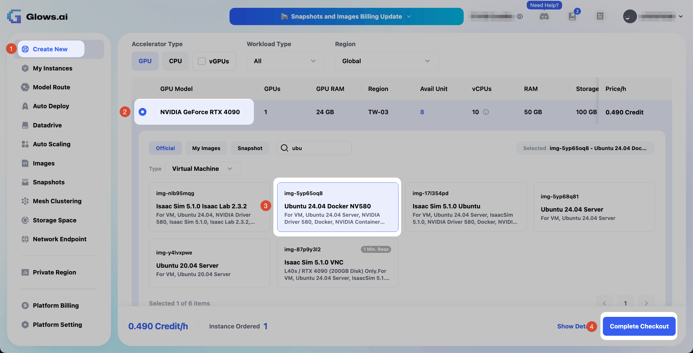

### 2. Find the Connection Details

Once the instance is running, go to `My Instances` to find the SSH command and password. The login user for this image is `glows`.

### Common Issue When Creating an Instance

**Strata fails to start on a container instance:**

Strata needs to lock part of the system memory for the GPU. In our tests, the locked-memory limit on container instances was only 8 MB and could not be raised.

**Fix:** When creating the instance, set `Type` to `Virtual Machine`.

## Part 2: Connect and Check the Environment

### 1. Connect over SSH

Connect to the instance with the SSH command from `My Instances` (replace `<PORT>` and `<HOST>` with your own instance's values):

```bash
ssh -p <PORT> glows@<HOST>
```

### 2. Check the GPU, Disk, and Memory

After connecting, run:

```bash
nvidia-smi
df -h /
free -g
```

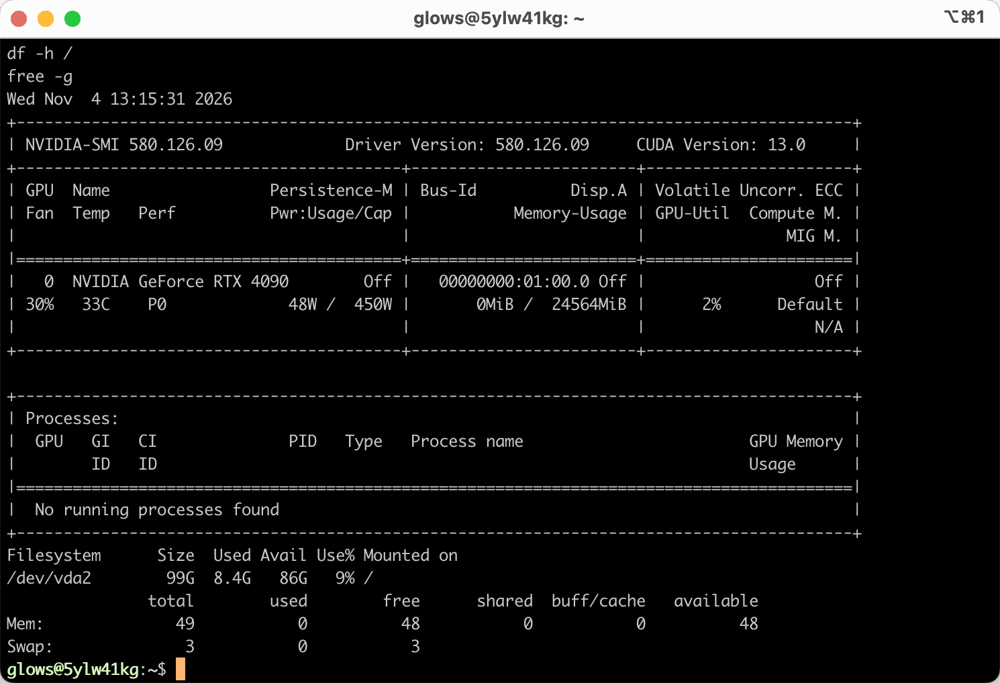

Confirm these three things:

- `nvidia-smi`: shows NVIDIA GeForce RTX 4090, driver version 580 or later, and VRAM usage of `0MiB`
- `df -h /`: at least 80 GB free (86 GB in our case)
- `free -g`: about 49 GB of total memory

## Part 3: Prepare the System

### 1. Switch to root

Only root can lift the locked-memory limit that Strata needs. Run this line on its own, because it asks for a password (the password from `My Instances`):

```bash
sudo -i
```

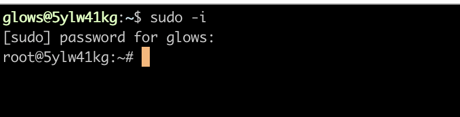

When the prompt starts with `root@`, you have switched successfully.

### 2. Update the Package List

Run:

```bash
apt update
```

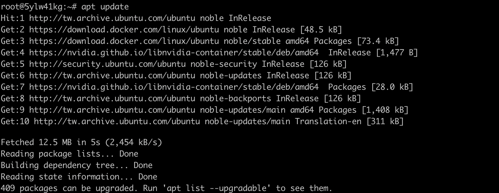

### 3. Install Git and tmux

Run:

```bash
apt install -y git tmux
```

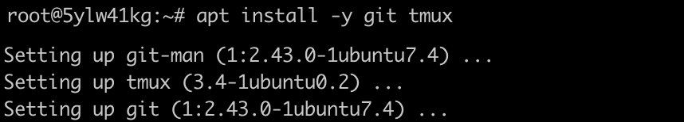

### 4. Create a tmux Session

The next step downloads about 74 GB. If you run it inside tmux, the download keeps going even if your SSH connection drops. Create a session named `strata`:

```bash
tmux new -s strata
```

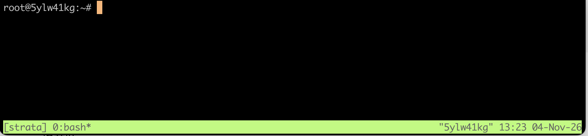

A green status bar at the bottom of the screen means you are inside tmux.

- To step away without stopping anything: press `Ctrl + B`, release, then press `D`
- To return to the session: run `sudo -i` first, then `tmux attach -t strata`

### Common Issues When Preparing the System

**`404 Not Found` when running apt install:**

The package list in this image is out of date, and the download addresses it records no longer work.

**Fix:** Run `apt update` to refresh the list first, then run the install command.

**Pasted commands don't run:**

If you paste `sudo -i` together with other commands, `sudo` swallows the following commands while it waits for the password.

**Fix:** Run `sudo -i` on its own line, enter the password, and then paste the other commands.

**Lots of `^[[B` characters appear on screen:**

Pressing the arrow keys while a program is running makes the terminal print the key codes. This does not affect the installation.

**Fix:** Avoid pressing arrow keys or typing in the tmux window during installation.

## Part 4: Install Strata

### 1. Run the Install Commands

Inside the tmux session, lift the locked-memory limit, download Strata, and run the setup script:

```bash
ulimit -l unlimited && ulimit -l
cd ~
git clone https://github.com/Niko1221/Strata.git
cd Strata
./setup.sh --setup --family qwen --model IQ2_XS --context 32768 --vision no --no-browser --yes
```

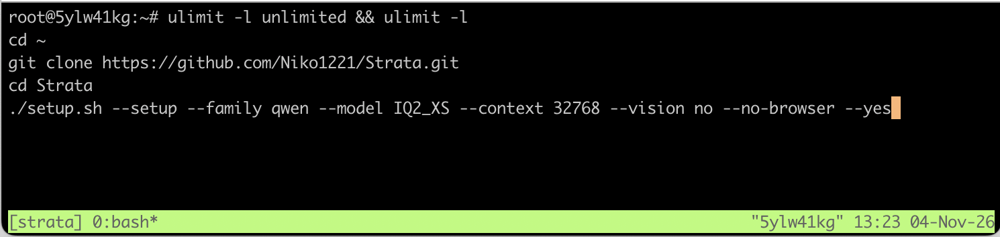

**Note:** The first line must print `unlimited`. Otherwise Strata cannot lock the experts in memory.

Parameters:

| Parameter | Description |
|---|---|
| `--family qwen` | Installs the original Qwen3.8-Flash-Next model |
| `--model IQ2_XS` | The 2-bit version: a 68 GB download that uses about 36 GB of memory, so it fits in this VM's 50 GB of memory and 100 GB disk |
| `--context 32768` | Context length of 32K tokens |
| `--vision no` | Skips image input support to save disk space and VRAM |
| `--no-browser` | Doesn't open a browser automatically (the VM has no display) |
| `--yes` | Uses the recommended default answer for every question |

For other parameters, see the official [INSTALL.md](https://github.com/Niko1221/Strata/blob/master/docs/INSTALL.md).

**Why IQ2_XS?** On this RTX 4090 VM, IQ2_XS leaves the most headroom. The smaller Q2_0 also writes an extra copy of the experts (about 40 GB) during installation on CPUs with AVX-512, which doesn't fit on the disk. Larger versions such as IQ3_S need an instance with more memory and disk.

### 2. Wait for Installation to Finish

The setup script runs six stages in order and shows `[ok]` as each one completes. In our test the whole process took about 45 minutes, mostly spent downloading the model (at about 37 MB/s).

**Stage 1** checks the computer's GPU, memory, and CPU. Here it detected the RTX 4090, 49 GB of memory, and a CPU with AVX-512:

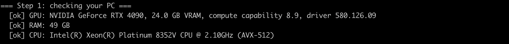

**Stage 2** lists the model sizes and confirms the settings. The experimental speed projection is off by default; leave it off:

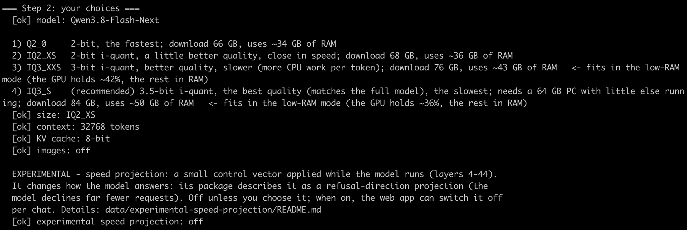

**Stage 3** installs Python packages:

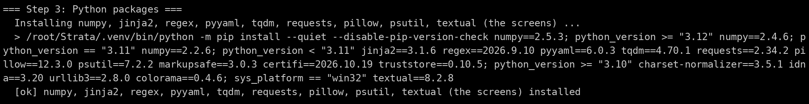

**Stage 4** downloads a ready-made inference engine, so there's nothing to compile. Seeing `No ready-made engine for v0.1.56 (HTTP Error 404)` is normal: the script falls back to the engine from the latest release:

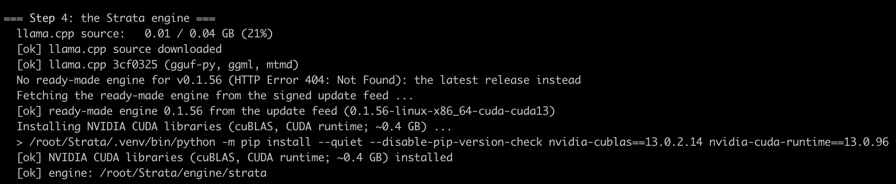

**Stage 5** downloads the two model files (39.23 GB and 28.80 GB) and verifies each one's SHA-256:

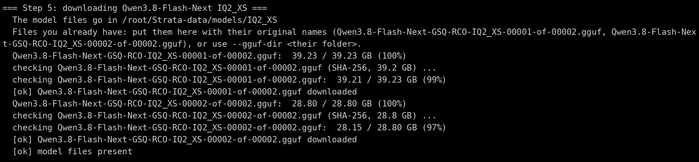

**Stage 6** converts the model into Strata's format and downloads the MTP draft layer (5.21 GB) used for speculative decoding:

```text
=== Step 6: preparing the model for Strata ===
  [ok] model prepared: /root/Strata-data/packs/iq2_xs
  MTP draft layer:   5.21 / 5.21 GB (100%)
```

### Common Issue When Installing Strata

**The download stops:**

The network or SSH connection dropped and the model download stopped.

**Fix:** Run the same `./setup.sh` command again. It resumes from where it stopped.

## Part 5: Start Strata

The model starts automatically when the setup script finishes. During startup Strata loads about 39 GB into memory, so the terminal may respond slowly for 1–3 minutes. In our test loading finished in 89 seconds, after which 12,842 experts (17.21 GiB) were placed in VRAM.

When you see `ready: http://127.0.0.1:8080/v1`, startup is complete:

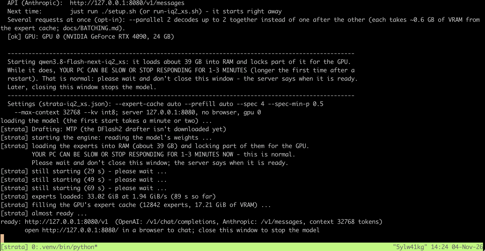

- The service provides both an OpenAI-compatible API (`/v1/chat/completions`) and an Anthropic-compatible API (`/v1/messages`)
- Keep this tmux window open; closing it stops the model
- On the same instance, you can start it again later by re-running `./setup.sh` in the Strata folder, without downloading anything again

## Part 6: Open the Web Interface through an SSH Tunnel

Strata listens only on `127.0.0.1:8080` inside the VM. An SSH tunnel forwards port 8080 on your computer to port 8080 on the VM, so you don't need to open any extra ports.

### 1. Create the SSH Tunnel

Open a new terminal window on your own computer and add `-L 8080:127.0.0.1:8080` to the original SSH command:

```bash
ssh -L 8080:127.0.0.1:8080 -p <PORT> glows@<HOST>
```

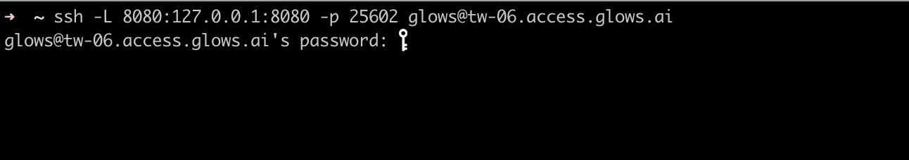

Log in with the same password and keep this window open; closing it shuts down the tunnel.

### 2. Open the Web Interface

Open `http://127.0.0.1:8080` in your browser to see Strata's web interface:

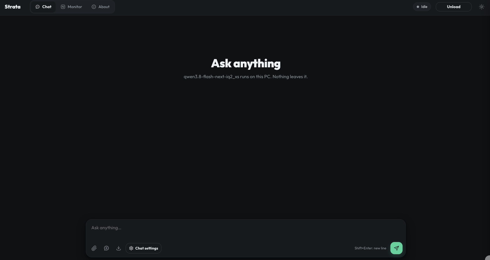

### Common Issue with the SSH Tunnel

**SSH shows `Address already in use`:**

Port 8080 on your computer is already used by another program.

**Fix:** Use a different local port, for example `-L 18080:127.0.0.1:8080`, and open `http://127.0.0.1:18080` in your browser.

## Part 7: Chat with the Model

### 1. A Short Question

Type a question on the `Chat` tab and press Enter. The model thinks briefly before answering, and each answer shows its token count and generation speed underneath:

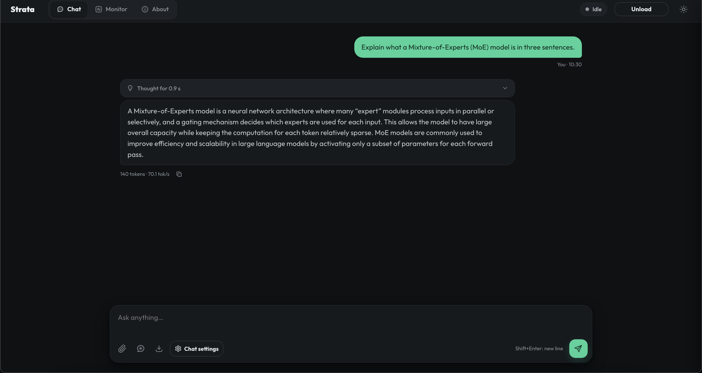

### 2. A Coding Question

Next, try a coding question. The longer answer gives a better picture of the steady-state speed:

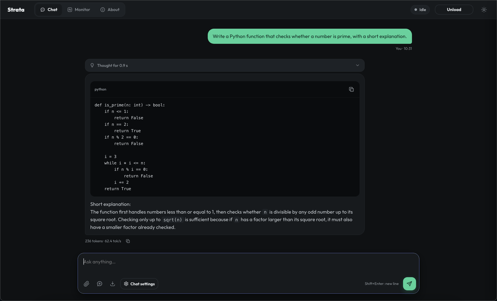

Our results:

| Question | Output | Speed |
|---|---|---|
| Explain what a Mixture-of-Experts (MoE) model is in three sentences. | 140 tokens | **70.1 tokens/s** |
| Write a Python function that checks whether a number is prime, with a short explanation. | 236 tokens | **62.4 tokens/s** |

The Strata developer measured 79 tokens per second for IQ2_XS on a desktop with an RTX 5070 and a Ryzen 5 7600. Speed depends on the CPU as well as the GPU, because the CPU computes every expert that isn't in VRAM.

## Part 8: View the Monitor Dashboard

Click the `Monitor` tab at the top to see how Strata uses the machine's resources. After our two questions, **more than 90% of the experts were served directly from VRAM**:

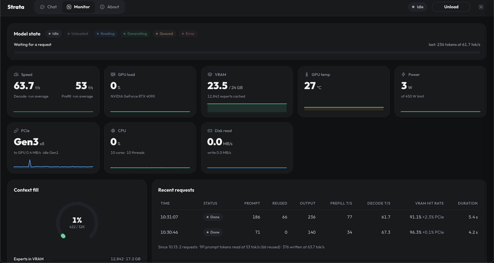

Field descriptions:

| Field | Value in our test | Meaning |
|---|---|---|
| Speed | 63.7 tokens/s (decode) | Average output speed across answers |
| VRAM | 23.5 / 24 GB, 12,842 experts cached | Strata fills free VRAM with the most frequently used experts |
| VRAM hit rate | 91.1–96.3% | Share of needed experts already in VRAM; the rest come from system memory |
| PCIe | Gen3 x8 | The link between the GPU and the host |
| CPU | 10 cores | The VM's vCPUs, which compute experts not in VRAM |
| Context fill | 422 / 32K tokens | Context length used by the conversation so far |

The prefill speed (53 tokens/s) is low because our questions were very short (71 and 186 tokens). To measure the real prompt-processing speed, use a longer prompt.

## Part 9: Call the OpenAI-Compatible API

While the SSH tunnel is open, any tool on your computer that supports the OpenAI format can use this model with the base URL `http://127.0.0.1:8080/v1` and the model ID `qwen3.8-flash-next-iq2_xs`.

Open another terminal window on your own computer and run this command to test it:

```bash
curl -s http://127.0.0.1:8080/v1/chat/completions \
-H "Content-Type: application/json" \
-d '{"model":"qwen3.8-flash-next-iq2_xs","messages":[{"role":"user","content":"Say hello in one sentence."}],"max_tokens":200}' \
| python3 -m json.tool
```

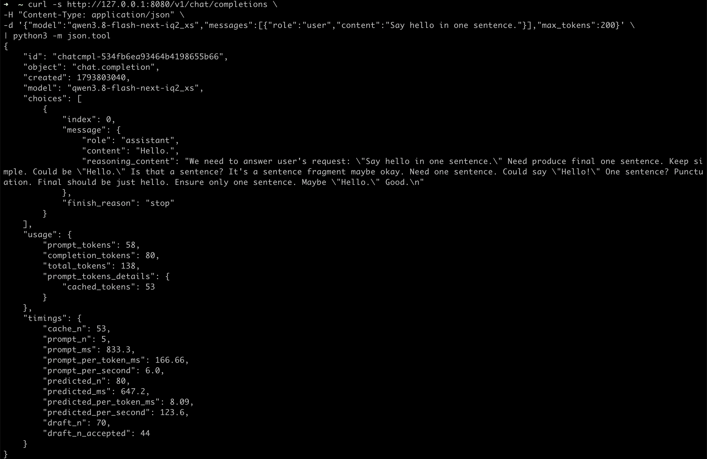

Fields worth noting in the response:

| Field | Value | Meaning |
|---|---|---|
| `content` | `Hello.` | The model's answer |
| `reasoning_content` | The model's thinking | The reasoning before the answer, returned separately from it |
| `cached_tokens` | 53 | Prompt tokens reused from the previous identical request |
| `predicted_per_second` | 123.6 | Output speed for this short answer |
| `draft_n` / `draft_n_accepted` | 70 / 44 | Speculative decoding guessed 70 tokens ahead, and 44 of them were accepted |

## Part 10: Release the Instance

When you're done, release the instance in `My Instances`. Instances are billed for as long as they are running.

**Note:** Releasing the instance also deletes the downloaded model, so you will need to download it again next time. A fresh installation takes about an hour, which is about 0.5 Credit at 0.490 Credit/h.

## Contact Us

If you have any questions or suggestions while using Glows.ai, feel free to contact us via email, Discord, or Line.

**Email:** [support@glows.ai](mailto:support@glows.ai)

**Discord:** [https://discord.com/invite/glowsai](https://discord.com/invite/glowsai)

**Line:** [https://lin.ee/fHcoDgG](https://lin.ee/fHcoDgG)
