This tutorial shows how to rent a GPU on [Glows.ai](https://glows.ai), deploy Tencent's open-source WeKnora, and run models on your own machine with Ollama to build a private knowledge base that can answer questions and automatically organize itself into a Wiki. Your documents and conversations stay on your own machine and are never sent to outside services.

This tutorial covers:

- Creating a VM instance on Glows.ai
- Installing Ollama and downloading local models
- Deploying WeKnora and connecting to its web interface from your computer
- Configuring models, creating a knowledge base, and uploading documents
- Testing knowledge base Q&A (RAG)
- Turning on Wiki mode so the AI organizes your knowledge automatically

## Introduction to WeKnora

[WeKnora](https://github.com/Tencent/WeKnora) is Tencent's open-source knowledge base platform (MIT-licensed) that you can host yourself. The same knowledge base can be used in three ways: RAG to look things up, Agents to carry out multi-step tasks, and Wiki to organize knowledge.

Most RAG tools can only answer questions. WeKnora adds **Wiki mode**: the AI turns your uploaded documents into interlinked Wiki pages and a knowledge graph, with the source cited on every page. When a document changes, the Wiki updates with it. People can also edit pages directly, and every change is versioned so it can be rolled back.

Why run it on Glows.ai:

- **No API fees**: To build the Wiki, the model has to read every document and write pages from it, which uses a lot of tokens. Running a local model on a Glows.ai GPU means you don't pay for those tokens
- **Your data stays put**: The models, documents, and conversations all stay on your own machine, which suits internal company documents
- **Enough hardware**: WeKnora itself runs 5 services, plus the models, which can easily bog down an ordinary laptop

This tutorial was tested with WeKnora v0.8.3 (2026/10/20). WeKnora is updated frequently, so if your interface looks different from the screenshots, go by what you see on screen.

## Part 1: Create an Instance

### 1. Create a VM Instance

Create a VM instance on Glows.ai. When choosing the image, set `Type` to `Virtual Machine` and select the **Ubuntu 24.04 Docker NV580** image (img-5yp65oq8). This image already has Docker and the NVIDIA driver installed, so you don't need to install them yourself. This tutorial uses an RTX 4090 (24GB VRAM).

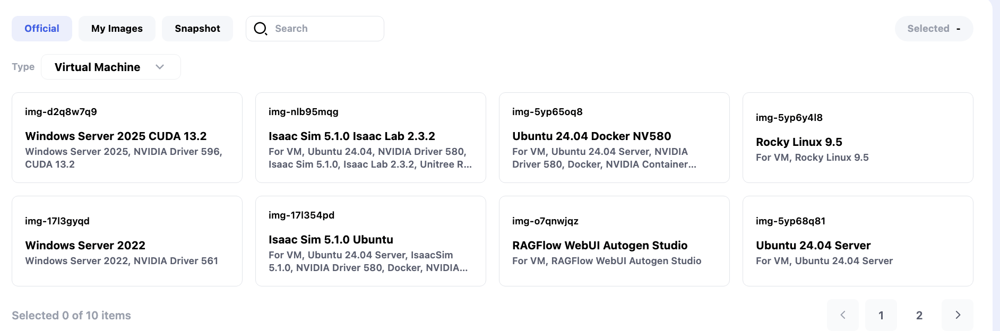

**Why a VM?** WeKnora uses Docker Compose to start several services at once. A container instance is itself a container, and usually can't run Docker inside it.

### 2. Connect over SSH

Once the instance status changes to Running, open it in `My Instances`. The `Access` tab shows the SSH command (SSH Command) and password:

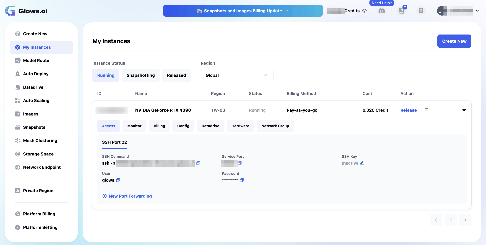

Copy the SSH command and paste it into a terminal on your own computer to log in (you can copy the password with the button next to Password):

```bash
ssh -p <PORT> glows@<HOST>
```

### 3. Check the GPU and Docker

After logging in, run:

```bash
nvidia-smi
docker compose version
```

If you can see the GPU information (an RTX 4090 with driver 580 in our case) and Docker Compose shows a version number, you're ready for the next step.

## Part 2: Install Ollama and Download Models

Ollama runs the models on this machine. WeKnora will use it to answer questions and organize documents.

### 1. Install Ollama

The installer asks for your sudo password, so paste this line on its own:

```bash
curl -fsSL https://ollama.com/install.sh | sh
```

When installation finishes, it shows `NVIDIA GPU installed.`, which means Ollama detected the GPU.

### 2. Change the Ollama Settings

Next, change two settings:

- **Make Ollama listen on 0.0.0.0**: By default Ollama listens only on 127.0.0.1, which the WeKnora containers can't reach
- **Raise the context to 32768**: The default is only 4096, which isn't enough for long documents

Paste this whole block at once:

```bash
sudo mkdir -p /etc/systemd/system/ollama.service.d
sudo tee /etc/systemd/system/ollama.service.d/override.conf > /dev/null <<'EOF'
[Service]
Environment="OLLAMA_HOST=0.0.0.0"
Environment="OLLAMA_CONTEXT_LENGTH=32768"
EOF
sudo systemctl daemon-reload && sudo systemctl restart ollama
sleep 3
curl http://localhost:11434
```

If the last line shows `Ollama is running`, it worked.

**Note:** Do not expose port 11434 to the public internet.

### 3. Download the Models

Download two models: the chat model qwen3.5:9b (about 6.5GB) and the multilingual embedding model bge-m3 (about 1.2GB, works well for both Chinese and English).

```bash
ollama pull qwen3.5:9b
ollama pull bge-m3
ollama list
```

When `ollama list` shows both models, you're done.

## Part 3: Deploy WeKnora

### 1. Add Your User to the docker Group

First add your login user to the docker group, or you'll get `permission denied` later. Paste the two lines separately; the second one applies the permission in the current window right away:

```bash
sudo usermod -aG docker $USER
```

```bash
newgrp docker
```

### 2. Download and Start WeKnora

Download WeKnora, copy the config file, and start the services. The first run downloads 5 images and takes about 2 minutes:

```bash
git clone https://github.com/Tencent/WeKnora.git && cd WeKnora && cp .env.example .env && docker compose up -d
```

After it starts, check the service status and version:

```bash
docker compose ps
cat VERSION
```

When all five services (app, docreader, frontend, postgres, redis) show Up, deployment is complete.

### 3. About the .env File

- For testing, the defaults are fine. The Ollama address already defaults to `http://host.docker.internal:11434`, so there's nothing to change
- Before real use, we recommend changing the default database and Redis passwords. You can also set the time zone `TZ`, for example to `Asia/Taipei`
- `SYSTEM_AES_KEY` encrypts the API keys stored in WeKnora. Don't change it once it's set, or the stored keys can no longer be decrypted

To pause the services later, use `docker compose stop`; to start them again, use `docker compose start`.

**Note:** Don't use `docker compose down -v`. The `-v` flag deletes your knowledge base data as well.

## Part 4: Connect to the WeKnora Web Interface

WeKnora's web interface runs on port 80 of the cloud machine. We'll use an SSH tunnel to connect it to port 8000 on your computer, so nothing is exposed publicly and only you can reach it.

### 1. Create the SSH Tunnel

Open a terminal on **your own computer** and add `-L 8000:localhost:80` to the SSH command from Glows.ai:

```bash
ssh -L 8000:localhost:80 -p <PORT> glows@<HOST>
```

Keep this window open after logging in, then open `http://localhost:8000` in your browser to see the WeKnora login page.

**Note:** Run this command on **your own computer**. If the terminal prompt shows the cloud machine's name (for example, it starts with `glows@`), you're still on the cloud machine. Type `exit` to return to your own computer first.

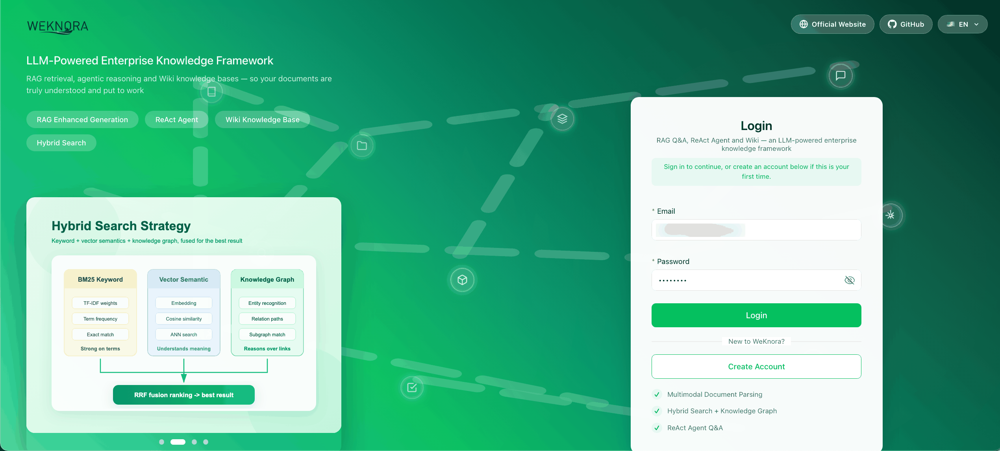

### 2. Create an Account and Switch the Language

On first use, click `Create Account` to sign up. The interface defaults to Simplified Chinese. You can switch to English from the language menu at the top right of the login page, or after logging in by clicking your account name at the bottom left → `All Settings` → `General Settings`. All screenshots in this tutorial use the English interface.

If you plan to open it to your team later, after creating your own account you can set `DISABLE_REGISTRATION` to `true` in `.env` and run `docker compose up -d` to apply it, so that not everyone who knows the URL can sign up.

## Part 5: Configure Models

Models must be added in the settings before you can select them when creating a knowledge base.

### 1. Open the Settings

Click your account name at the bottom left and select `All Settings`.

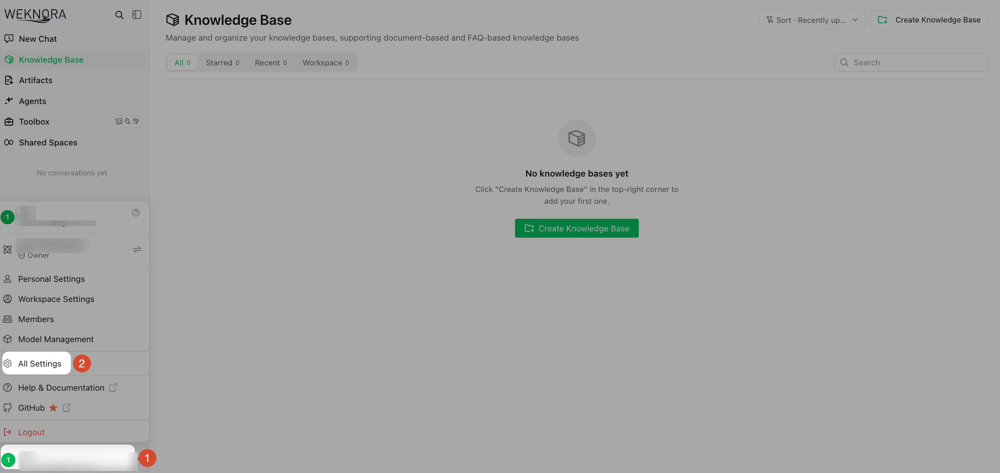

### 2. Confirm WeKnora Can Reach Ollama

Select `Ollama` on the left and confirm that `Ollama Service Status` shows **Available** and that `Installed Models` lists `qwen3.5:9b` and `bge-m3:latest`. If it shows Unavailable, WeKnora can't reach Ollama; go back and check the `OLLAMA_HOST` setting.

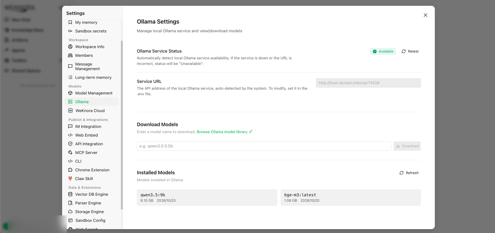

### 3. Add the Chat Model

Select `Model Management` on the left and click `Add Model`.

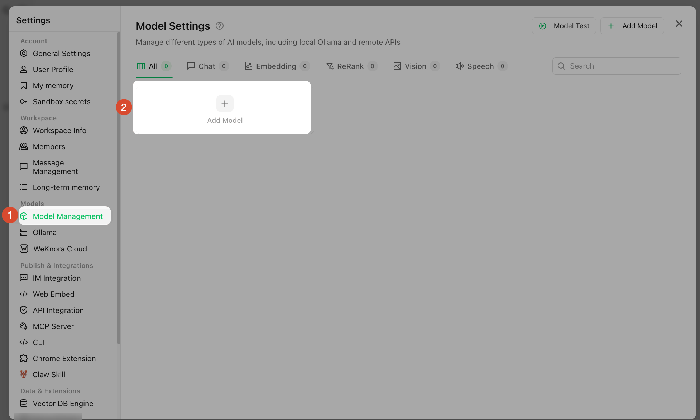

- `Model Type`: Chat
- `Source`: Ollama
- `Model Name`: `qwen3.5:9b`
- `Context Window`: `32768`, matching the context length set in Ollama earlier

Click `Save and close`. With Ollama you don't need to test the connection; the dropdown only lists models that are already downloaded.

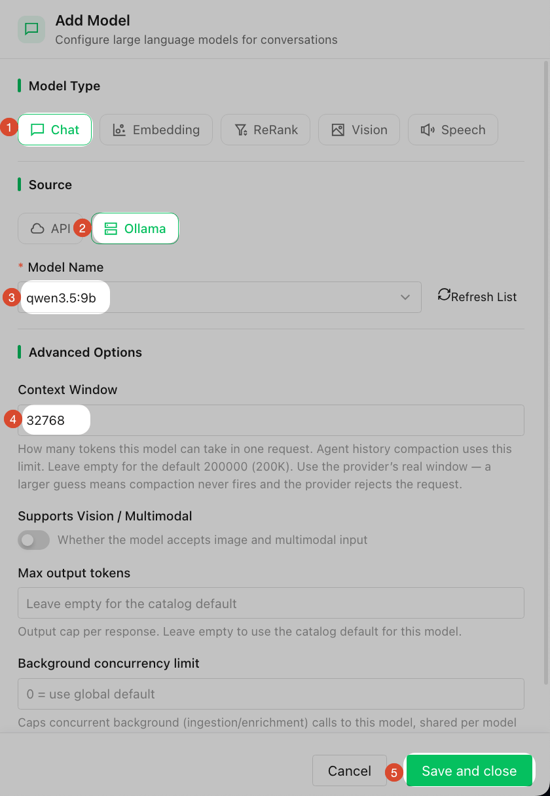

**Why fill in Context Window?** If you leave it empty, WeKnora assumes the model can read 200000 tokens at once, but Ollama is set to only 32768, so anything beyond that gets cut off. With matching numbers, WeKnora automatically compresses older content when a conversation gets too long.

### 4. Add the Embedding Model

Click `Add Model` again:

- `Model Type`: Embedding
- `Source`: Ollama
- `Model Name`: `bge-m3:latest`
- Click `Detect Dimension`; you should see `Vector dimension: 1024`

Click `Save and close`.

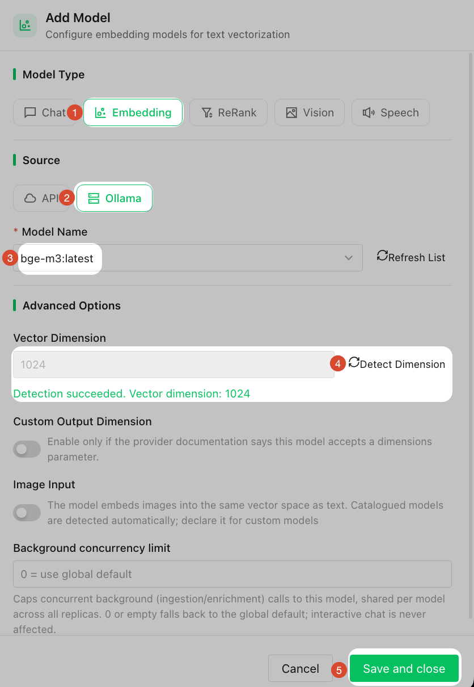

- Once you choose an embedding model, don't change it. Changing it means rebuilding the whole knowledge base
- You can also use an external API (such as OpenAI) by setting `Source` to `API`, but your document content will be sent to an outside service

### Common Issue When Configuring Models

**Nothing can be found after changing the embedding model:**

Vectors from the old and new embedding models don't match, so the existing index can't be reused.

**Fix:** Create the knowledge base again.

## Part 6: Create a Knowledge Base and Upload Documents

Click `Knowledge Base` on the left → `Create Knowledge Base` at the top right, then configure the following.

### 1. Basic Information

- `Knowledge Base Type`: select `Document-based`. `FAQ Q&A` is for curated "question + standard answer" pairs imported from CSV or Excel
- `Indexing Strategy`: check only `RAG Search` for now; we'll turn on `Wiki Knowledge Base` in a later part
- `Knowledge Base Name`: for example, `Glows.ai SDK API`

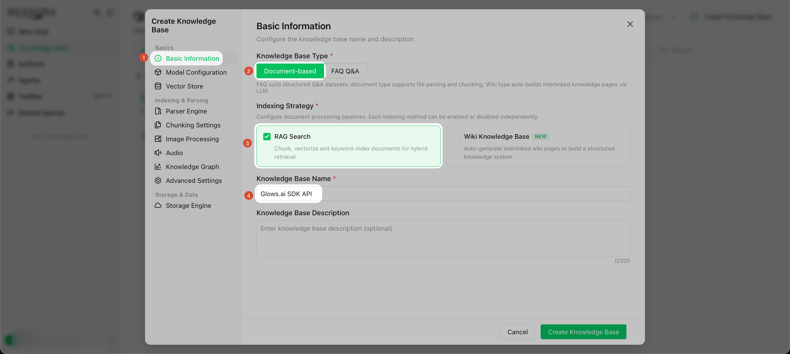

### 2. Model Configuration

Set `LLM Model` to `qwen3.5:9b` and `Embedding Model` to `bge-m3:latest`.

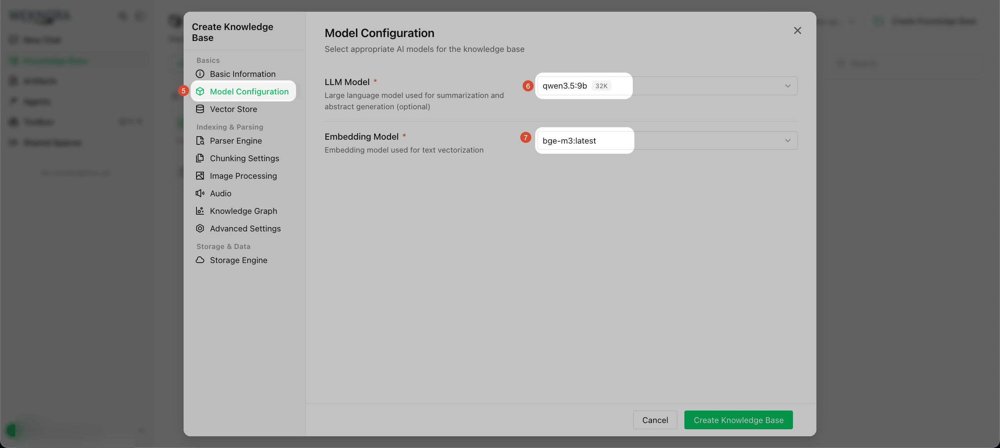

### 3. Chunking Settings

Keep the defaults and click `Create Knowledge Base`.

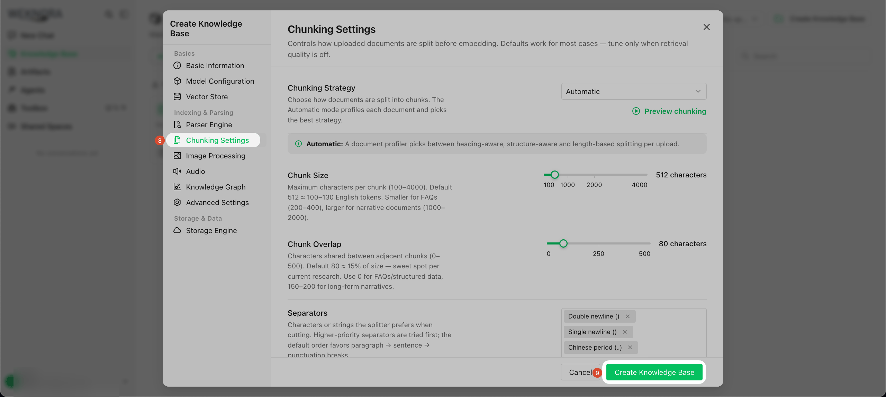

New knowledge bases have `Parent-Child Chunking` turned on by default: small 384-character chunks are used for search, and the 4096-character parent chunk they belong to is passed to the model to answer. While it's on, the `Chunk Size` setting above isn't used.

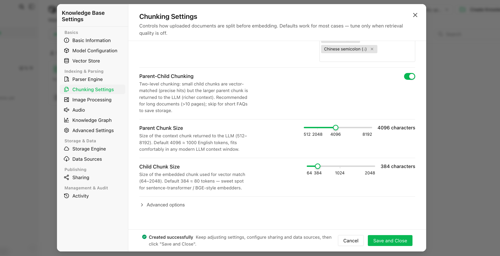

| | Parent-Child Chunking (default) | Single-level 1024 |
|---|---|---|
| Suited to | Documents you can't tidy up one by one, such as documents written separately by each department | Documents that are already organized, where each section makes sense on its own |
| Search | Small chunks stay on topic, so search is more precise | Each chunk is larger |
| Content sent to the model | Up to 4096 characters with full context, but uses more tokens | Exactly one section |

The API documents used in this test are already organized by section, so you could also turn off `Parent-Child Chunking` and set `Chunk Size` to 1024.

**Tip:** Click `Preview chunking` and paste a document to preview how it's split. When a Markdown document has 3 or more headings, WeKnora splits by heading, and each chunk keeps the heading it belongs to. If any chunk is more than twice the Chunk Size, it falls back to splitting by length, and the heading information is lost.

### 4. Upload Documents

Open the knowledge base, click `Add Document` at the top right, and choose the files to upload. When the `Confirm Upload` window appears:

- `AI Question Generation`: turn it off. It's on by default and generates 3 questions for every chunk, which makes processing much slower with a local model
- Keep the other settings at their defaults

Click `Upload and parse`.

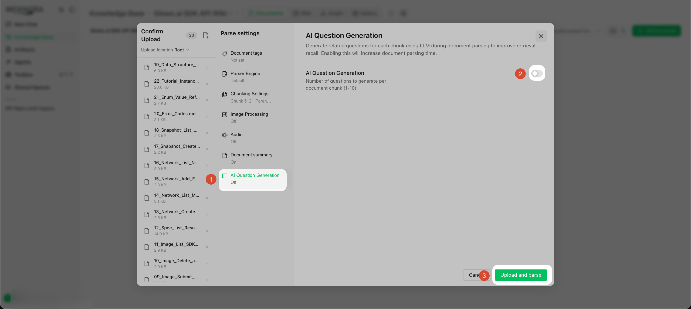

Once every document's status changes to **Completed**, you can start asking questions. In our test, 23 API documents finished processing in about 4 minutes.

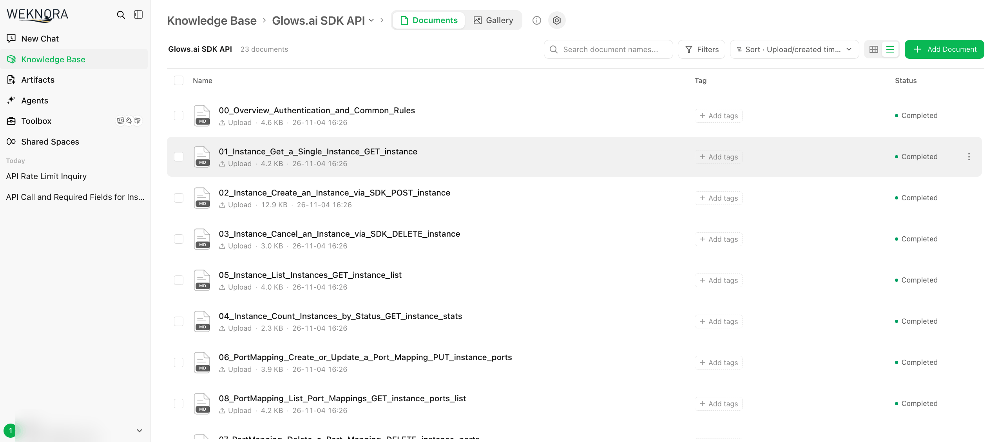

### Common Issue When Creating a Knowledge Base

**The chunking preview doesn't change after editing Chunk Size:**

While `Parent-Child Chunking` is on, `Chunk Size` isn't used.

**Fix:** Turn off `Parent-Child Chunking`, or adjust the parent and child chunk sizes instead.

## Part 7: Test Q&A

### 1. The Built-in Agents

WeKnora comes with 4 built-in Agents:

| Agent | Purpose |
|---|---|
| Quick Answer | Searches the knowledge base for relevant passages, then answers (RAG) with source citations |
| Smart Reasoning | Plans its own steps and calls tools, suited to questions that need several steps. Requires a ReRank model, which Ollama doesn't support, so it isn't covered here |
| Wiki Questioner | Finds answers in Wiki pages; Wiki mode must be turned on first |
| Data Analyst | Analyzes CSV and Excel files |

### 2. Choose a Model for the Agent

Each Agent needs its own chat model. If none is selected, asking a question shows `Agent "Quick Answer" is not ready`. Click `Agents` on the left → `Quick Answer`.

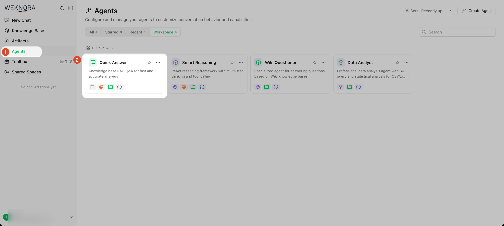

Select `Model Config` on the left, set `Model` to `qwen3.5:9b`, and click `Save and Close`. Leave `Thinking Mode` set to `Off`. `ReRank Model` has a red asterisk, but Quick Answer works fine with it left empty.

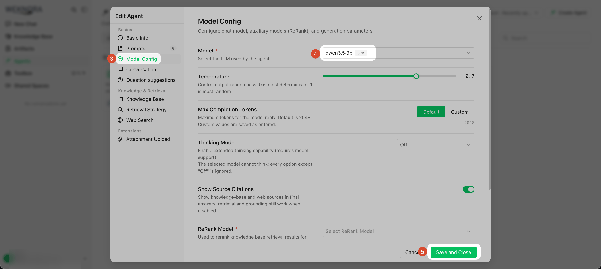

### 3. Ask a Question

Click `New Chat` on the left, choose the `Quick Answer` Agent, type `@` in the input box to select the knowledge base you just created, and then enter your question.

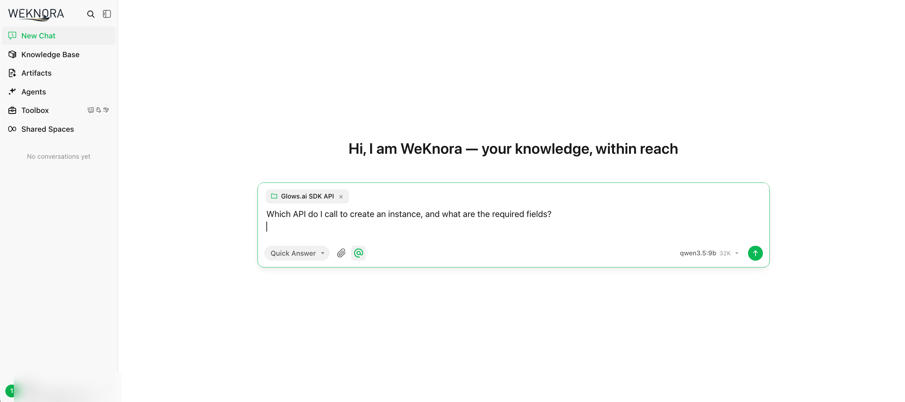

The search process appears above the answer, and `Document sources` on the right lists the documents that were cited; click one to see the quoted text. In our test the local model finished answering within about 1 minute.

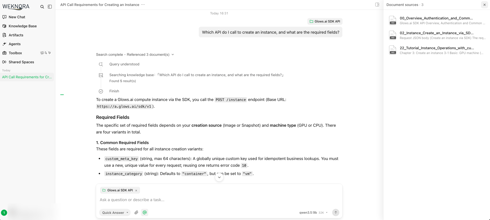

### 4. Check the Knowledge Base with Different Question Types

We recommend checking how the knowledge base performs with the following question types. Start a new chat for each question so earlier questions don't affect the answer:

| Question type | Example | What to look for |
|---|---|---|
| A fact from one document | `Which API do I call to create an instance, and what are the required fields?` | Whether the answer and the cited file are correct |
| A shared rule | `How do I authenticate API requests?` | Whether it cites the overview document |
| Telling similar content apart | `Which API should I use to find out how many instances are currently running?` | Whether it can tell the stats API from the list API |
| Across documents | `Which APIs do I need to call, in order, to create an instance and then cancel it?` | Whether it combines several documents |
| Not in the documents | `Does the API have a rate limit?` | It should say the documents don't cover it; a made-up number is a hallucination |

The answer to the first question organizes the four ways to create an instance into a table, with all the required fields correct:

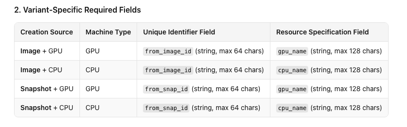

When asked `Does the API have a rate limit?`, the model cited the error code document, explained that exceeding the limit returns HTTP 429, and clearly stated that the documents don't specify an exact limit, rather than making up a number:

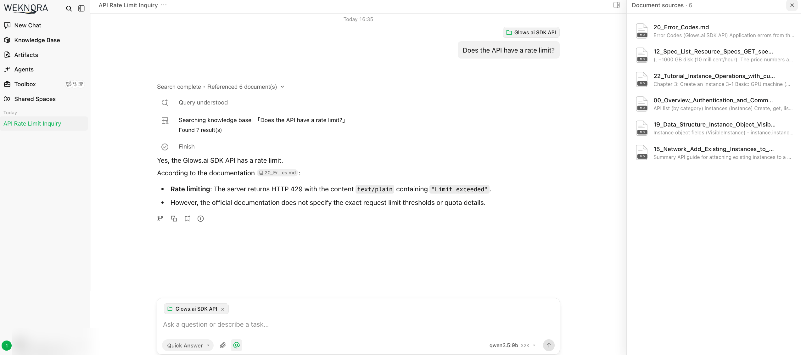

### 5. Lessons from Testing

- **When an answer isn't good, check the citations first**. If the right passage wasn't found, work on the document content; if it was found but not used, you can add rules in the Agent's `Prompts`
- **How documents are written matters a lot**. When an illustrative example comes first, the model may cite it first. Put examples that work as-is at the front and mark placeholder values as "replace this", and the model is less likely to pick the wrong one
- **Small models occasionally miss details or overstate things**, so open the citations to check the original text for anything important

### Common Issue When Testing Q&A

**Asking a question shows `Agent "Quick Answer" is not ready`:**

The Agent doesn't have a chat model yet. If an exclamation mark appears next to an Agent when you select it, with **Setup needed: Chat model**, it's the same cause:

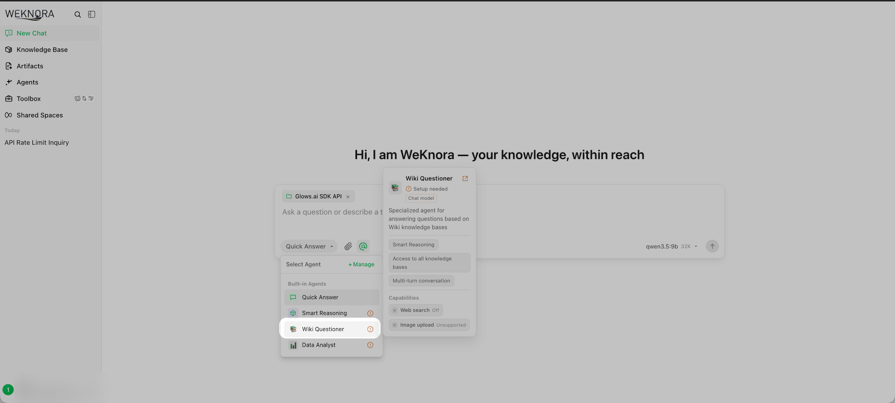

**Fix:** Go to `Agents` → that Agent → `Model Config` and choose a model.

## Part 8: Turn On Wiki Mode

RAG goes back to the original text for every question. Wiki mode instead has the AI read the documents first and organize the content into interlinked pages, which are then used for lookups. A topic scattered across several documents is merged into one page, and people can browse the pages directly.

Once a knowledge base contains documents, its `Indexing Strategy` can no longer be changed, so create a separate knowledge base with both RAG and Wiki turned on.

### 1. Basic Information

- `Knowledge Base Type`: `Document-based`
- `Indexing Strategy`: check both `RAG Search` and `Wiki Knowledge Base`
- `Extraction Granularity`: select `Standard` (see the table below for the differences)
- `Wiki Extraction Focus` (optional): tells the AI what to pay special attention to. For API documents, for example: `Prioritize API names and paths, request parameters, error codes, and status values`
- `Wiki Content Instructions` (optional): lets you specify the tone or language of the pages; we leave it empty here
- Scroll down and set `Knowledge Base Name` to `Glows.ai SDK API Wiki`

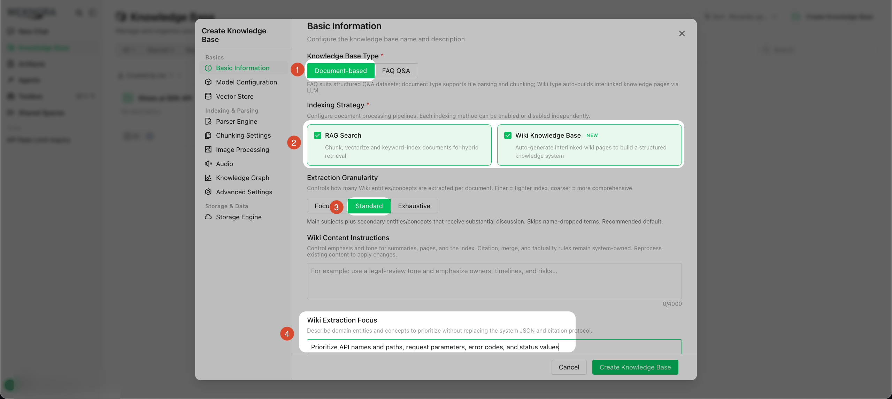

| Extraction Granularity | What it extracts | Best for |
|---|---|---|
| Focused | Only the main subject of each document | A quick first look at the results |
| Standard | The main subject, plus secondary concepts that are described in detail | Most cases; recommended |
| Exhaustive | Even things mentioned only in passing | The most pages, but prone to thin, noisy pages |

### 2. Model Configuration

Set both `LLM Model` and `Wiki Synthesis Model` to `qwen3.5:9b`, and `Embedding Model` to `bge-m3:latest`. `Wiki Synthesis Model` writes the documents into Wiki pages; if it's not set, the LLM Model is used instead.

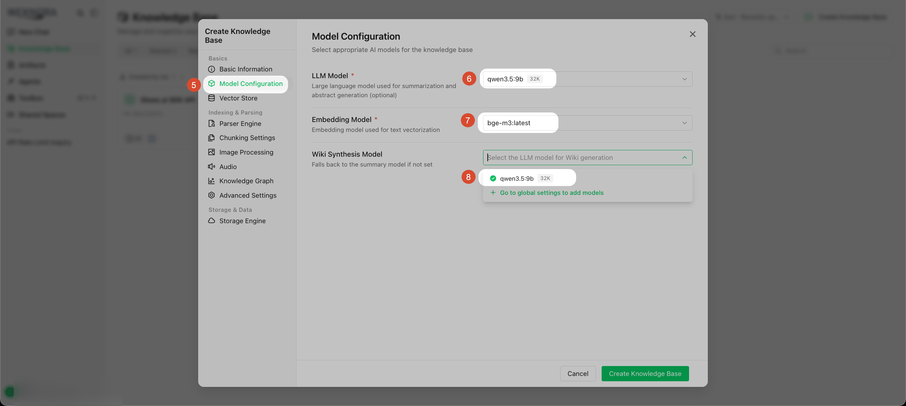

### 3. Chunking Settings

Keep the defaults and click `Create Knowledge Base`.

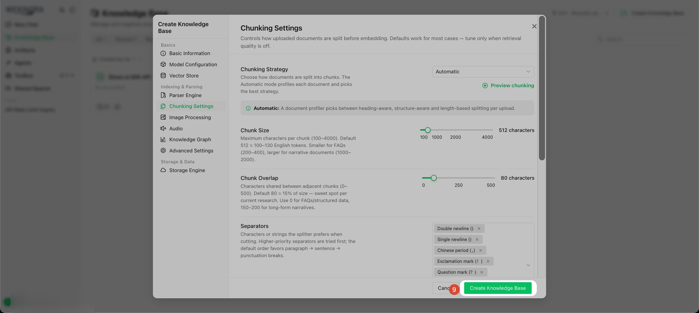

### 4. Upload Documents

Upload documents the same way as before, and remember to turn off `AI Question Generation`. After the documents show **Completed**, the Wiki pages are generated one after another.

### 5. Browse the Wiki

`Wiki` and `Graph` tabs now appear at the top of the knowledge base. The home page of the `Wiki` tab is the `Index`, which lists a summary of each document, with all pages listed by category on the left:

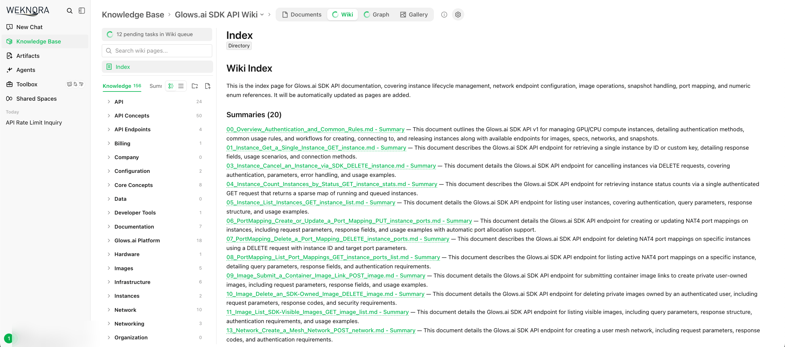

Open any page to see the organized content. Below the title are the page type (for example, Entities), the version number, and aliases. At the bottom of the page, `Linked from` and `Source documents` list which pages link here and which source documents the page was written from:

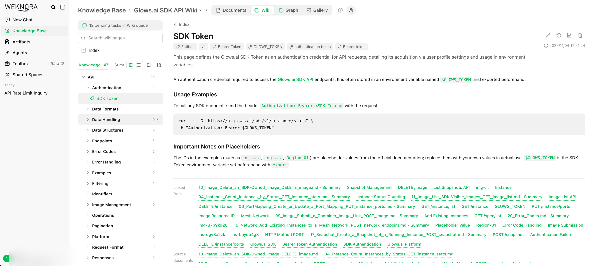

The `Graph` tab draws the relationships between pages as a network:

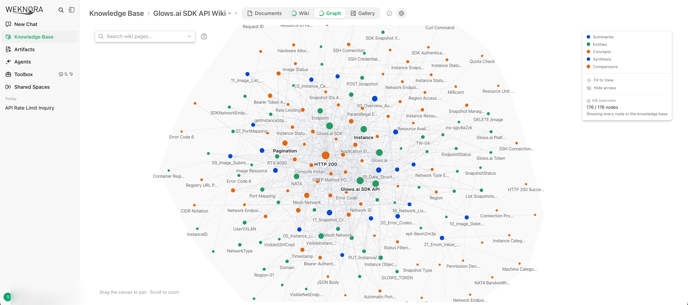

You can edit Wiki pages directly in the browser, and they also update automatically when new documents are added. Every change is versioned: click the clock icon at the top right of a page to compare versions and roll back to an earlier one.

### 6. Ask Questions with the Wiki

`Wiki Questioner` also needs a model first: `Agents` → `Wiki Questioner` → `Model Config`, set `Model` to `qwen3.5:9b`, and click `Save and Close`.

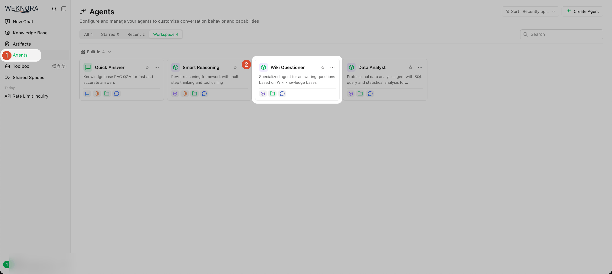

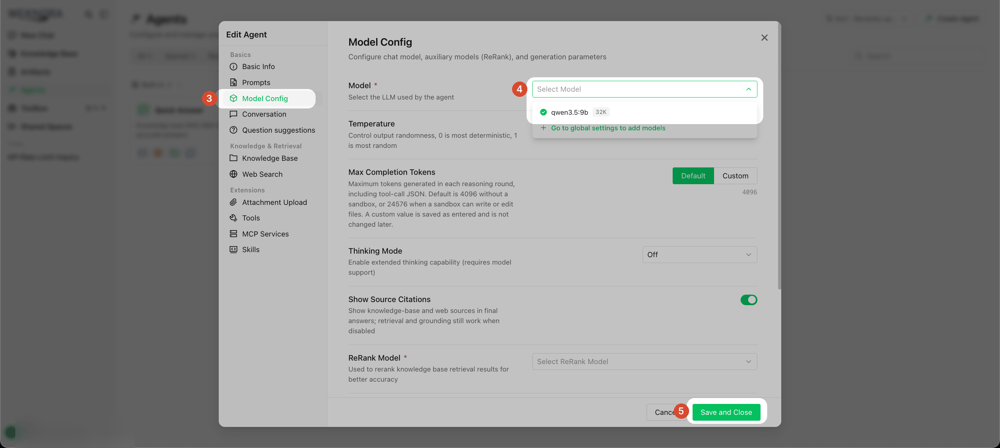

Click `New Chat`, choose the `Wiki Questioner` Agent, use `@` to select `Glows.ai SDK API Wiki`, and enter your question.

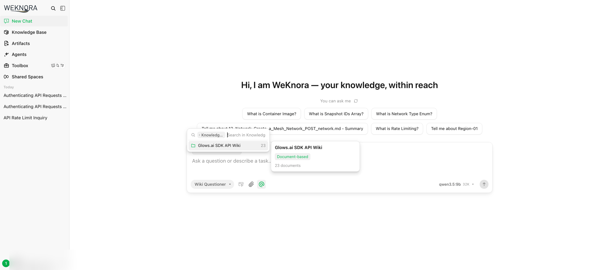

For example, ask `How do I authenticate API requests?`. The answer first shows what it read, then lays out three steps: get an SDK Token, set an environment variable, and include it in the header:

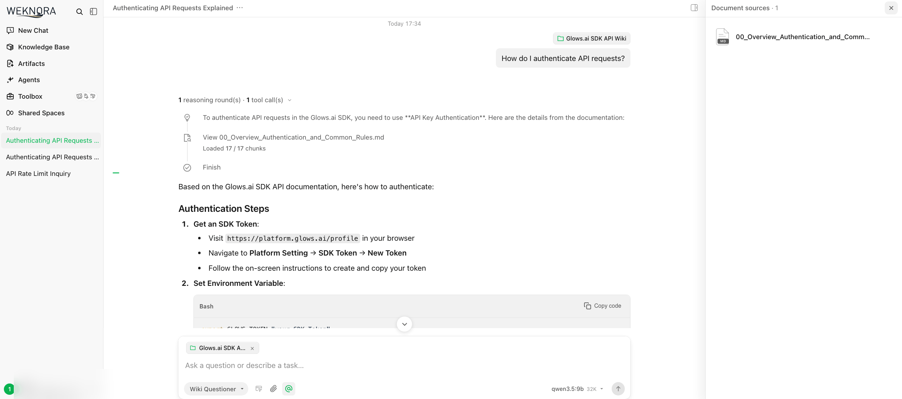

**Advanced test:** Change one fact in a source document and upload it again, then see whether the Wiki page updates automatically. This is what makes Wiki mode better suited than ordinary RAG for maintaining knowledge over time.

### Common Issue in Wiki Mode

**Wiki Questioner gives incomplete answers:**

If you don't use `@` to select a knowledge base, it searches every knowledge base, and the answers tend to be incomplete.

**Fix:** Use `@` to select the Wiki knowledge base you want to query.

## Contact Us

If you have any questions or suggestions while using Glows.ai, feel free to contact us via email, Discord, or Line.

**Email:** [support@glows.ai](mailto:support@glows.ai)

**Discord:** [https://discord.com/invite/glowsai](https://discord.com/invite/glowsai)

**Line:** [https://lin.ee/fHcoDgG](https://lin.ee/fHcoDgG)
