このチュートリアルでは、[Glows.ai](https://glows.ai) の RTX 4090 仮想マシン上で、オープンソースの推論エンジン Strata を使って 125B パラメータの MoE モデル Qwen3.8-Flash-Next を動かし、自分のパソコンから Web インターフェースと API で利用する方法を解説します。

実測では、モデルは毎秒 62–70 トークンを生成しました。全体の所要時間は約 1 時間で、その大半は約 74 GB のモデルのダウンロード待ちです。

このチュートリアルの内容は以下のとおりです。

- Glows.ai で RTX 4090 仮想マシンを作成する
- 接続して環境を確認する
- システム環境を準備する
- Strata をインストールしてモデルをダウンロードする
- Strata を起動する
- SSH トンネル経由で Web インターフェースを開く
- モデルと対話する
- Monitor ダッシュボードを確認する
- OpenAI 互換 API を呼び出す
- インスタンスを解放する

## Strata の紹介

**[Strata](https://github.com/Niko1221/Strata)** はオープンソース（MIT ライセンス）の LLM 推論エンジンです。本来はサーバー級のハードウェアが必要な [Qwen3.8-Flash-Next](https://huggingface.co/Qwen/Qwen3.8-Flash-Next) のようなモデルを、コンシューマー向けのグラフィックボード 1 枚で動かすことを目指しています。量子化フォーマットと一部の CPU 演算には llama.cpp の ggml を利用しています。

Qwen3.8-Flash-Next の総パラメータ数は 125B ですが、1 トークンあたりに使われるのは約 6B だけです。モデルの 48 層にはそれぞれ 512 個の Experts（合計 24,576 個）があり、各トークンは層ごとにそのうち 10 個にしか割り当てられません。Strata はこの特性を利用し、モデル全体を VRAM に詰め込もうとするのではなく、マシン全体にモデルを分散させます。

| 場所 | Strata が置くもの | 今回の実測 |
|---|---|---|
| GPU VRAM | Attention 層、Router、KV Cache、最もよく使われる Experts | 12,842 個の Experts、17.2 GB |
| システムメモリ | 24,576 個すべての Experts。VRAM にない Experts は CPU が計算 | 約 37 GB 使用 |
| ディスク | 28.8 GB の n-gram 埋め込みテーブル。必要なときだけ読み込む | — |

Strata は、モデルに内蔵された MTP 層を使って後続のトークンを先読みします（speculative decoding）。開発者によると、これで生成速度が約 1.6～1.8 倍になります。

公式のハードウェア要件と、このチュートリアルで使う Glows.ai 仮想マシンの比較は以下のとおりです。

| | Strata の要件 | 本チュートリアルの Glows.ai 仮想マシン |
|---|---|---|
| GPU | NVIDIA RTX 20/30/40/50 シリーズ、VRAM 12 GB 以上 | RTX 4090、24 GB |
| メモリ | 32 GB（Coder 版のみ）、64 GB ですべての版が動作 | 50 GB |
| ディスク | 約 70～80 GB の空き容量 | 100 GB |
| CPU | AVX2 対応の x86-64 | Xeon Platinum 8352V（AVX-512）、10 vCPUs |
| NVIDIA ドライバー | 580 以上 | 580.126.09（プリインストール済み） |
| OS | Windows 10/11 または Linux | Ubuntu 24.04 |

**注意：** モデルの重みは Qwen Community License 1.0 で公開されています。一部の商用利用（Model-as-a-Service など）には別途ライセンスが必要なため、外部にサービスとして提供する前に必ず確認してください。

## 事前準備

- 約 1 時間の作業時間（大半はモデルのダウンロード）
- RTX 4090 仮想マシンは 0.490 Credit/h のため、このチュートリアルの費用は 1 Credit 未満です

## パート 1：Glows.ai で仮想マシンを作成する

### 1. インスタンスを作成する

`Create New` をクリックしてインスタンスの作成を始めます。

1. GPU Model で **NVIDIA GeForce RTX 4090**（24 GB VRAM、50 GB メモリ、100 GB ストレージ）を選択します。このチュートリアルでは TW-03 リージョンを使用します
2. `Official` タブで `Type` を `Virtual Machine` に設定し、**Ubuntu 24.04 Docker NV580** イメージ（img-5yp65oq8）を選択します。このイメージには Strata が要求する最低バージョンである NVIDIA 580 ドライバーがプリインストールされているため、ドライバーのインストールや再起動は不要です
3. `Complete Checkout` をクリックします。料金は 0.490 Credit/h です

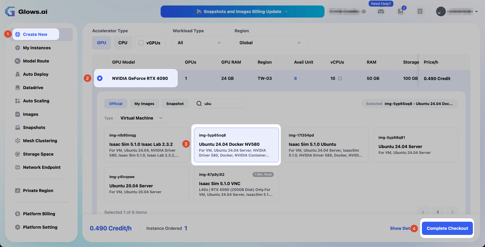

### 2. 接続情報を確認する

インスタンスが起動したら、`My Instances` で SSH コマンドとパスワードを確認します。このイメージのログインユーザーは `glows` です。

### インスタンス作成時によくある問題

**コンテナ（Container）インスタンスで Strata が起動しない：**

Strata はメモリの一部を GPU 用にロックする必要があります。実測では、コンテナインスタンスのロック可能メモリの上限は 8 MB しかなく、引き上げることもできませんでした。

**解決方法：** インスタンス作成時に `Type` を `Virtual Machine` に設定してください。

## パート 2：接続して環境を確認する

### 1. SSH で接続する

`My Instances` の SSH コマンドでインスタンスに接続します（`<PORT>` と `<HOST>` はご自身のインスタンスの値に置き換えてください）。

```bash
ssh -p <PORT> glows@<HOST>
```

### 2. GPU、ディスク、メモリを確認する

接続後、次を実行します。

```bash
nvidia-smi
df -h /
free -g
```

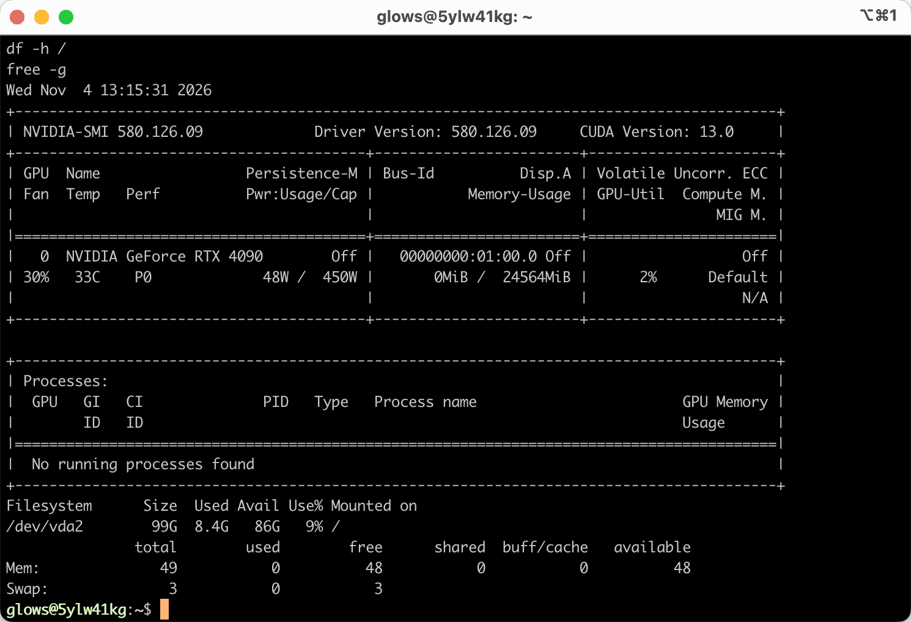

次の 3 点を確認してください。

- `nvidia-smi`：NVIDIA GeForce RTX 4090、ドライバーバージョン 580 以上、VRAM 使用量 `0MiB` と表示される
- `df -h /`：空き容量が 80 GB 以上ある（今回は 86 GB）
- `free -g`：メモリの合計が約 49 GB

## パート 3：システム環境を準備する

### 1. root に切り替える

Strata に必要なロック可能メモリの上限を解除できるのは root だけです。パスワード（`My Instances` に表示されるもの）の入力を求められるため、この行は単独で実行してください。

```bash
sudo -i
```

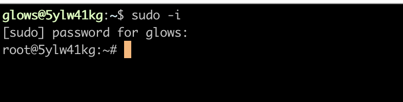

プロンプトが `root@` で始まれば、切り替え成功です。

### 2. パッケージリストを更新する

次を実行します。

```bash
apt update
```

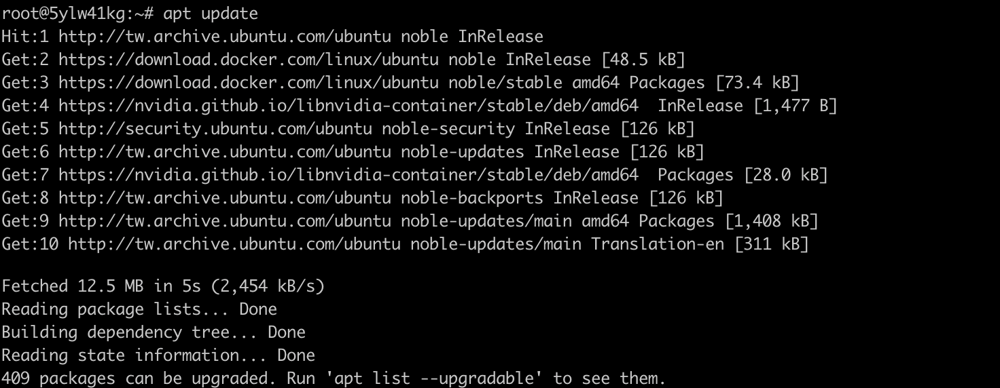

### 3. Git と tmux をインストールする

次を実行します。

```bash
apt install -y git tmux
```

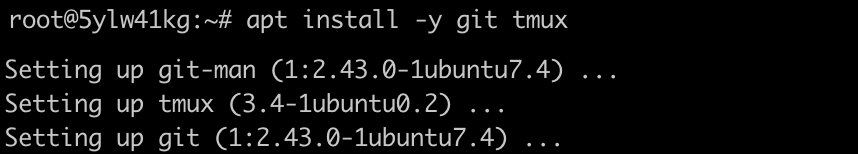

### 4. tmux セッションを作成する

次のステップでは約 74 GB をダウンロードします。tmux の中で実行すれば、SSH が切断されてもダウンロードは続きます。`strata` という名前のセッションを作成します。

```bash
tmux new -s strata
```

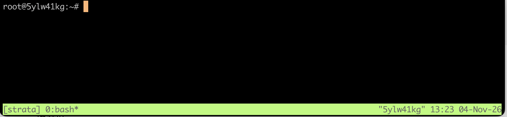

画面下部に緑色のステータスバーが表示されれば、tmux に入っています。

- 中断せずに一時的に離れる：`Ctrl + B` を押して離し、続けて `D` を押す
- セッションに戻る：先に `sudo -i` を実行し、次に `tmux attach -t strata` を実行する

### システム環境の準備でよくある問題

**apt install の実行時に `404 Not Found` が表示される：**

このイメージのパッケージリストは古くなっており、リストに記録されたダウンロード先がすでに無効になっています。

**解決方法：** 先に `apt update` でリストを更新してから、インストールコマンドを実行してください。

**貼り付けたコマンドが実行されない：**

`sudo -i` をほかのコマンドと一緒に貼り付けると、`sudo` がパスワード入力を待つ間に後続のコマンドを読み込んでしまいます。

**解決方法：** `sudo -i` は 1 行だけで実行し、パスワードを入力してからほかのコマンドを貼り付けてください。

**画面に `^[[B` という文字が大量に表示される：**

プログラムの実行中に矢印キーを押すと、ターミナルがキーコードを表示します。インストールには影響しません。

**解決方法：** インストール中は tmux ウィンドウで矢印キーを押したり文字を入力したりしないでください。

## パート 4：Strata をインストールする

### 1. インストールコマンドを実行する

tmux セッションの中で、ロック可能メモリの上限を解除し、Strata をダウンロードしてセットアップスクリプトを実行します。

```bash
ulimit -l unlimited && ulimit -l
cd ~
git clone https://github.com/Niko1221/Strata.git
cd Strata
./setup.sh --setup --family qwen --model IQ2_XS --context 32768 --vision no --no-browser --yes
```

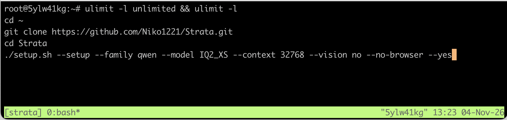

**注意：** 1 行目で必ず `unlimited` と表示される必要があります。表示されない場合、Strata は Experts をメモリにロックできません。

パラメータの説明：

| パラメータ | 説明 |
|---|---|
| `--family qwen` | オリジナルの Qwen3.8-Flash-Next モデルをインストールする |
| `--model IQ2_XS` | 2-bit 版。ダウンロード 68 GB、メモリ使用量約 36 GB で、この仮想マシンの 50 GB メモリと 100 GB ディスクに収まる |
| `--context 32768` | コンテキスト長 32K トークン |
| `--vision no` | 画像入力機能をインストールせず、ディスクと VRAM を節約する |
| `--no-browser` | ブラウザを自動で開かない（仮想マシンには画面がない） |
| `--yes` | すべての質問に推奨のデフォルト回答を使う |

そのほかのパラメータは公式の [INSTALL.md](https://github.com/Niko1221/Strata/blob/master/docs/INSTALL.md) を参照してください。

**なぜ IQ2_XS なのか？** この RTX 4090 仮想マシンでは、IQ2_XS が最も余裕のある選択です。よりサイズの小さい Q2_0 は、AVX-512 対応の CPU ではインストール時に Experts のコピー（約 40 GB）を追加で書き込むため、ディスクに収まりません。IQ3_S などのより大きい版には、メモリとディスクがより大きいインスタンスが必要です。

### 2. インストールの完了を待つ

セットアップスクリプトは 6 つの段階を順に実行し、各段階が終わるたびに `[ok]` を表示します。今回の実測では全体で約 45 分かかり、その大半はモデルのダウンロード（約 37 MB/s）でした。

**段階 1** では、パソコンの GPU、メモリ、CPU をチェックします。今回は RTX 4090、49 GB のメモリ、AVX-512 対応の CPU が検出されました。

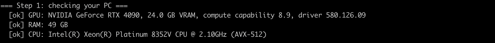

**段階 2** では、各モデルサイズを一覧表示し、設定を確認します。実験的な speed projection はデフォルトでオフになっているので、そのままで構いません。

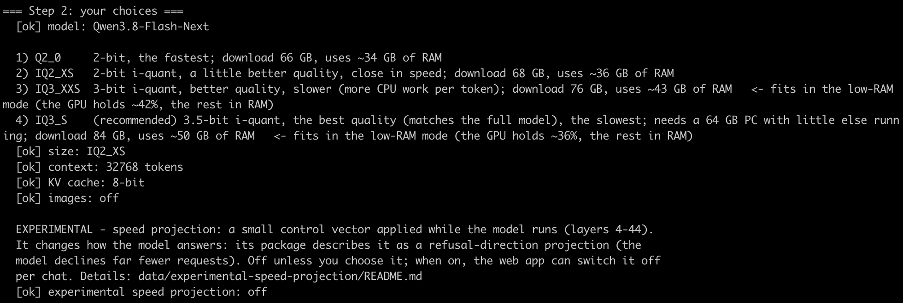

**段階 3** では Python パッケージをインストールします。

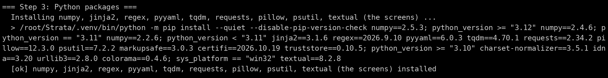

**段階 4** では既製の推論エンジンをダウンロードするため、コンパイルは不要です。`No ready-made engine for v0.1.56 (HTTP Error 404)` と表示されるのは正常で、スクリプトは最新リリースのエンジンを代わりに使います。

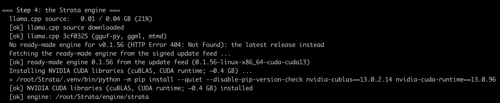

**段階 5** では 2 つのモデルファイル（39.23 GB と 28.80 GB）をダウンロードし、それぞれの SHA-256 を検証します。

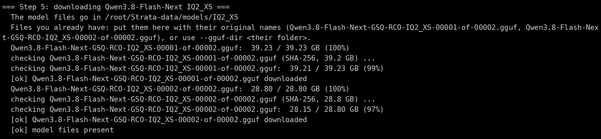

**段階 6** ではモデルを Strata 用のフォーマットに変換し、speculative decoding 用の MTP ドラフト層（5.21 GB）をダウンロードします。

```text
=== Step 6: preparing the model for Strata ===
  [ok] model prepared: /root/Strata-data/packs/iq2_xs
  MTP draft layer:   5.21 / 5.21 GB (100%)
```

### Strata のインストールでよくある問題

**ダウンロードが止まった：**

ネットワークまたは SSH 接続が切れ、モデルのダウンロードが止まりました。

**解決方法：** 同じ `./setup.sh` コマンドをもう一度実行すると、中断したところからダウンロードが再開されます。

## パート 5：Strata を起動する

セットアップスクリプトが終わると、モデルが自動的に起動します。起動時に Strata は約 39 GB をメモリに読み込むため、ターミナルの反応が 1～3 分ほど遅くなることがあります。今回の実測では 89 秒で読み込みが終わり、続いて 12,842 個の Experts（17.21 GiB）が VRAM に配置されました。

`ready: http://127.0.0.1:8080/v1` と表示されれば、起動完了です。

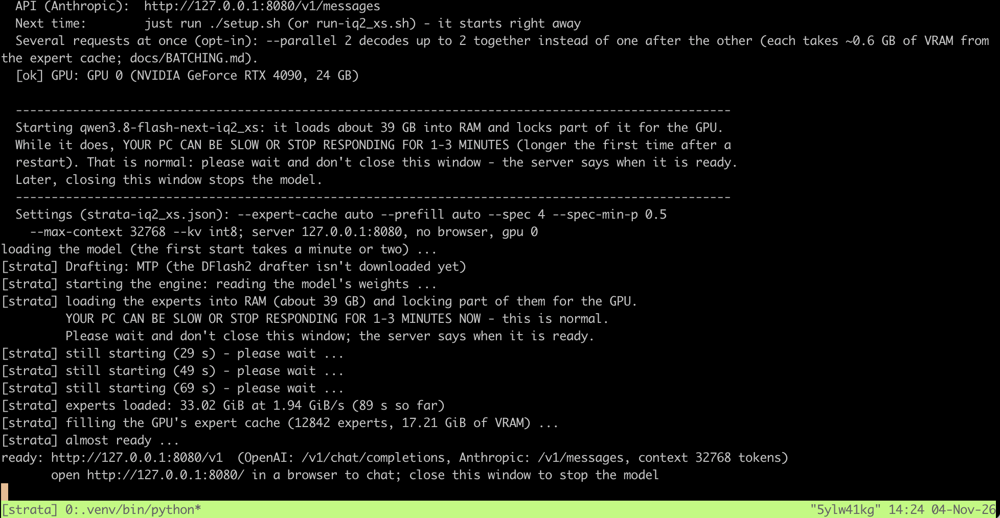

- サービスは OpenAI 互換 API（`/v1/chat/completions`）と Anthropic 互換 API（`/v1/messages`）の両方を提供します
- この tmux ウィンドウは開いたままにしてください。閉じるとモデルが停止します
- 同じインスタンスであれば、次回以降は Strata フォルダで `./setup.sh` を再実行するだけで起動でき、再ダウンロードは発生しません

## パート 6：SSH トンネル経由で Web インターフェースを開く

Strata は仮想マシン内部の `127.0.0.1:8080` でのみ待ち受けています。SSH トンネルを使えば、パソコンの 8080 ポートを仮想マシンの 8080 ポートに転送でき、ポートを追加で開放する必要はありません。

### 1. SSH トンネルを作成する

自分のパソコンで新しいターミナルウィンドウを開き、元の SSH コマンドに `-L 8080:127.0.0.1:8080` を追加します。

```bash
ssh -L 8080:127.0.0.1:8080 -p <PORT> glows@<HOST>
```

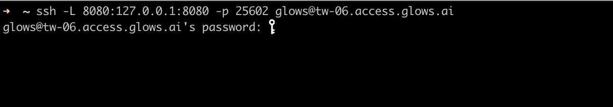

同じパスワードでログインしたら、このウィンドウは開いたままにしてください。閉じるとトンネルが切断されます。

### 2. Web インターフェースを開く

ブラウザで `http://127.0.0.1:8080` を開くと、Strata の Web インターフェースが表示されます。

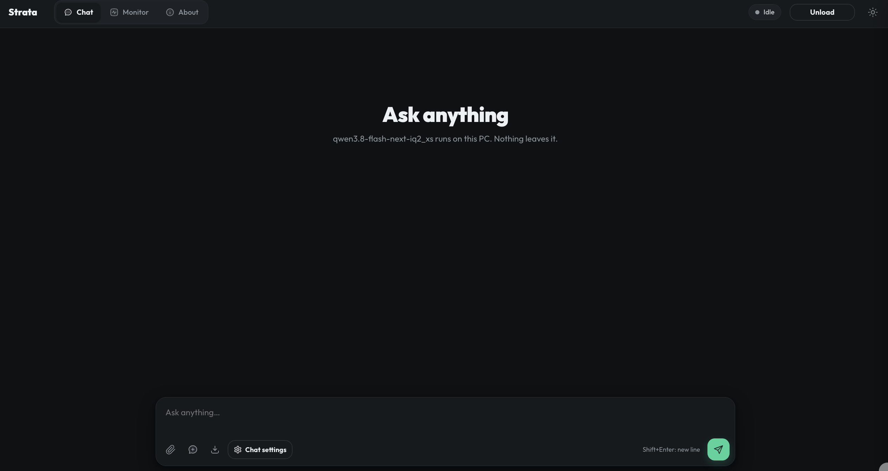

### SSH トンネルでよくある問題

**SSH で `Address already in use` と表示される：**

パソコンの 8080 ポートがすでにほかのプログラムに使われています。

**解決方法：** 別のローカルポート（例：`-L 18080:127.0.0.1:8080`）を使い、ブラウザで `http://127.0.0.1:18080` を開いてください。

## パート 7：モデルと対話する

### 1. 短い質問

`Chat` タブに質問を入力して Enter を押します。モデルは少し考えてから回答し、各回答の下にトークン数と生成速度が表示されます。

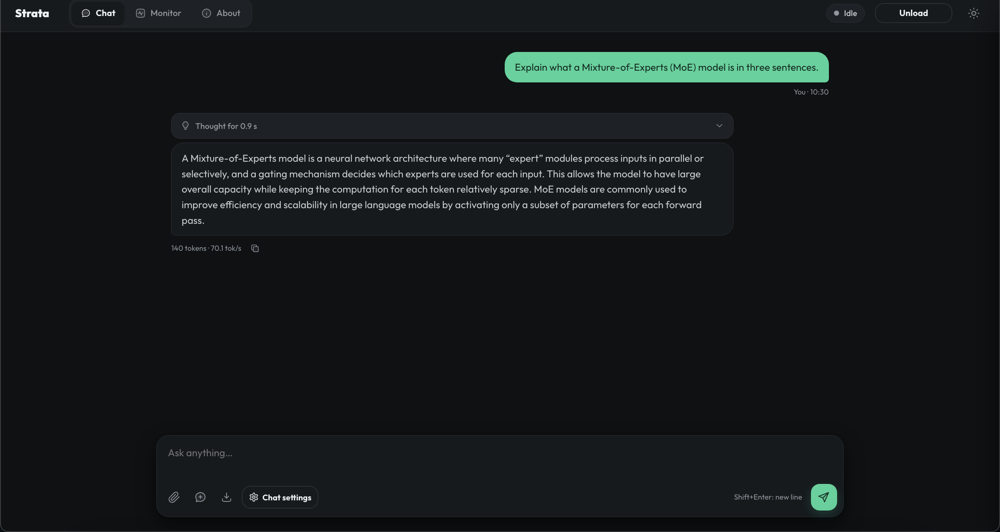

### 2. プログラミングの質問

次にプログラミングの質問を試します。回答が長いため、安定した速度がわかりやすくなります。

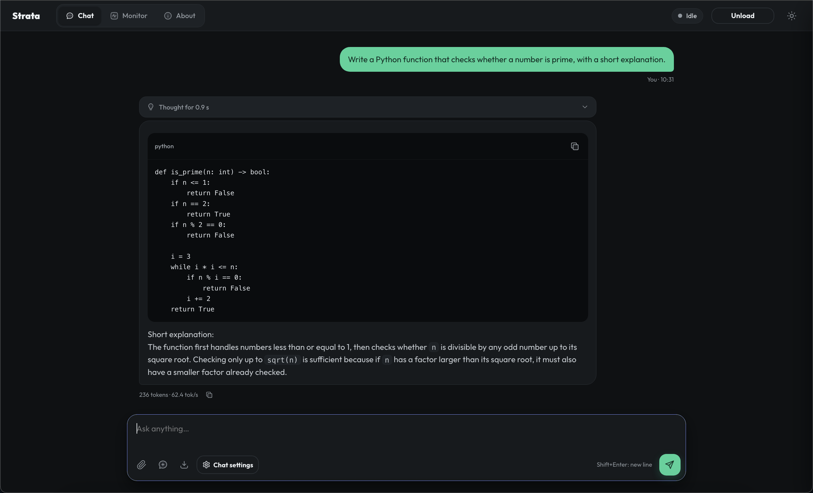

今回の実測結果：

| 質問 | 出力 | 速度 |
|---|---|---|
| Explain what a Mixture-of-Experts (MoE) model is in three sentences. | 140 tokens | **70.1 tokens/s** |
| Write a Python function that checks whether a number is prime, with a short explanation. | 236 tokens | **62.4 tokens/s** |

Strata の開発者は、RTX 5070 と Ryzen 5 7600 を搭載したデスクトップで、IQ2_XS が毎秒 79 トークンを生成したと報告しています。VRAM にない Experts はすべて CPU が計算するため、速度は GPU だけでなく CPU にも左右されます。

## パート 8：Monitor ダッシュボードを確認する

上部の `Monitor` タブをクリックすると、Strata がこのマシンのリソースをどう使っているかを確認できます。2 つの質問をした後には、**90% 以上の Experts が VRAM から直接取得されていました**。

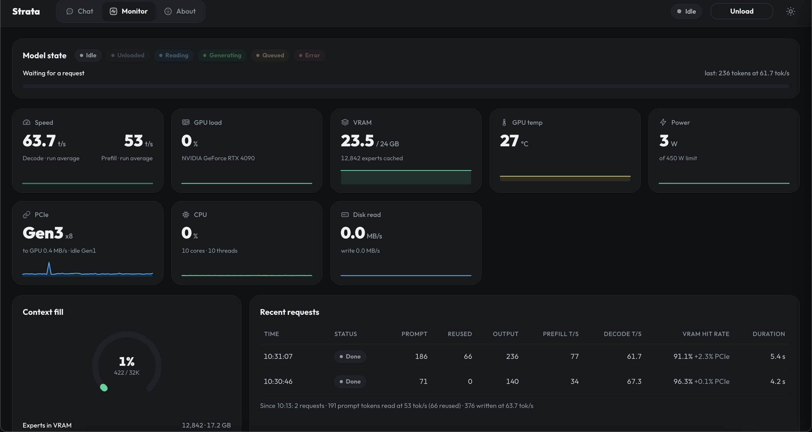

各項目の説明：

| 項目 | 今回の値 | 意味 |
|---|---|---|
| Speed | 63.7 tokens/s（decode） | 各回答の平均出力速度 |
| VRAM | 23.5 / 24 GB、12,842 experts cached | Strata は空いている VRAM を最もよく使われる Experts で埋める |
| VRAM hit rate | 91.1～96.3% | 必要な Experts のうち VRAM にすでにあった割合。残りはシステムメモリから取得 |
| PCIe | Gen3 x8 | GPU とホスト間の転送経路 |
| CPU | 10 cores | 仮想マシンの vCPU。VRAM にない Experts を計算する |
| Context fill | 422 / 32K tokens | 対話で使用済みのコンテキスト長 |

Prefill 速度（53 tokens/s）が低いのは、質問がとても短かった（71 トークンと 186 トークン）ためです。実際の読み込み速度を測るには、長めのプロンプトを使ってください。

## パート 9：OpenAI 互換 API を呼び出す

SSH トンネルが開いている間は、パソコン上で OpenAI 形式に対応したツールであれば、Base URL `http://127.0.0.1:8080/v1` とモデル ID `qwen3.8-flash-next-iq2_xs` でこのモデルを利用できます。

自分のパソコンで別のターミナルウィンドウを開き、次のコマンドでテストします。

```bash
curl -s http://127.0.0.1:8080/v1/chat/completions \
-H "Content-Type: application/json" \
-d '{"model":"qwen3.8-flash-next-iq2_xs","messages":[{"role":"user","content":"Say hello in one sentence."}],"max_tokens":200}' \
| python3 -m json.tool
```

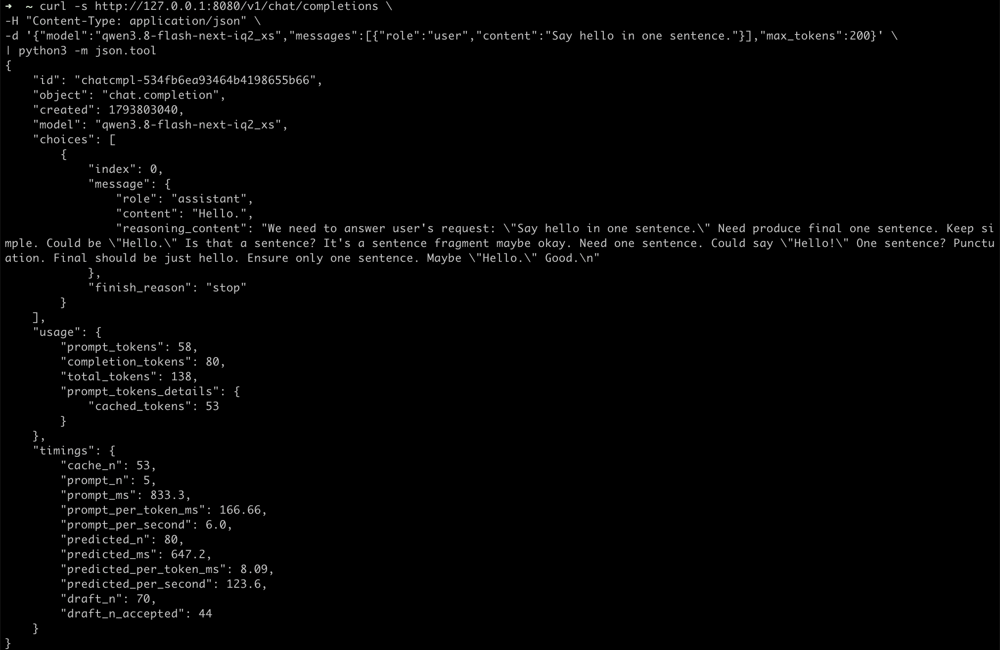

レスポンスで注目すべき項目：

| 項目 | 値 | 意味 |
|---|---|---|
| `content` | `Hello.` | モデルの回答 |
| `reasoning_content` | モデルの思考内容 | 回答前の思考。回答とは別に返される |
| `cached_tokens` | 53 | 直前の同じリクエストから再利用されたプロンプトトークン |
| `predicted_per_second` | 123.6 | 今回の短い回答の出力速度 |
| `draft_n` / `draft_n_accepted` | 70 / 44 | Speculative decoding が 70 トークンを先読みし、そのうち 44 トークンが採用された |

## パート 10：インスタンスを解放する

使い終わったら、`My Instances` でインスタンスを解放してください。インスタンスは稼働している間ずっと課金されます。

**注意：** インスタンスを解放すると、ダウンロードしたモデルも削除されるため、次回は再ダウンロードが必要です。再インストールには約 1 時間かかり、0.490 Credit/h で約 0.5 Credit です。

## お問い合わせ

Glows.ai の利用中に質問やご意見がある場合は、email、Discord、Line からお問い合わせください。

**Email:** [support@glows.ai](mailto:support@glows.ai)

**Discord:** [https://discord.com/invite/glowsai](https://discord.com/invite/glowsai)

**Line:** [https://lin.ee/fHcoDgG](https://lin.ee/fHcoDgG)
