このチュートリアルでは、[Glows.ai](https://glows.ai) で GPU をレンタルして Tencent のオープンソース WeKnora をデプロイし、Ollama を使って自分のマシン上でモデルを動かし、質問に答え、自動で Wiki に整理してくれるプライベートなナレッジベースを構築する方法を解説します。ドキュメントと会話は自分のマシンに残り、外部サービスに送られることはありません。

このチュートリアルの内容は以下のとおりです。

- Glows.ai で VM インスタンスを作成する
- Ollama をインストールしてローカルモデルをダウンロードする
- WeKnora をデプロイし、自分のパソコンから Web インターフェースに接続する
- モデルを設定し、ナレッジベースを作成してドキュメントをアップロードする
- ナレッジベースの質問応答（RAG）をテストする
- Wiki モードを有効にして、AI に知識を自動で整理させる

## WeKnora の紹介

[WeKnora](https://github.com/Tencent/WeKnora) は Tencent がオープンソースで公開しているナレッジベースプラットフォーム（MIT ライセンス）で、自分でホストできます。1 つのナレッジベースに 3 つの使い方があります。RAG で情報を調べる、Agent で複数ステップのタスクを実行する、Wiki で知識を整理する、の 3 つです。

一般的な RAG ツールは「質問に答える」ことしかできませんが、WeKnora には **Wiki モード** があります。AI がアップロードされたドキュメントを、相互にリンクされた Wiki ページとナレッジグラフに整理し、各ページには出典が付きます。ドキュメントが更新されると Wiki も自動で更新されます。人が直接編集することもでき、変更はすべてバージョン履歴に残るため、ロールバックも可能です。

Glows.ai で動かす理由：

- **API 料金がかからない**：Wiki を生成するとき、モデルはすべてのドキュメントを読んでからページを書くため、大量のトークンを消費します。Glows.ai の GPU でローカルモデルを動かせば、そのトークンに料金はかかりません
- **データが外に出ない**：モデル、ドキュメント、会話はすべて自分のマシン上にあるため、社内ドキュメントにも向いています
- **十分なハードウェア**：WeKnora 自体が 5 つのサービスを動かし、さらにモデルも動かすため、一般的なノートパソコンでは動作が重くなりがちです

このチュートリアルは WeKnora v0.8.3（2026/10/20）で検証しています。WeKnora は更新が速いため、画面がスクリーンショットと異なる場合は、実際の画面に従ってください。

## パート 1：インスタンスを作成する

### 1. VM インスタンスを作成する

Glows.ai で VM インスタンスを作成します。イメージを選ぶときは、`Type` を `Virtual Machine` にし、**Ubuntu 24.04 Docker NV580** イメージ（img-5yp65oq8）を選択します。このイメージには Docker と NVIDIA ドライバーがインストール済みなので、自分でインストールする必要はありません。今回は RTX 4090（24GB VRAM）を使用します。

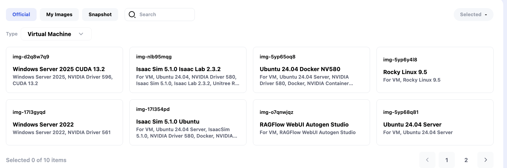

**なぜ VM を選ぶのか？** WeKnora は Docker Compose で複数のサービスを一度に起動します。コンテナタイプのインスタンスはそれ自体がコンテナなので、通常はその中でさらに Docker を動かすことができません。

### 2. SSH で接続する

インスタンスのステータスが Running になったら、`My Instances` でそのインスタンスを開きます。`Access` タブに SSH 接続コマンド（SSH Command）とパスワードが表示されます。

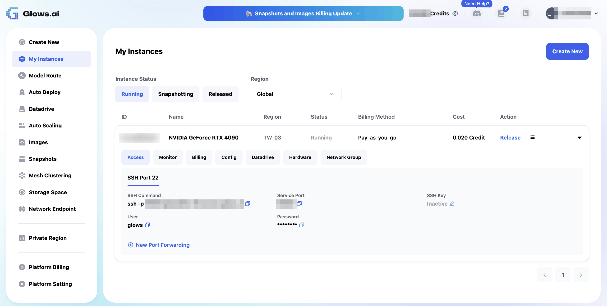

SSH コマンドをコピーし、自分のパソコンのターミナルに貼り付けてログインします（パスワードは Password の横のボタンでコピーできます）。

```bash
ssh -p <PORT> glows@<HOST>
```

### 3. GPU と Docker を確認する

ログイン後、次を実行します。

```bash
nvidia-smi
docker compose version
```

GPU の情報（今回は RTX 4090、ドライバー 580）が表示され、Docker Compose のバージョン番号が表示されれば、次のステップに進めます。

## パート 2：Ollama をインストールしてモデルをダウンロードする

Ollama はこのマシン上でモデルを動かします。WeKnora はこのあと Ollama を通じて質問に答えたり、ドキュメントを整理したりします。

### 1. Ollama をインストールする

インストール時に sudo のパスワードを求められるため、この行は単独で貼り付けてください。

```bash
curl -fsSL https://ollama.com/install.sh | sh
```

インストールが終わると `NVIDIA GPU installed.` と表示され、Ollama が GPU を検出したことがわかります。

### 2. Ollama の設定を変更する

次に、2 つの設定を変更します。

- **Ollama が 0.0.0.0 で待ち受けるようにする**：Ollama はデフォルトで 127.0.0.1 でしか待ち受けないため、WeKnora のコンテナから接続できません
- **context を 32768 に増やす**：デフォルトは 4096 しかなく、長いドキュメントを読むには足りません

以下のブロックをまとめて貼り付けます。

```bash
sudo mkdir -p /etc/systemd/system/ollama.service.d
sudo tee /etc/systemd/system/ollama.service.d/override.conf > /dev/null <<'EOF'
[Service]
Environment="OLLAMA_HOST=0.0.0.0"
Environment="OLLAMA_CONTEXT_LENGTH=32768"
EOF
sudo systemctl daemon-reload && sudo systemctl restart ollama
sleep 3
curl http://localhost:11434
```

最後の行に `Ollama is running` と表示されれば成功です。

**注意：** 11434 ポートはインターネットに公開しないでください。

### 3. モデルをダウンロードする

2 つのモデルをダウンロードします。チャットモデル qwen3.5:9b（約 6.5GB）と、多言語対応の embedding モデル bge-m3（約 1.2GB、中国語と英語の両方に対応）です。

```bash
ollama pull qwen3.5:9b
ollama pull bge-m3
ollama list
```

`ollama list` に 2 つのモデルが表示されれば完了です。

## パート 3：WeKnora をデプロイする

### 1. ユーザーを docker グループに追加する

まずログインユーザーを docker グループに追加します。追加しないと、あとで `permission denied` が表示されます。2 行は別々に貼り付けてください。2 行目で、現在のウィンドウに権限がすぐ反映されます。

```bash
sudo usermod -aG docker $USER
```

```bash
newgrp docker
```

### 2. WeKnora をダウンロードして起動する

WeKnora をダウンロードし、設定ファイルをコピーしてサービスを起動します。初回は 5 つのイメージをダウンロードするため、約 2 分かかります。

```bash
git clone https://github.com/Tencent/WeKnora.git && cd WeKnora && cp .env.example .env && docker compose up -d
```

起動後、サービスの状態とバージョンを確認します。

```bash
docker compose ps
cat VERSION
```

app、docreader、frontend、postgres、redis の 5 つのサービスがすべて Up と表示されれば、デプロイ完了です。

### 3. .env 設定ファイルについて

- テスト用ならデフォルト値のままで構いません。Ollama のアドレスはデフォルトで `http://host.docker.internal:11434` になっているため、変更は不要です
- 本番利用の前には、データベースと Redis のデフォルトパスワードを変更することをおすすめします。タイムゾーン `TZ` も必要に応じて変更できます（例：`Asia/Taipei`）
- `SYSTEM_AES_KEY` は WeKnora に保存される API Key の暗号化に使われます。一度設定したら変更しないでください。変更すると、保存済みの Key を復号できなくなります

あとでサービスを一時停止するには `docker compose stop`、再開するには `docker compose start` を使います。

**注意：** `docker compose down -v` は使わないでください。`-v` を付けると、ナレッジベースのデータも一緒に削除されます。

## パート 4：WeKnora の Web インターフェースに接続する

WeKnora の Web インターフェースはクラウドマシンの 80 ポートで動いています。SSH トンネルで自分のパソコンの 8000 ポートにつなげば、外部に公開せず、自分だけがアクセスできます。

### 1. SSH トンネルを作成する

**自分のパソコン**でターミナルを開き、Glows.ai の SSH コマンドに `-L 8000:localhost:80` を追加します。

```bash
ssh -L 8000:localhost:80 -p <PORT> glows@<HOST>
```

ログイン後はこのウィンドウを開いたままにし、ブラウザで `http://localhost:8000` を開くと、WeKnora のログイン画面が表示されます。

**注意：** このコマンドは**自分のパソコン**で実行してください。ターミナルの先頭にクラウドマシンの名前（例：`glows@` で始まる表示）が出ている場合は、まだクラウドマシンの中にいます。先に `exit` を入力して自分のパソコンに戻ってから実行してください。

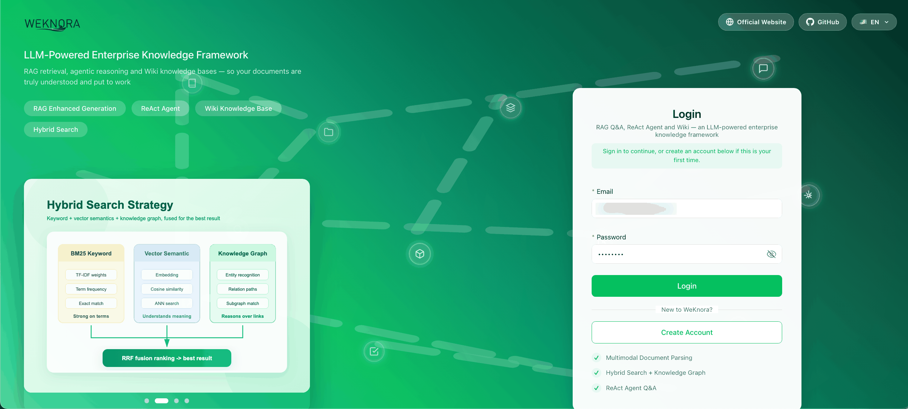

### 2. アカウントを登録して言語を切り替える

初回は `Create Account` をクリックして登録します。インターフェースのデフォルトは簡体字中国語です。ログイン画面右上の言語メニューで English に切り替えるか、ログイン後に左下のアカウント名 → `All Settings` → `General Settings` で切り替えられます。このチュートリアルのスクリーンショットはすべて英語インターフェースです。

あとでチームに公開する場合は、自分のアカウントを登録したあと、`.env` の `DISABLE_REGISTRATION` を `true` に変更し、`docker compose up -d` を実行して反映させると、URL を知っている人が誰でも登録できる状態を防げます。

## パート 5：モデルを設定する

WeKnora では、モデルを先に設定画面で追加しておかないと、ナレッジベースの作成時に選択できません。

### 1. 設定を開く

左下のアカウント名をクリックし、`All Settings` を選択します。

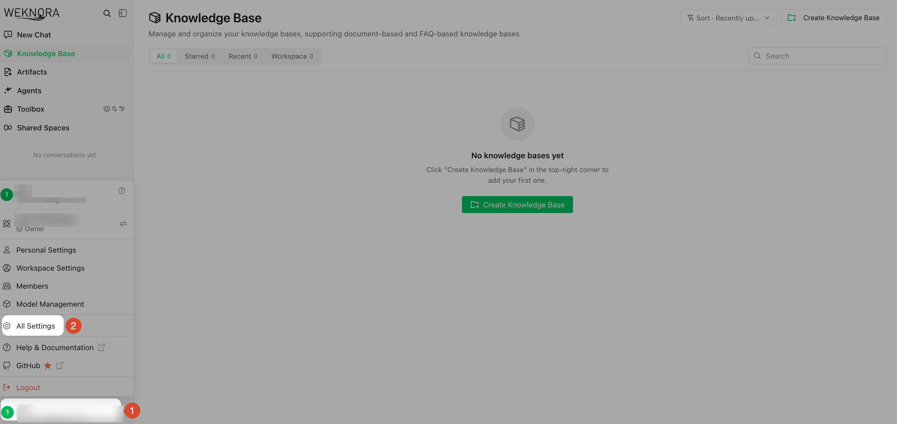

### 2. WeKnora が Ollama に接続できることを確認する

左側で `Ollama` を選択し、`Ollama Service Status` が **Available** になっていること、下の `Installed Models` に `qwen3.5:9b` と `bge-m3:latest` が表示されていることを確認します。Unavailable と表示される場合は WeKnora が Ollama に接続できていないため、前述の `OLLAMA_HOST` の設定を確認してください。

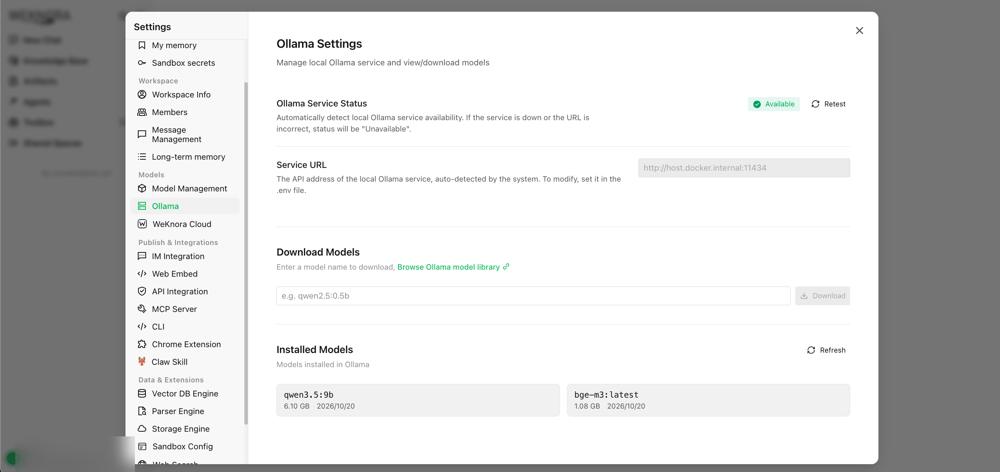

### 3. チャットモデルを追加する

左側で `Model Management` を選択し、`Add Model` をクリックします。

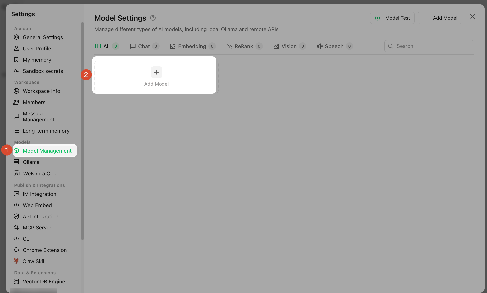

- `Model Type`：Chat
- `Source`：Ollama
- `Model Name`：`qwen3.5:9b`
- `Context Window`：`32768`。前に Ollama で設定した context の長さと同じにします

設定したら `Save and close` をクリックします。Ollama を選んだ場合は接続テストは不要で、ドロップダウンにはダウンロード済みのモデルだけが表示されます。

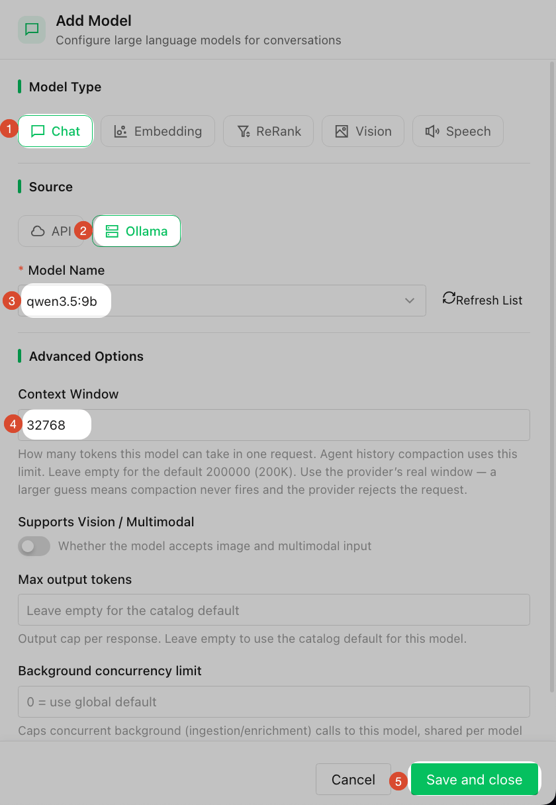

**なぜ Context Window を入力するのか？** 空欄のままだと、WeKnora はモデルが一度に 200000 トークンを読めると判断しますが、Ollama は 32768 にしか設定されていないため、超えた部分はそのまま切り捨てられます。同じ数値を入力しておけば、会話が長くなりすぎたときに WeKnora が古い内容を自動で圧縮します。

### 4. Embedding モデルを追加する

もう一度 `Add Model` をクリックします。

- `Model Type`：Embedding
- `Source`：Ollama
- `Model Name`：`bge-m3:latest`
- `Detect Dimension` をクリックし、`Vector dimension: 1024` と表示されれば OK です

設定したら `Save and close` をクリックします。

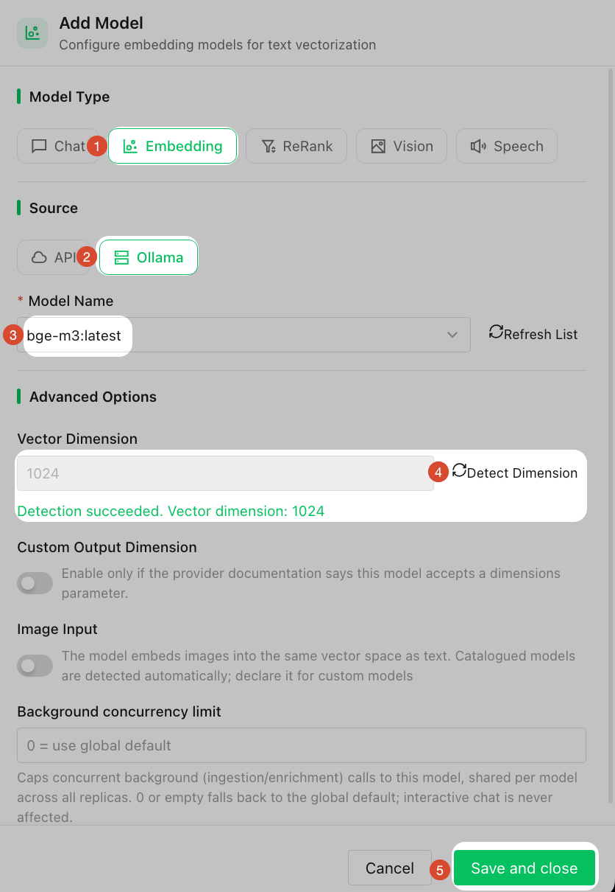

- embedding モデルは一度決めたら変更しないでください。変更するとナレッジベース全体を作り直す必要があります
- 外部 API（OpenAI など）に接続することもできます。`Source` で `API` を選ぶだけですが、ドキュメントの内容が外部サービスに送られます

### モデル設定時によくある問題

**embedding モデルを変更したあと、何も検索できない：**

新旧の embedding モデルが生成するベクトルは互換性がないため、既存のインデックスを引き継げません。

**解決方法：** ナレッジベースを作り直してください。

## パート 6：ナレッジベースを作成してドキュメントをアップロードする

左側の `Knowledge Base` → 右上の `Create Knowledge Base` をクリックし、以下を設定します。

### 1. Basic Information

- `Knowledge Base Type`：`Document-based` を選択します。`FAQ Q&A` は整理済みの「質問＋標準回答」用で、CSV または Excel でインポートします
- `Indexing Strategy`：まずは `RAG Search` だけにチェックを入れます。`Wiki Knowledge Base` はあとのパートで有効にします
- `Knowledge Base Name`：例：`Glows.ai SDK API`

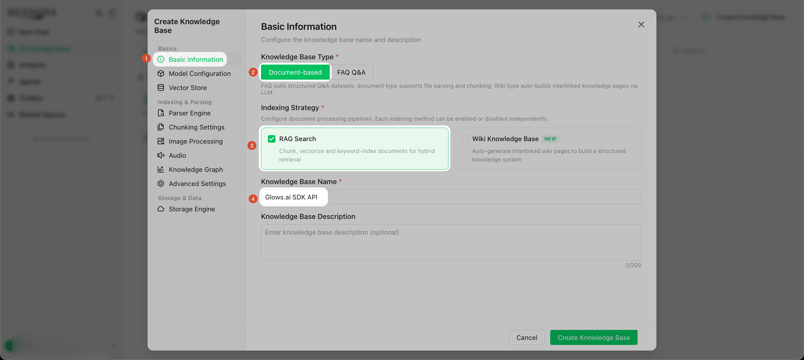

### 2. Model Configuration

`LLM Model` で `qwen3.5:9b`、`Embedding Model` で `bge-m3:latest` を選択します。

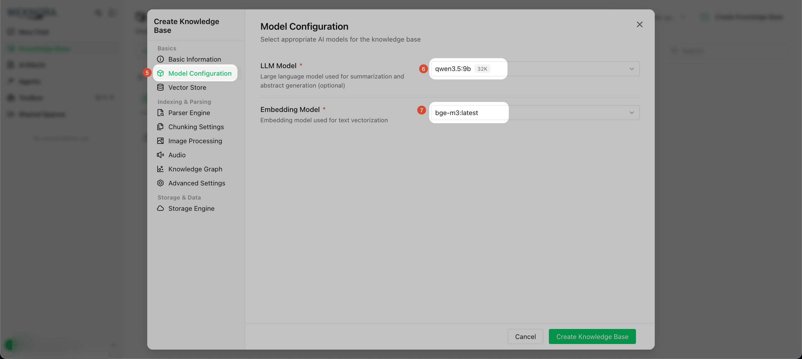

### 3. Chunking Settings

デフォルトのまま `Create Knowledge Base` をクリックします。

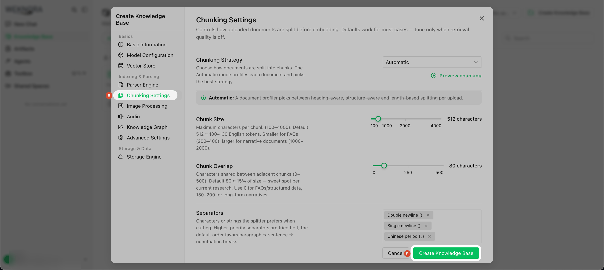

新しく作成したナレッジベースでは、デフォルトで `Parent-Child Chunking` が有効になっています。384 文字の小さなチャンクで検索し、それが属する 4096 文字の大きなチャンクをモデルに渡して回答させる仕組みです。有効な間は、上の `Chunk Size` は使われません。

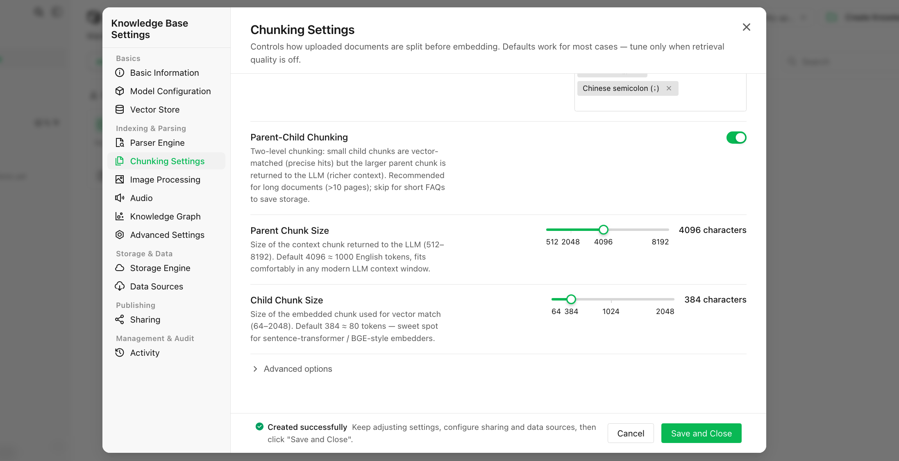

| | Parent-Child Chunking（デフォルト） | 単層 1024 |
|---|---|---|
| 向いているドキュメント | 1 つずつ整理しきれないドキュメント（各部署が個別に書いたものなど） | 整理済みで、各段落が単独で理解できるドキュメント |
| 検索 | 小さなチャンクは話題がまとまっているため、検索精度が高い | 1 チャンクが大きい |
| モデルに渡す内容 | 最大 4096 文字。文脈は完全だが、トークンを多く消費する | ちょうど 1 段落 |

今回のテストで使った API ドキュメントはすでに段落ごとに整理されているため、`Parent-Child Chunking` をオフにして `Chunk Size` を 1024 にしても構いません。

**ヒント：** `Preview chunking` をクリックしてドキュメントを貼り付けると、分割結果をプレビューできます。Markdown ドキュメントに見出しが 3 つ以上ある場合は「見出しで分割」が選ばれ、各チャンクに所属する見出しが付きます。いずれかのチャンクが Chunk Size の 2 倍を超えると「長さで分割」に戻り、見出し情報も失われます。

### 4. ドキュメントをアップロードする

ナレッジベースを開き、右上の `Add Document` をクリックして、アップロードするファイルを選びます。`Confirm Upload` ウィンドウが表示されたら：

- `AI Question Generation`：オフにします。デフォルトでオンになっており、チャンクごとに 3 つの質問を生成するため、ローカルモデルでは処理がかなり遅くなります
- そのほかの設定はデフォルトのままにします

`Upload and parse` をクリックします。

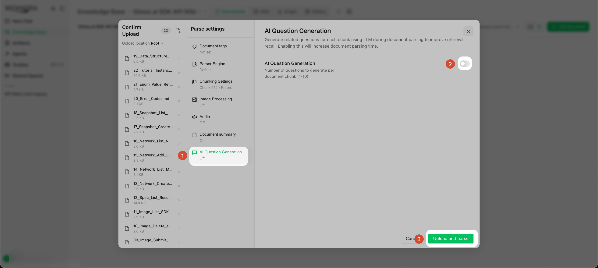

すべてのドキュメントのステータスが **Completed** になれば、質問を始められます。実測では、23 件の API ドキュメントの処理が約 4 分で完了しました。

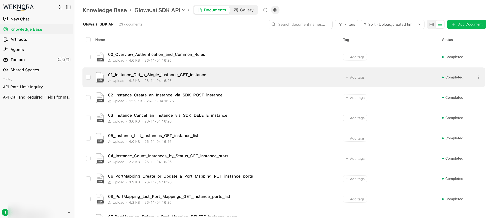

### ナレッジベース作成時によくある問題

**Chunk Size を変更したのに、プレビュー結果が変わらない：**

`Parent-Child Chunking` が有効な間は、`Chunk Size` は使われません。

**解決方法：** `Parent-Child Chunking` をオフにするか、親チャンクと子チャンクのサイズを調整してください。

## パート 7：質問応答をテストする

### 1. 内蔵の Agent について

WeKnora には 4 つの Agent が内蔵されています。

| Agent | 用途 |
|---|---|
| Quick Answer | ナレッジベースから関連する段落を検索してから回答（RAG）し、引用元を表示する |
| Smart Reasoning | 自分で手順を計画してツールを呼び出す。複数ステップが必要な質問向け。ReRank モデルが必要で、Ollama は対応していないため、本記事では扱わない |
| Wiki Questioner | Wiki ページから答えを探す。先に Wiki モードを有効にする必要がある |
| Data Analyst | CSV や Excel ファイルを分析する |

### 2. Agent のモデルを選ぶ

Agent ごとにチャットモデルを指定する必要があります。指定しないと、質問時に `Agent "Quick Answer" is not ready` と表示されます。左側の `Agents` → `Quick Answer` をクリックします。

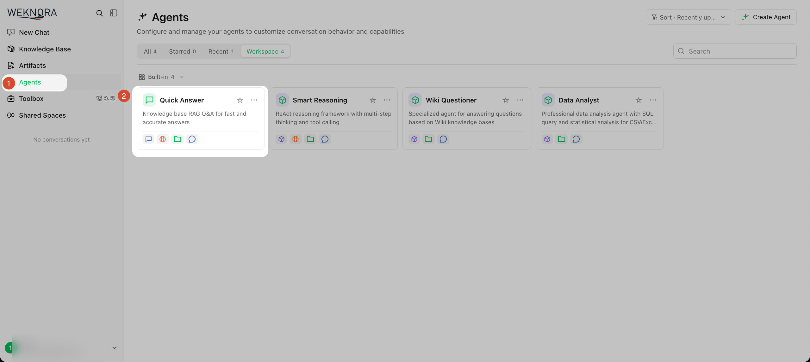

左側で `Model Config` を選択し、`Model` で `qwen3.5:9b` を選んで `Save and Close` をクリックします。`Thinking Mode` は `Off` のままにします。`ReRank Model` には赤いアスタリスクが付いていますが、Quick Answer では空欄のままでも問題なく使えます。

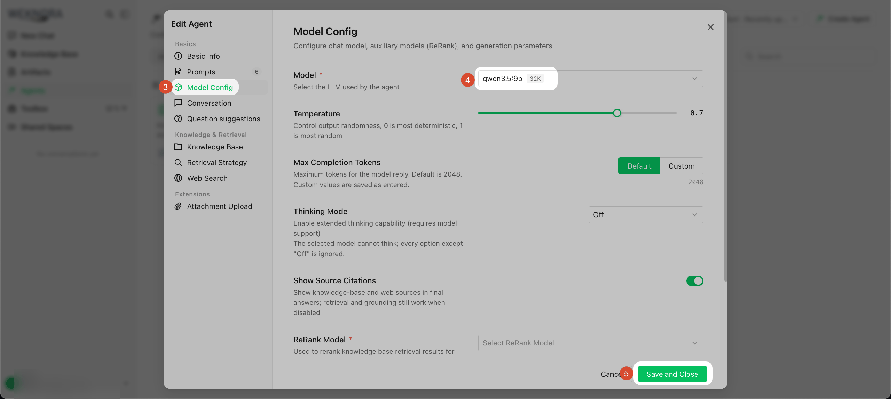

### 3. 質問する

左側の `New Chat` をクリックし、Agent で `Quick Answer` を選び、入力欄で `@` を入力して先ほど作成したナレッジベースを選択してから、質問を入力します。

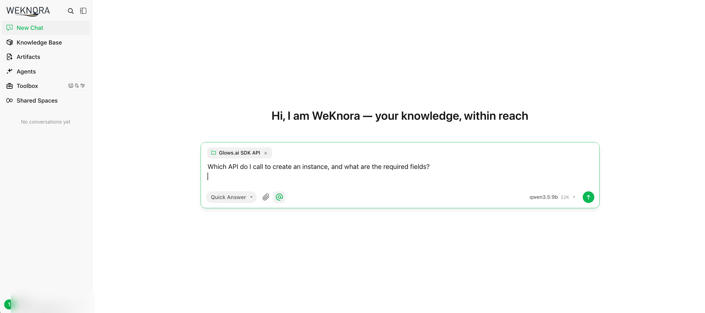

回答の上には検索の過程が表示され、右側の `Document sources` に引用されたドキュメントが一覧表示されます。クリックすると引用された原文を確認できます。実測では、ローカルモデルは約 1 分以内に回答を終えました。

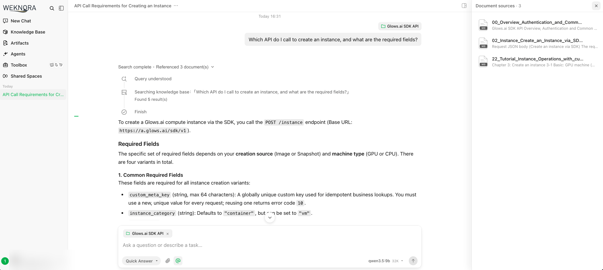

### 4. いろいろな種類の質問でナレッジベースを確認する

次のような種類の質問でナレッジベースの性能を確認することをおすすめします。前の質問が回答に影響しないよう、1 問ごとに新しい会話を始めてください。

| 質問の種類 | 例 | 確認するポイント |
|---|---|---|
| 1 つのドキュメントにある事実 | `Which API do I call to create an instance, and what are the required fields?` | 回答と引用されたファイルが正しいか |
| 共通ルール | `How do I authenticate API requests?` | 概要ドキュメントを引用しているか |
| 似た内容の区別 | `Which API should I use to find out how many instances are currently running?` | stats と list の 2 つの API を区別できているか |
| 複数ドキュメントにまたがる | `Which APIs do I need to call, in order, to create an instance and then cancel it?` | 複数のドキュメントを統合できているか |
| ドキュメントに書かれていない | `Does the API have a rate limit?` | ドキュメントに記載がないと説明すべきで、数値を作り出したらハルシネーション |

1 問目の回答では、4 種類の作成方法が表にまとめられ、必須項目もすべて正しく示されました。

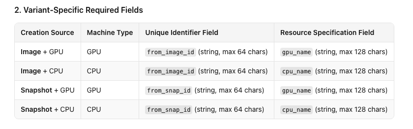

`Does the API have a rate limit?` と質問すると、モデルはエラーコードのドキュメントを引用し、上限を超えると HTTP 429 が返ると説明したうえで、具体的な回数の上限はドキュメントに書かれていないと明確に述べ、数値を作り出すことはありませんでした。

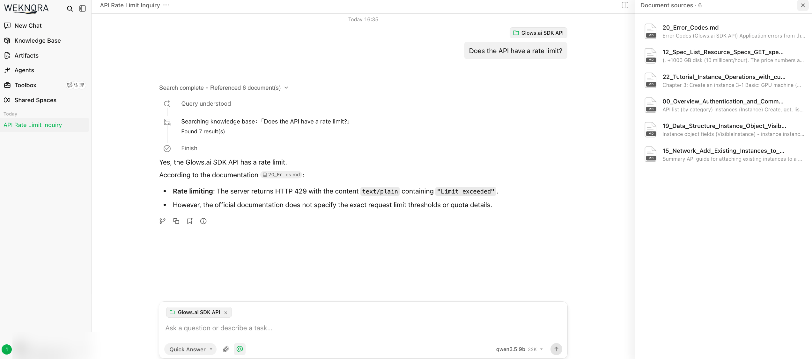

### 5. 実測から得られたポイント

- **回答がよくないときは、まず引用を確認する**。正しい段落が検索されていなければドキュメントの内容を見直し、検索されているのに使われていなければ、Agent の `Prompts` にルールを追加できます
- **ドキュメントの書き方の影響は大きい**。説明用のサンプルが先に書かれていると、モデルがそちらを優先して引用することがあります。そのまま使えるサンプルを前に置き、説明用の値に「要置き換え」と明記すると、モデルが選び間違えにくくなります
- **小さなモデルは細部を見落としたり、言い過ぎたりすることがある**ため、重要な情報は引用を開いて原文を確認してください

### 質問応答のテストでよくある問題

**質問時に `Agent "Quick Answer" is not ready` と表示される：**

Agent にチャットモデルがまだ選ばれていません。Agent を選ぶときに横に感嘆符が表示され、**Setup needed: Chat model** と出る場合も同じ原因です。

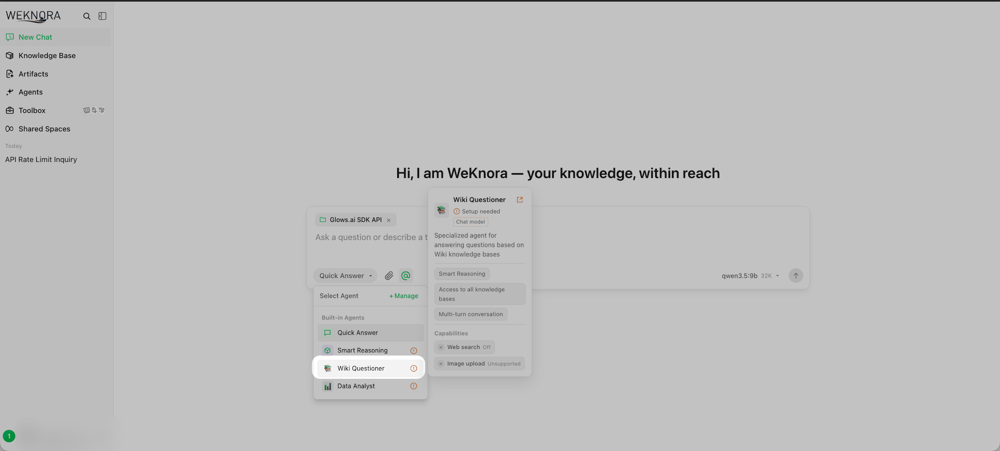

**解決方法：** `Agents` → 該当する Agent → `Model Config` でモデルを選択してください。

## パート 8：Wiki モードを有効にする

RAG は質問のたびに原文に戻って調べます。一方 Wiki は、先に AI にドキュメントを読ませ、内容を相互にリンクされたページに整理しておき、以降は整理済みの内容を参照します。複数のドキュメントに散らばった同じテーマは 1 ページにまとめられ、人が直接閲覧することもできます。

ナレッジベースにドキュメントが入ると `Indexing Strategy` は変更できなくなるため、RAG と Wiki の両方を有効にしたナレッジベースを別に作成します。

### 1. Basic Information

- `Knowledge Base Type`：`Document-based`
- `Indexing Strategy`：`RAG Search` と `Wiki Knowledge Base` の両方にチェック
- `Extraction Granularity`：`Standard` を選択（違いは下の表を参照）
- `Wiki Extraction Focus`（任意）：AI に特に整理してほしい内容を指定します。API ドキュメントの例：`Prioritize API names and paths, request parameters, error codes, and status values`
- `Wiki Content Instructions`（任意）：ページの文体や言語を指定できます。本記事では空欄にします
- 下にスクロールし、`Knowledge Base Name` に `Glows.ai SDK API Wiki` と入力します

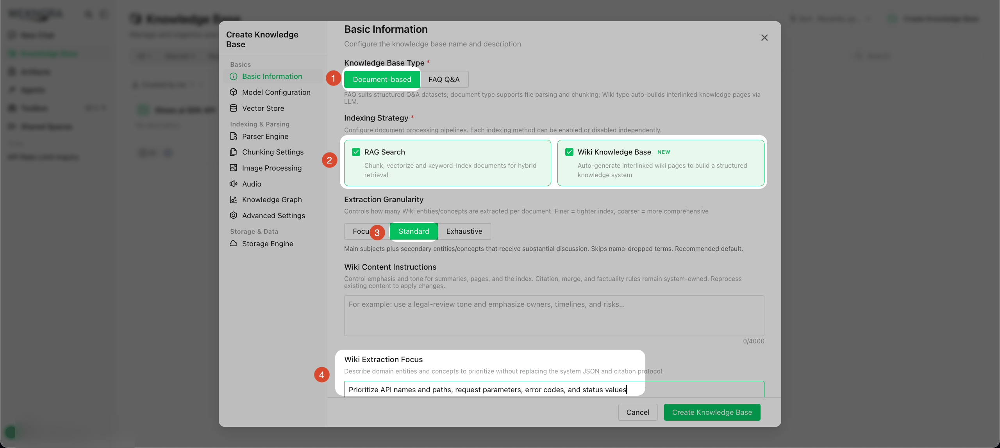

| Extraction Granularity | 抽出する内容 | 向いている用途 |
|---|---|---|
| Focused | 各ドキュメントの主題だけ | まず手早く効果を確認したいとき |
| Standard | 主題と、詳しく説明されている副次的な概念 | ほとんどの場合。おすすめ |
| Exhaustive | ついでに触れられただけのものまで抽出 | ページ数は最も多いが、中身の薄いノイズページが出やすい |

### 2. Model Configuration

`LLM Model` と `Wiki Synthesis Model` の両方で `qwen3.5:9b`、`Embedding Model` で `bge-m3:latest` を選択します。`Wiki Synthesis Model` はドキュメントを Wiki ページに書き起こす役割で、選ばなかった場合は LLM Model が使われます。

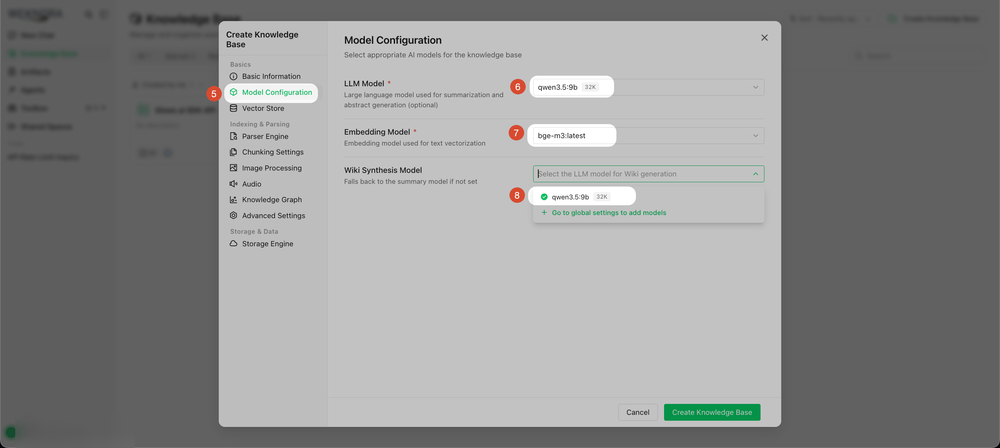

### 3. Chunking Settings

デフォルトのまま `Create Knowledge Base` をクリックします。

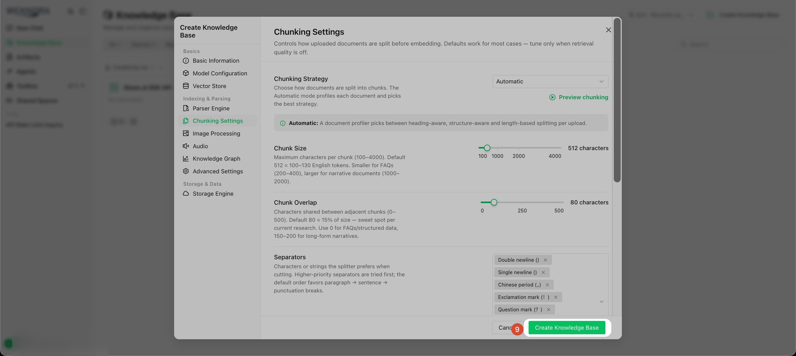

### 4. ドキュメントをアップロードする

アップロードの方法は前と同じです。`AI Question Generation` をオフにするのを忘れないでください。ドキュメントが **Completed** になったあと、Wiki ページが順次生成されます。

### 5. Wiki を確認する

ナレッジベースの上部に `Wiki` と `Graph` タブが追加されます。`Wiki` タブのトップページは `Index` で、各ドキュメントの要約が一覧表示され、左側にはすべてのページがカテゴリ別に並びます。

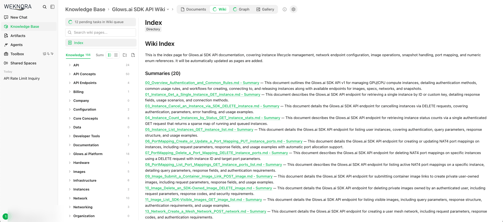

任意のページを開くと、整理された内容を確認できます。タイトルの下にはページの種類（例：Entities）、バージョン番号、別名が表示されます。ページ最下部の `Linked from` と `Source documents` には、このページにリンクしているページと、ページの元になったドキュメントが一覧表示されます。

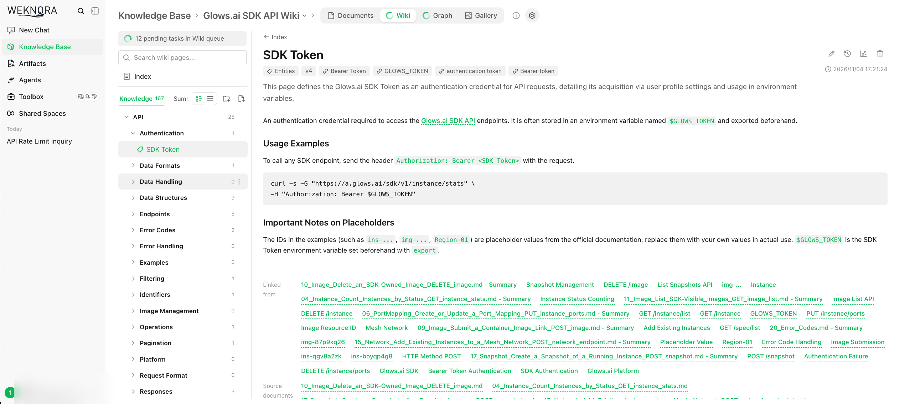

`Graph` タブでは、ページ間の関係がネットワーク図で表示されます。

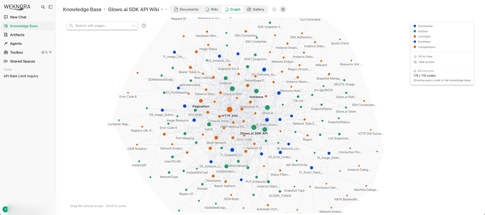

Wiki ページはブラウザ上で直接編集でき、新しいドキュメントが追加されると自動で更新されます。変更はすべてバージョン履歴に残り、ページ右上の時計アイコンをクリックすると、変更前後の差分を比較したり、古いバージョンに戻したりできます。

### 6. Wiki で質問する

`Wiki Questioner` も先にモデルを選ぶ必要があります。`Agents` → `Wiki Questioner` → `Model Config` で `Model` に `qwen3.5:9b` を選び、`Save and Close` をクリックします。

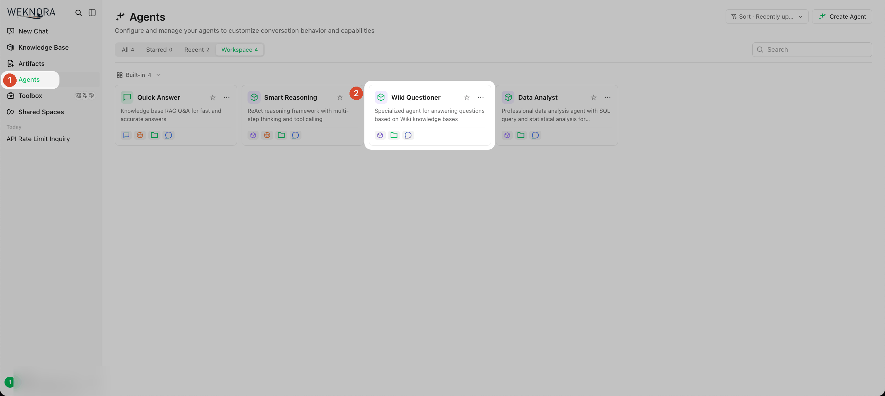

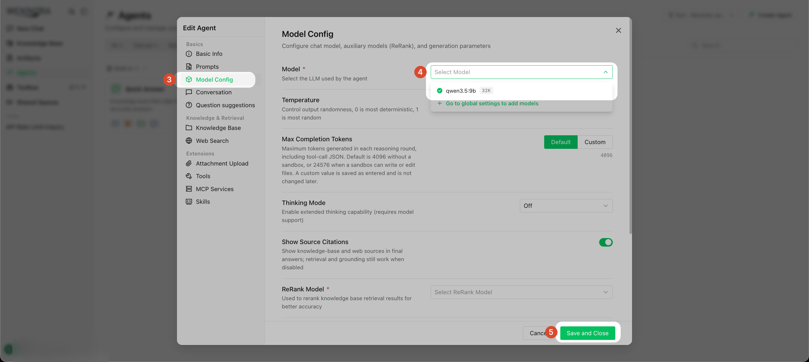

`New Chat` をクリックし、Agent で `Wiki Questioner` を選び、`@` で `Glows.ai SDK API Wiki` を選択してから質問を入力します。

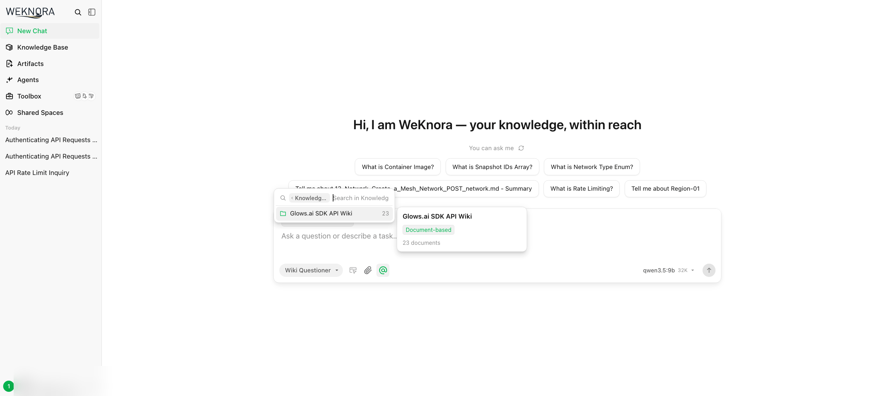

たとえば `How do I authenticate API requests?` と質問すると、回答の上に読み込んだ内容が表示され、続いて SDK Token の取得、環境変数の設定、header への追加という 3 つの手順がまとめられます。

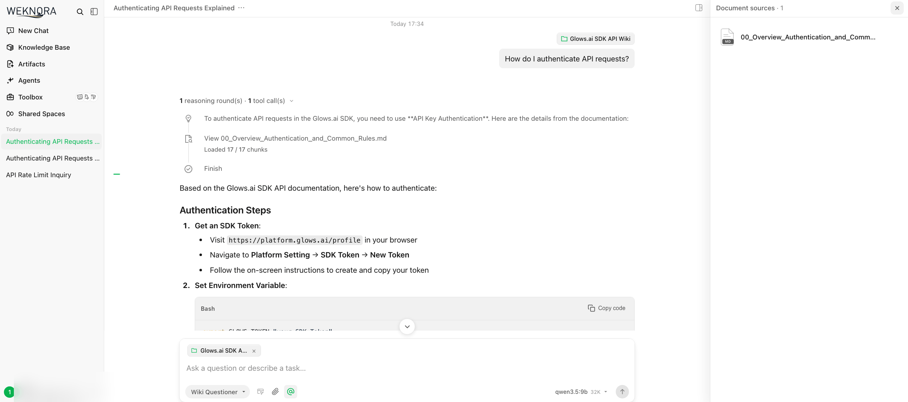

**応用テスト：** 元のドキュメントの事実を 1 つ書き換えて再アップロードし、Wiki ページが自動で更新されるか確認してみてください。これが、Wiki モードが一般的な RAG よりも長期的な知識の管理に向いている点です。

### Wiki モードでよくある問題

**Wiki Questioner の回答が不完全：**

質問時に `@` でナレッジベースを選択していないと、すべてのナレッジベースから検索するため、回答が不完全になりがちです。

**解決方法：** `@` で検索したい Wiki ナレッジベースを選択してください。

## お問い合わせ

Glows.ai の利用中に質問やご意見がある場合は、email、Discord、Line からお問い合わせください。

**Email:** [support@glows.ai](mailto:support@glows.ai)

**Discord:** [https://discord.com/invite/glowsai](https://discord.com/invite/glowsai)

**Line:** [https://lin.ee/fHcoDgG](https://lin.ee/fHcoDgG)
