本教程將教大家如何在 [Glows.ai](https://glows.ai) 的 RTX 4090 虛擬機上，使用開源推論引擎 Strata 運行 125B 參數的 MoE 模型 Qwen3.8-Flash-Next，並從自己的電腦透過網頁介面與 API 使用它。

實測模型每秒可生成 62–70 個 tokens。整個流程約一小時，大部分時間是在等待約 74 GB 的模型下載。

本教程包括以下內容：

- 在 Glows.ai 建立 RTX 4090 虛擬機
- 連線並檢查環境
- 準備系統環境
- 安裝 Strata 並下載模型
- 啟動 Strata
- 透過 SSH Tunnel 開啟網頁介面
- 與模型對話
- 查看 Monitor 儀表板
- 呼叫 OpenAI 相容 API
- 釋放實例

## Strata 簡介

**[Strata](https://github.com/Niko1221/Strata)** 是一個開源（MIT 授權）的 LLM 推論引擎，目標是讓 [Qwen3.8-Flash-Next](https://huggingface.co/Qwen/Qwen3.8-Flash-Next) 這種原本需要伺服器等級硬體的模型，也能在單張消費級顯示卡上運行。它的量化格式與部分 CPU 運算沿用 llama.cpp 的 ggml。

Qwen3.8-Flash-Next 共有 125B 參數，但每個 token 只啟用約 6B。模型的 48 層中，每層有 512 個 Experts（共 24,576 個），每個 token 在每層只會交給其中 10 個。Strata 利用這個特性，不嘗試把整個模型塞進 VRAM，而是把模型分配到整台機器：

| 位置 | Strata 放什麼 | 本次實測 |
|---|---|---|
| GPU VRAM | Attention 層、Router、KV Cache，以及最常用的 Experts | 12,842 個 Experts，17.2 GB |
| 系統記憶體 | 全部 24,576 個 Experts；不在 VRAM 的 Experts 由 CPU 計算 | 使用約 37 GB |
| 硬碟 | 28.8 GB 的 n-gram 嵌入表，需要時才讀取 | — |

Strata 也會用模型內建的 MTP 層預先猜測後續 tokens（speculative decoding），開發者表示可讓生成速度提升約 1.6～1.8 倍。

官方硬體需求與本教程使用的 Glows.ai 虛擬機對照如下：

| | Strata 需求 | 本教程的 Glows.ai 虛擬機 |
|---|---|---|
| GPU | NVIDIA RTX 20/30/40/50 系列，VRAM 12 GB 以上 | RTX 4090，24 GB |
| 記憶體 | 32 GB（僅限 Coder 版）；64 GB 可跑所有版本 | 50 GB |
| 硬碟 | 約 70～80 GB 可用空間 | 100 GB |
| CPU | 支援 AVX2 的 x86-64 | Xeon Platinum 8352V（AVX-512），10 vCPUs |
| NVIDIA 驅動 | 580 以上 | 580.126.09（已預裝） |
| 作業系統 | Windows 10/11 或 Linux | Ubuntu 24.04 |

**注意：** 模型權重採用 Qwen Community License 1.0，部分商業用途（例如 Model-as-a-Service）需另外取得授權，對外提供服務前請先確認。

## 前置準備

- 約 1 小時的操作時間（大部分為模型下載）
- RTX 4090 虛擬機為 0.490 Credit/h，完成本教程約需不到 1 Credit

## 一、在 Glows.ai 建立虛擬機

### 1. 建立實例

點擊 `Create New` 後開始建立實例：

1. GPU Model 選擇 **NVIDIA GeForce RTX 4090**（24 GB VRAM、50 GB 記憶體、100 GB 儲存空間），本教程使用 TW-03 區域
2. 在 `Official` 分頁中，將 `Type` 設為 `Virtual Machine`，並選擇 **Ubuntu 24.04 Docker NV580** 鏡像（img-5yp65oq8）。這個鏡像已預裝 NVIDIA 580 驅動，是 Strata 要求的最低版本，因此不需要自行安裝驅動或重新開機
3. 點擊 `Complete Checkout`，費用為 0.490 Credit/h

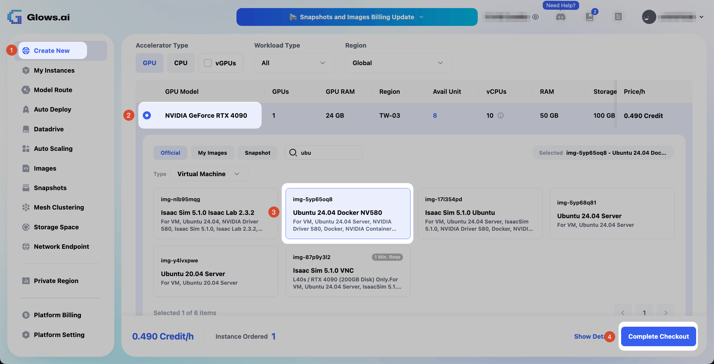

### 2. 查看連線資訊

實例啟動後，到 `My Instances` 查看 SSH 指令與密碼。此鏡像的登入帳號為 `glows`。

### 建立實例常見問題

**使用容器（Container）實例時 Strata 無法啟動：**

Strata 需要把部分記憶體鎖定給 GPU 使用。我們實測容器實例的鎖定記憶體上限只有 8 MB，而且無法調高。

**解決方式**：建立實例時，將 `Type` 設為 `Virtual Machine`。

## 二、連線並檢查環境

### 1. 透過 SSH 連線

使用 `My Instances` 中的 SSH 指令連線到實例（將 `<PORT>` 與 `<HOST>` 換成您自己實例的值）：

```bash
ssh -p <PORT> glows@<HOST>
```

### 2. 檢查 GPU、硬碟與記憶體

連線後執行：

```bash
nvidia-smi
df -h /
free -g
```

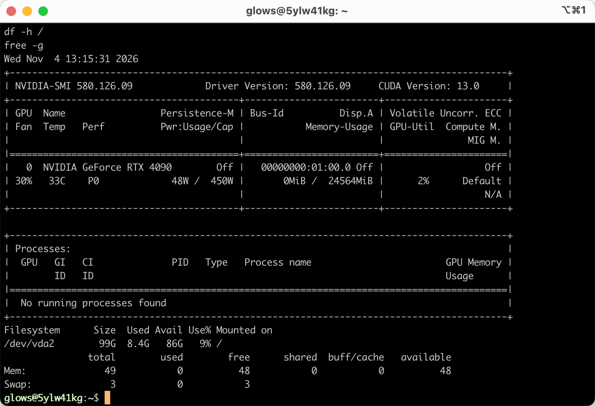

確認以下三點：

- `nvidia-smi`：顯示 NVIDIA GeForce RTX 4090、驅動版本 580 以上，VRAM 使用量為 `0MiB`
- `df -h /`：可用空間至少 80 GB（本次為 86 GB）
- `free -g`：記憶體總量約 49 GB

## 三、準備系統環境

### 1. 切換為 root

只有 root 能解除 Strata 需要的鎖定記憶體上限。這行請單獨執行，因為它會要求輸入密碼（即 `My Instances` 中的密碼）：

```bash
sudo -i
```

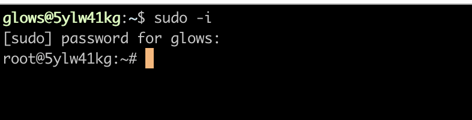

提示字元變成 `root@` 開頭，代表切換成功。

### 2. 更新套件清單

執行：

```bash
apt update
```

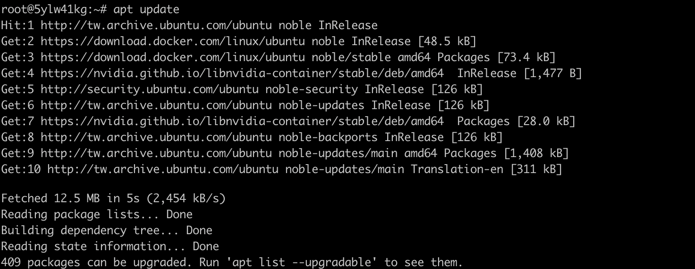

### 3. 安裝 Git 與 tmux

執行：

```bash
apt install -y git tmux
```

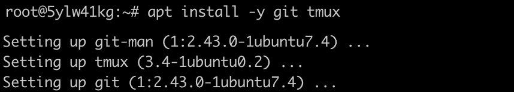

### 4. 建立 tmux 工作階段

下一步要下載約 74 GB，在 tmux 裡執行的話，即使 SSH 斷線，下載也會繼續進行。建立一個名為 `strata` 的工作階段：

```bash
tmux new -s strata
```

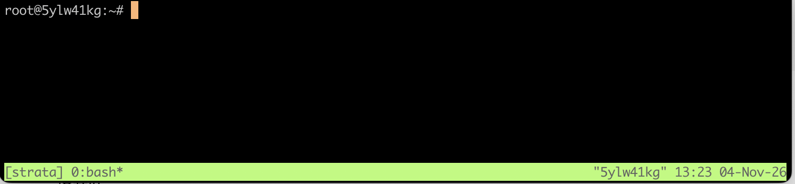

畫面下方出現綠色狀態列，代表已進入 tmux。

- 暫時離開但不中斷：按 `Ctrl + B`，放開後再按 `D`
- 重新回到工作階段：先執行 `sudo -i`，再執行 `tmux attach -t strata`

### 準備系統環境常見問題

**執行 apt install 時出現 `404 Not Found`：**

這個鏡像的套件清單已經過期，清單中記錄的下載位址已失效。

**解決方式**：先執行 `apt update` 更新清單，再執行安裝指令。

**貼上的指令沒有執行：**

把 `sudo -i` 和其他指令一起貼上時，`sudo` 在等待輸入密碼的同時，會把後面的指令吃掉。

**解決方式**：`sudo -i` 單獨一行執行，輸入密碼後再貼上其他指令。

**畫面出現大量 `^[[B` 字元：**

程式執行中按了方向鍵，終端機會把按鍵代碼印出來，不影響安裝。

**解決方式**：安裝過程中避免在 tmux 視窗裡按方向鍵或打字。

## 四、安裝 Strata

### 1. 執行安裝指令

在 tmux 工作階段中，解除鎖定記憶體上限、下載 Strata 並執行安裝腳本：

```bash
ulimit -l unlimited && ulimit -l
cd ~
git clone https://github.com/Niko1221/Strata.git
cd Strata
./setup.sh --setup --family qwen --model IQ2_XS --context 32768 --vision no --no-browser --yes
```

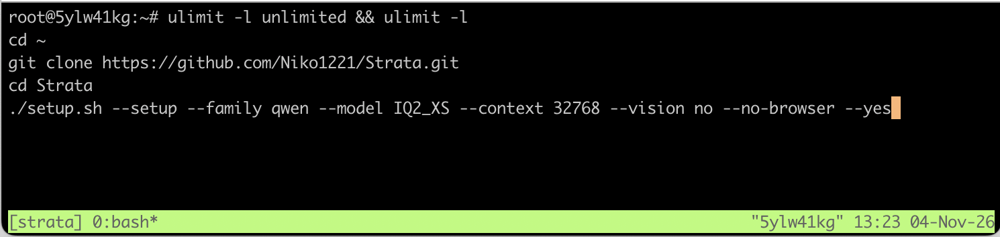

**注意：** 第一行必須印出 `unlimited`，否則 Strata 無法把 Experts 鎖定在記憶體中。

參數說明：

| 參數 | 說明 |
|---|---|
| `--family qwen` | 安裝原版 Qwen3.8-Flash-Next 模型 |
| `--model IQ2_XS` | 2-bit 版本，下載 68 GB、使用約 36 GB 記憶體，放得進這台虛擬機的 50 GB 記憶體與 100 GB 硬碟 |
| `--context 32768` | 上下文長度 32K tokens |
| `--vision no` | 不安裝讀圖功能，節省硬碟與 VRAM |
| `--no-browser` | 不自動開啟瀏覽器（虛擬機沒有螢幕） |
| `--yes` | 所有問題都使用建議的預設答案 |

其他參數可參考官方的 [INSTALL.md](https://github.com/Niko1221/Strata/blob/master/docs/INSTALL.md)。

**為什麼選 IQ2_XS？** 在這台 RTX 4090 虛擬機上，IQ2_XS 是空間最寬裕的版本。體積更小的 Q2_0 在支援 AVX-512 的 CPU 上，安裝時還會另外寫入約 40 GB 的 Experts 副本，硬碟放不下；IQ3_S 等更大的版本則需要記憶體與硬碟更大的實例。

### 2. 等待安裝完成

安裝腳本會依序執行六個階段，每完成一個階段就會顯示 `[ok]`。本次實測整個過程約 45 分鐘，大部分時間在下載模型（速度約 37 MB/s）。

**階段 1** 檢查電腦的 GPU、記憶體與 CPU，本次偵測到 RTX 4090、49 GB 記憶體與支援 AVX-512 的 CPU：

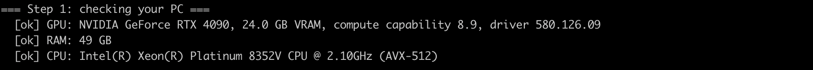

**階段 2** 列出各種模型大小並確認設定。實驗性的 speed projection 預設關閉，維持關閉即可：

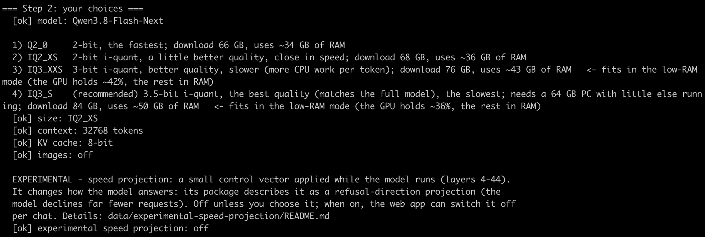

**階段 3** 安裝 Python 套件：

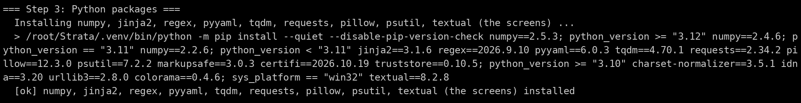

**階段 4** 下載現成的推論引擎，不需要編譯。畫面出現 `No ready-made engine for v0.1.56 (HTTP Error 404)` 是正常的，腳本會改用最新發布版的引擎：

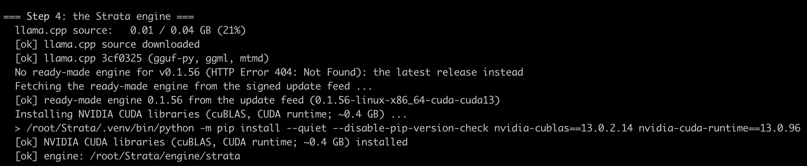

**階段 5** 下載兩個模型檔（39.23 GB 與 28.80 GB），並逐一檢查 SHA-256：

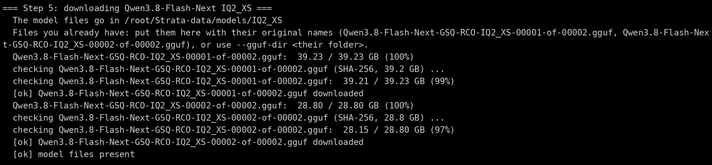

**階段 6** 將模型轉換成 Strata 使用的格式，並下載 speculative decoding 用的 MTP 草稿層（5.21 GB）：

```text
=== Step 6: preparing the model for Strata ===
  [ok] model prepared: /root/Strata-data/packs/iq2_xs
  MTP draft layer:   5.21 / 5.21 GB (100%)
```

### 安裝 Strata 常見問題

**下載中斷：**

網路或 SSH 連線中斷，導致模型下載停止。

**解決方式**：重新執行同一行 `./setup.sh` 指令，會從中斷的地方繼續下載。

## 五、啟動 Strata

安裝腳本跑完後會自動啟動模型。啟動時 Strata 會把約 39 GB 載入記憶體，終端機可能會有 1～3 分鐘反應較慢。本次實測 89 秒載入完成，接著把 12,842 個 Experts（17.21 GiB）放進 VRAM。

看到 `ready: http://127.0.0.1:8080/v1`，就代表啟動完成：

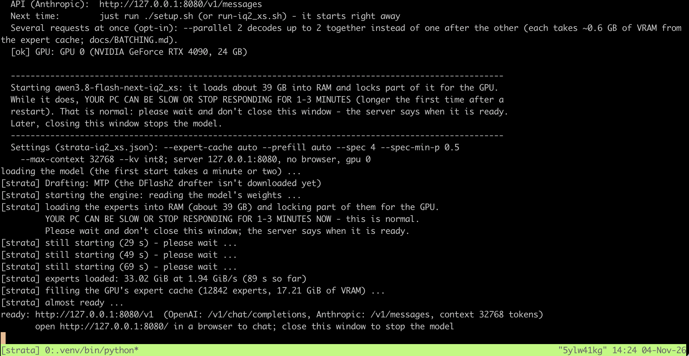

- 服務同時提供 OpenAI 相容 API（`/v1/chat/completions`）與 Anthropic 相容 API（`/v1/messages`）
- 請保持這個 tmux 視窗開著，關掉就會停止模型
- 在同一台實例上，之後只要在 Strata 資料夾重新執行 `./setup.sh` 就能直接啟動，不會重新下載

## 六、透過 SSH Tunnel 開啟網頁介面

Strata 只在虛擬機內部監聽 `127.0.0.1:8080`。SSH Tunnel 可以把您電腦上的 8080 port 轉接到虛擬機的 8080 port，不需要另外開放任何 port。

### 1. 建立 SSH Tunnel

在自己的電腦上開啟一個新的終端機視窗，在原本的 SSH 指令中加上 `-L 8080:127.0.0.1:8080`：

```bash
ssh -L 8080:127.0.0.1:8080 -p <PORT> glows@<HOST>
```

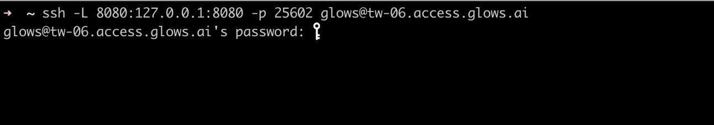

輸入同一組密碼登入後，保持這個視窗開著，關掉就會中斷 Tunnel。

### 2. 開啟網頁介面

在瀏覽器開啟 `http://127.0.0.1:8080`，就能看到 Strata 的網頁介面：

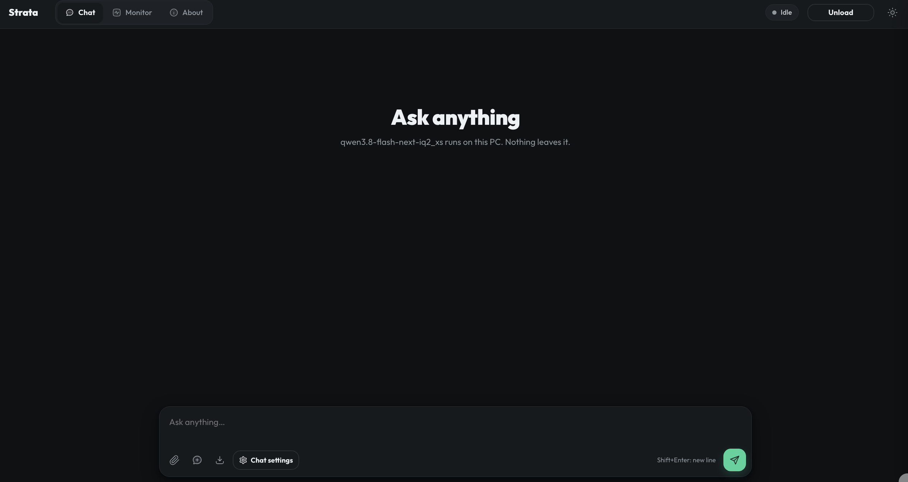

### SSH Tunnel 常見問題

**SSH 顯示 `Address already in use`：**

您電腦上的 8080 port 已被其他程式佔用。

**解決方式**：改用其他本機 port，例如 `-L 18080:127.0.0.1:8080`，並在瀏覽器開啟 `http://127.0.0.1:18080`。

## 七、與模型對話

### 1. 簡短問題

在 `Chat` 分頁輸入問題後按 Enter。模型會先簡短思考再回答，每個回答下方會顯示 token 數與生成速度：

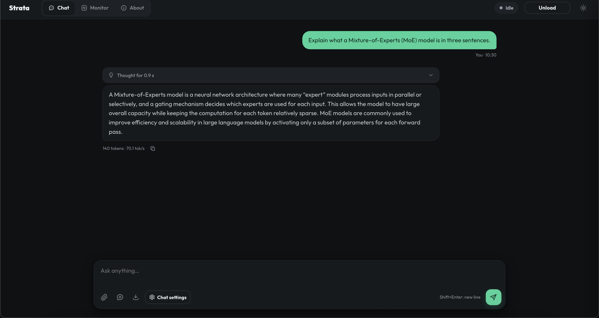

### 2. 寫程式的問題

再試一個寫程式的問題，回答較長，較能看出穩定的速度：

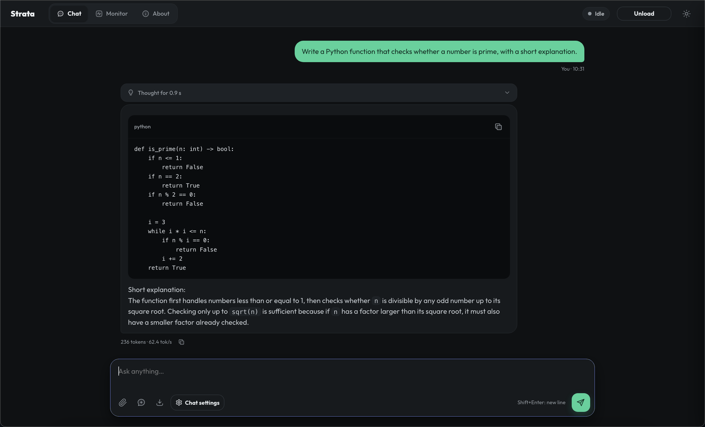

本次實測結果：

| 問題 | 輸出 | 速度 |
|---|---|---|
| Explain what a Mixture-of-Experts (MoE) model is in three sentences. | 140 tokens | **70.1 tokens/s** |
| Write a Python function that checks whether a number is prime, with a short explanation. | 236 tokens | **62.4 tokens/s** |

Strata 開發者在 RTX 5070 搭配 Ryzen 5 7600 的桌機上，測得 IQ2_XS 每秒 79 個 tokens。速度除了取決於 GPU，也取決於 CPU，因為不在 VRAM 裡的 Experts 都由 CPU 計算。

## 八、查看 Monitor 儀表板

點擊上方的 `Monitor` 分頁，可以看到 Strata 如何使用這台機器的資源。在我們問完兩個問題後，**超過 90% 的 Experts 都直接從 VRAM 取用**：

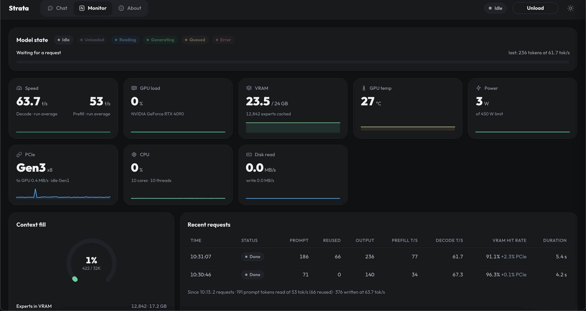

各欄位說明：

| 欄位 | 本次數值 | 代表的意思 |
|---|---|---|
| Speed | 63.7 tokens/s（decode） | 各次回答的平均輸出速度 |
| VRAM | 23.5 / 24 GB，12,842 experts cached | Strata 會用最常用的 Experts 填滿空閒的 VRAM |
| VRAM hit rate | 91.1～96.3% | 需要的 Experts 中有多少已在 VRAM，其餘從記憶體取用 |
| PCIe | Gen3 x8 | GPU 與主機之間的傳輸通道 |
| CPU | 10 cores | 虛擬機的 vCPU，負責計算不在 VRAM 的 Experts |
| Context fill | 422 / 32K tokens | 對話已使用的上下文長度 |

Prefill 速度（53 tokens/s）偏低，是因為我們的問題很短（71 與 186 個 tokens）；要測量真實的讀取速度，請用較長的 prompt。

## 九、呼叫 OpenAI 相容 API

SSH Tunnel 開著的時候，您電腦上任何支援 OpenAI 格式的工具，都能透過 Base URL `http://127.0.0.1:8080/v1` 與模型 ID `qwen3.8-flash-next-iq2_xs` 使用這個模型。

在自己電腦上開啟另一個終端機視窗，執行以下指令測試：

```bash
curl -s http://127.0.0.1:8080/v1/chat/completions \
-H "Content-Type: application/json" \
-d '{"model":"qwen3.8-flash-next-iq2_xs","messages":[{"role":"user","content":"Say hello in one sentence."}],"max_tokens":200}' \
| python3 -m json.tool
```

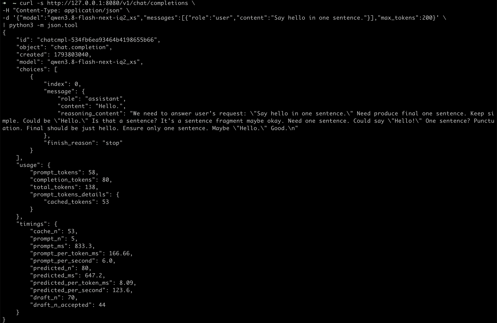

回應中值得注意的欄位：

| 欄位 | 數值 | 意思 |
|---|---|---|
| `content` | `Hello.` | 模型的回答 |
| `reasoning_content` | 模型的思考內容 | 回答前的思考，與回答分開回傳 |
| `cached_tokens` | 53 | 重複使用上一次相同請求的 prompt tokens |
| `predicted_per_second` | 123.6 | 這次短回答的輸出速度 |
| `draft_n` / `draft_n_accepted` | 70 / 44 | Speculative decoding 預先猜了 70 個 tokens，其中 44 個被採用 |

## 十、釋放實例

使用完畢後，到 `My Instances` 釋放實例。實例在運行期間會持續計費。

**注意：** 釋放後，下載的模型也會一併刪除，下次使用時需要重新下載。重新安裝一次大約一小時，以 0.490 Credit/h 計算約 0.5 Credit。

## 聯絡我們

使用 Glows.ai 時若有問題或建議，可透過 email、Discord 或 Line 聯絡我們。

**Email:** [support@glows.ai](mailto:support@glows.ai)

**Discord:** [https://discord.com/invite/glowsai](https://discord.com/invite/glowsai)

**Line:** [https://lin.ee/fHcoDgG](https://lin.ee/fHcoDgG)
