本教程將教大家如何在 [Glows.ai](https://glows.ai) 租用 GPU 部署騰訊開源的 WeKnora，並用 Ollama 在自己的機器上跑模型，打造一個可以問答、還會自動整理成 Wiki 的私有知識庫。文件和對話都留在自己的機器上，不會傳到外部服務。

本教程包括以下內容：

- 在 Glows.ai 建立 VM 實例
- 安裝 Ollama 並下載本地模型
- 部署 WeKnora，並從自己的電腦連進網頁介面
- 設定模型、建立知識庫、上傳文件
- 測試知識庫問答（RAG）
- 開啟 Wiki 模式，讓 AI 自動整理知識

## WeKnora 簡介

[WeKnora](https://github.com/Tencent/WeKnora) 是騰訊開源的知識庫平台（MIT 授權），可以自己架設。同一個知識庫有三種用法：用 RAG 查資料、用 Agent 執行多步任務、用 Wiki 整理知識。

一般的 RAG 工具只能「回答問題」，WeKnora 多了 **Wiki 模式**：AI 會把上傳的文件整理成一頁頁互相連結的 Wiki 頁面和知識圖譜，每頁附原文出處。文件更新時 Wiki 會自動跟著更新，人也可以直接編輯，每次修改都留有版本紀錄，可以回滾。

為什麼要在 Glows.ai 上跑：

- **不用付 API 費用**：生成 Wiki 時，模型要讀完每份文件再寫成頁面，很吃 token。用 Glows.ai 的 GPU 跑本地模型，就不用為這些 token 付費
- **資料不外流**：模型、文件、對話都在自己的機器上，適合放公司內部文件
- **硬體夠力**：WeKnora 本身要跑 5 個服務，再加上模型，一般筆電容易卡

本教程的測試版本為 WeKnora v0.8.3（2026/10/20）。WeKnora 更新很快，如果您看到的介面跟截圖不同，以實際畫面為準。

## 一、建立實例

### 1. 建立 VM 實例

在 Glows.ai 建立一台 VM 實例。選擇鏡像時，`Type` 選 `Virtual Machine`，鏡像選 **Ubuntu 24.04 Docker NV580**（img-5yp65oq8）。這個鏡像已經裝好 Docker 和 NVIDIA 驅動，不用自己裝。本次實作使用 RTX 4090（24GB VRAM）。

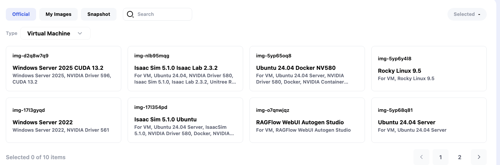

**為什麼要選 VM？** WeKnora 是用 Docker Compose 一次啟動好幾個服務。容器類型的實例本身就是一個容器，通常沒辦法在裡面再跑 Docker。

### 2. 透過 SSH 連線

實例狀態變成 Running 後，到 `My Instances` 點開這台實例，在 `Access` 分頁就能看到 SSH 連線指令（SSH Command）和密碼：

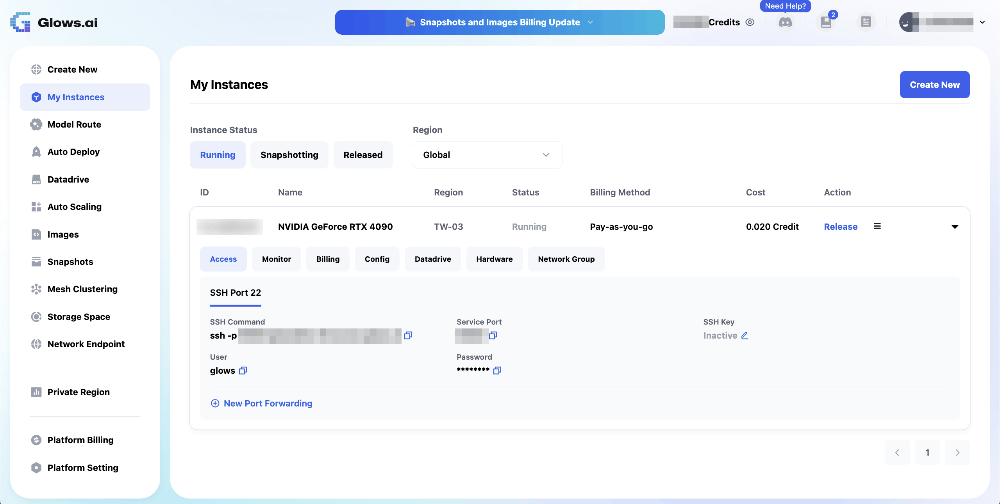

複製 SSH 指令，貼到自己電腦的終端機登入（密碼可以點 Password 旁的按鈕複製）：

```bash
ssh -p <PORT> glows@<HOST>
```

### 3. 確認顯卡與 Docker

登入後執行：

```bash
nvidia-smi
docker compose version
```

看得到顯卡資訊（本次為 RTX 4090、驅動 580），且 Docker Compose 有顯示版本號，就可以繼續下一步。

## 二、安裝 Ollama 並下載模型

Ollama 負責在這台機器上跑模型，WeKnora 之後會透過它來問答和整理文件。

### 1. 安裝 Ollama

安裝時會要求輸入 sudo 密碼，這行要單獨貼：

```bash
curl -fsSL https://ollama.com/install.sh | sh
```

安裝完成會顯示 `NVIDIA GPU installed.`，代表 Ollama 有偵測到顯卡。

### 2. 修改 Ollama 設定

接著要改兩個設定：

- **讓 Ollama 監聽 0.0.0.0**：Ollama 預設只監聽 127.0.0.1，WeKnora 的容器會連不到
- **把 context 加大到 32768**：預設只有 4096，讀長文件會不夠用

以下整段一起貼：

```bash
sudo mkdir -p /etc/systemd/system/ollama.service.d
sudo tee /etc/systemd/system/ollama.service.d/override.conf > /dev/null <<'EOF'
[Service]
Environment="OLLAMA_HOST=0.0.0.0"
Environment="OLLAMA_CONTEXT_LENGTH=32768"
EOF
sudo systemctl daemon-reload && sudo systemctl restart ollama
sleep 3
curl http://localhost:11434
```

最後一行顯示 `Ollama is running` 就成功了。

**注意：** 11434 這個 port 不要開放到公網。

### 3. 下載模型

下載兩個模型：對話模型 qwen3.5:9b（約 6.5GB）和多語言 embedding 模型 bge-m3（約 1.2GB，中英文都適用）。

```bash
ollama pull qwen3.5:9b
ollama pull bge-m3
ollama list
```

`ollama list` 看得到兩個模型就完成了。

## 三、部署 WeKnora

### 1. 將帳號加入 docker 群組

先把登入帳號加進 docker 群組，不然後面會出現 `permission denied`。兩行分開貼，第二行會讓權限在目前視窗立刻生效：

```bash
sudo usermod -aG docker $USER
```

```bash
newgrp docker
```

### 2. 下載並啟動 WeKnora

下載 WeKnora、複製設定檔、啟動服務。第一次會下載 5 個鏡像，約需 2 分鐘：

```bash
git clone https://github.com/Tencent/WeKnora.git && cd WeKnora && cp .env.example .env && docker compose up -d
```

啟動後確認服務狀態和版本：

```bash
docker compose ps
cat VERSION
```

app、docreader、frontend、postgres、redis 五個服務都顯示 Up，就部署完成了。

### 3. 關於 .env 設定檔

- 測試用可以直接用預設值，Ollama 的位址預設就是 `http://host.docker.internal:11434`，不用改
- 正式使用前，建議改掉資料庫和 Redis 的預設密碼，時區 `TZ` 可以改成 `Asia/Taipei`
- `SYSTEM_AES_KEY` 用來加密存在 WeKnora 裡的 API Key，設定好之後不要再改，否則已存的 Key 會解不開

之後要暫停服務用 `docker compose stop`，重新啟動用 `docker compose start`。

**注意：** 不要用 `docker compose down -v`，加了 `-v` 會把知識庫資料一起刪掉。

## 四、連接 WeKnora 網頁

WeKnora 的網頁跑在雲端機器的 80 port。我們用 SSH Tunnel 把它接到自己電腦的 8000 port，這樣不用對外開放，只有自己連得到。

### 1. 建立 SSH Tunnel

在**自己的電腦**開一個終端機，在 Glows.ai 給的 SSH 指令加上 `-L 8000:localhost:80`：

```bash
ssh -L 8000:localhost:80 -p <PORT> glows@<HOST>
```

登入後這個視窗要一直開著，接著用瀏覽器打開 `http://localhost:8000`，就會看到 WeKnora 的登入畫面。

**注意：** 這行指令要在**自己的電腦**執行。如果終端機開頭顯示的是雲端機器的名稱（例如 `glows@` 開頭），代表您還在雲端機器裡，先輸入 `exit` 回到自己的電腦再執行。

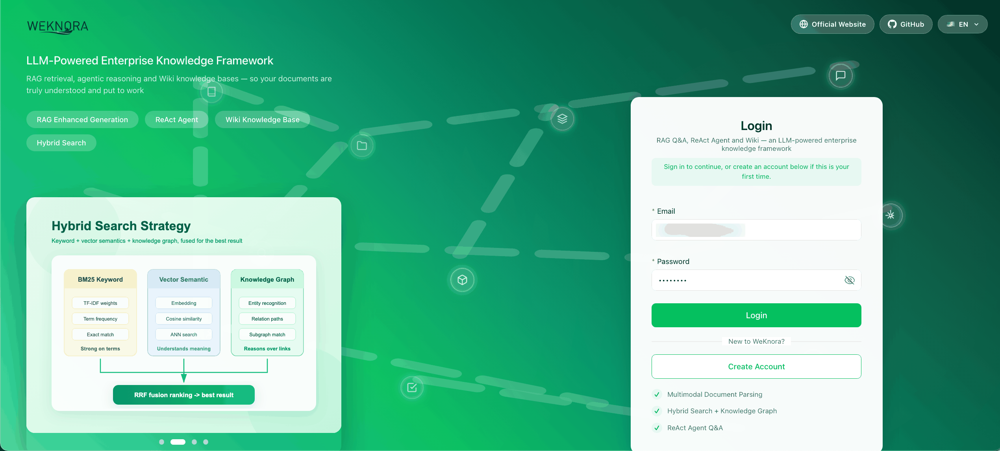

### 2. 註冊帳號並切換語言

第一次使用點 `Create Account` 註冊。介面預設是簡體中文，可以在登入頁右上角的語言選單切換成 English，或登入後點左下角帳號名稱 → `All Settings` → `General Settings` 切換。本教程的截圖都使用英文介面。

如果之後要開放給團隊使用，註冊完自己的帳號後，可以在 `.env` 把 `DISABLE_REGISTRATION` 改成 `true`，再執行 `docker compose up -d` 套用，避免知道網址的人都能註冊。

## 五、設定模型

WeKnora 的模型要先在設定裡加進來，建立知識庫時才選得到。

### 1. 開啟設定

點左下角的帳號名稱，選 `All Settings`。

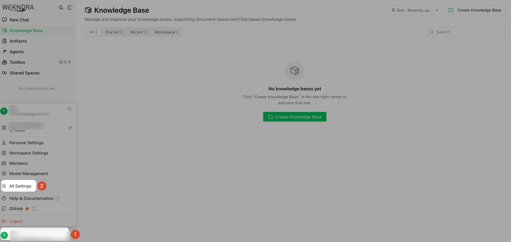

### 2. 確認 WeKnora 連得到 Ollama

左邊選 `Ollama`，確認 `Ollama Service Status` 顯示 **Available**，下方的 `Installed Models` 看得到 `qwen3.5:9b` 和 `bge-m3:latest`。如果顯示 Unavailable，代表 WeKnora 連不到 Ollama，回頭檢查前面的 `OLLAMA_HOST` 設定。

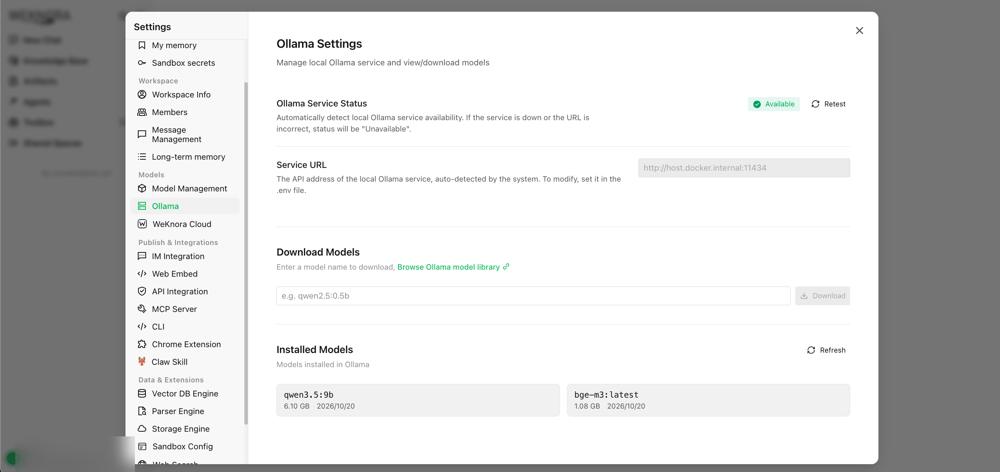

### 3. 新增對話模型

左邊選 `Model Management`，按 `Add Model`。

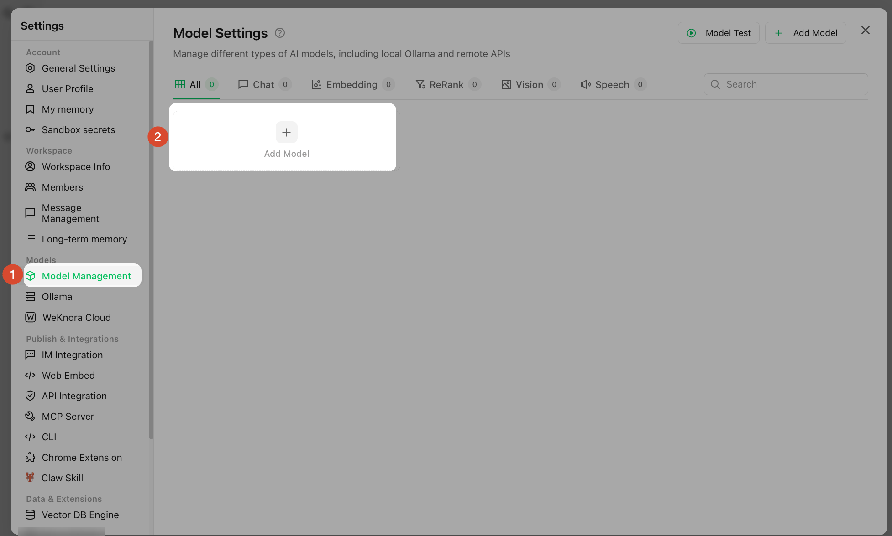

- `Model Type`：Chat
- `Source`：Ollama
- `Model Name`：`qwen3.5:9b`
- `Context Window`：`32768`，跟前面 Ollama 設定的 context 長度一致

設定好按 `Save and close`。選 Ollama 時不需要測試連線，下拉選單列出的都是已經下載好的模型。

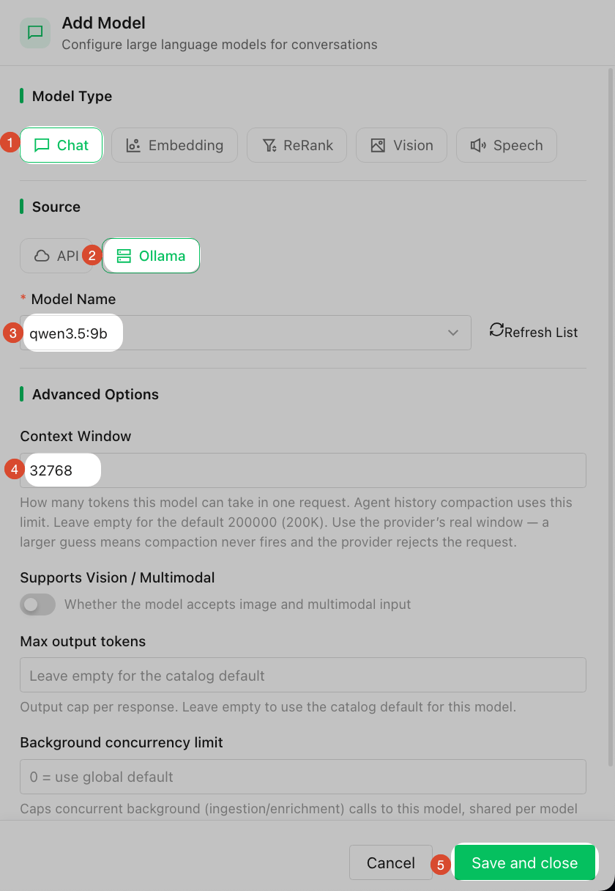

**為什麼要填 Context Window？** 留空的話，WeKnora 會以為模型一次能讀 200000 tokens，但 Ollama 只設了 32768，超過的部分會被直接截掉。填上一致的數字，WeKnora 才會在對話太長時自動壓縮舊內容。

### 4. 新增 Embedding 模型

再按一次 `Add Model`：

- `Model Type`：Embedding
- `Source`：Ollama
- `Model Name`：`bge-m3:latest`
- 按 `Detect Dimension`，出現 `Vector dimension: 1024` 就對了

設定好按 `Save and close`。

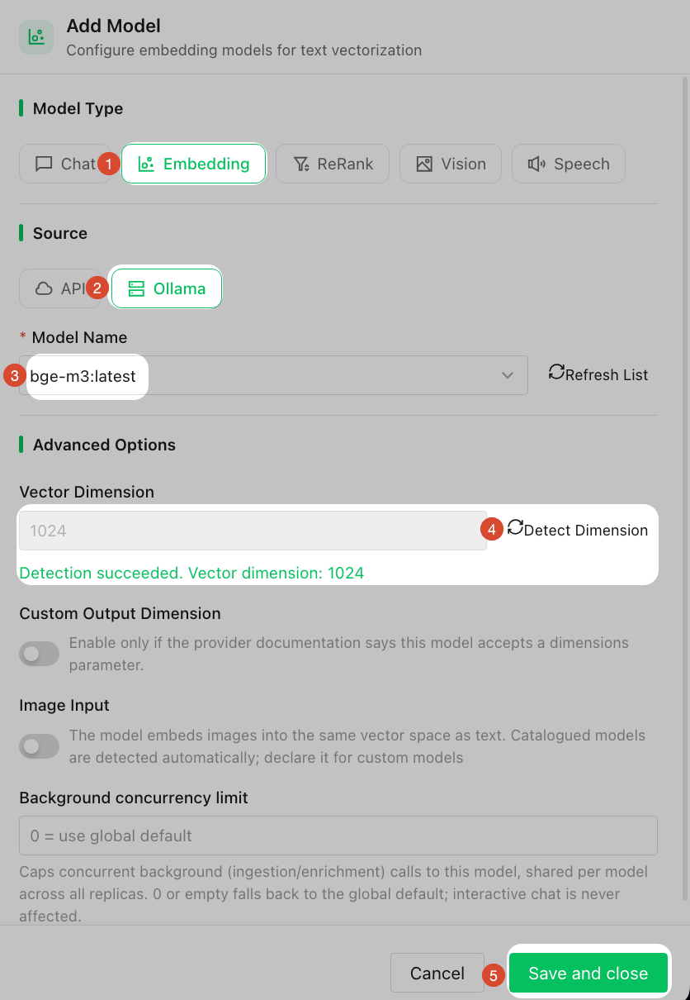

- embedding 模型選定後就不要換，換了整個知識庫要重新建立
- 也可以改接外部 API（例如 OpenAI），`Source` 選 `API` 即可，但文件內容會送到外部服務

### 設定模型常見問題

**換了 embedding 模型後搜不到東西：**

新舊 embedding 模型產生的向量對不上，原本建立的索引無法沿用。

**解決方式**：重新建立知識庫。

## 六、建立知識庫並上傳文件

點左側 `Knowledge Base` → 右上角 `Create Knowledge Base`，設定以下幾個地方。

### 1. Basic Information

- `Knowledge Base Type`：選 `Document-based`。`FAQ Q&A` 是給整理好的「問題＋標準答案」用的，要用 CSV 或 Excel 匯入
- `Indexing Strategy`：先只勾 `RAG Search`，`Wiki Knowledge Base` 後面一節再開
- `Knowledge Base Name`：例如 `Glows.ai SDK API`

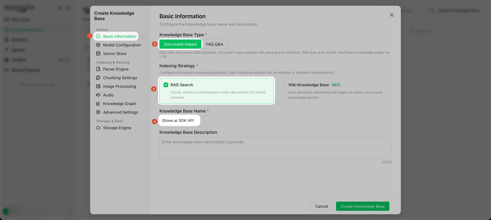

### 2. Model Configuration

`LLM Model` 選 `qwen3.5:9b`，`Embedding Model` 選 `bge-m3:latest`。

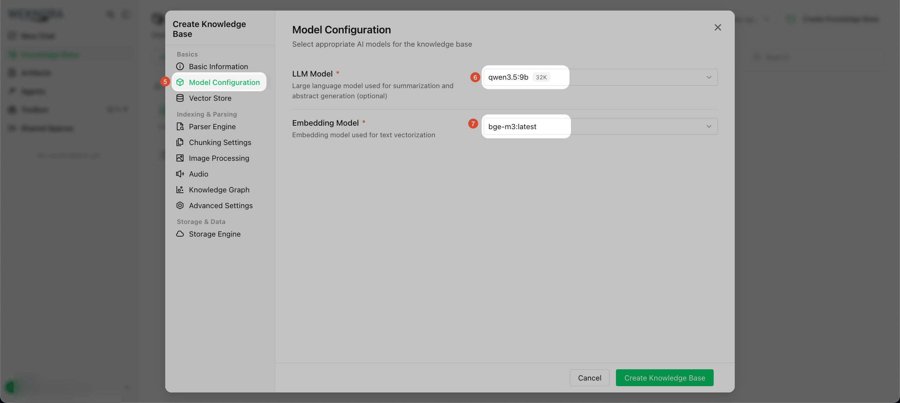

### 3. Chunking Settings

維持預設，按 `Create Knowledge Base`。

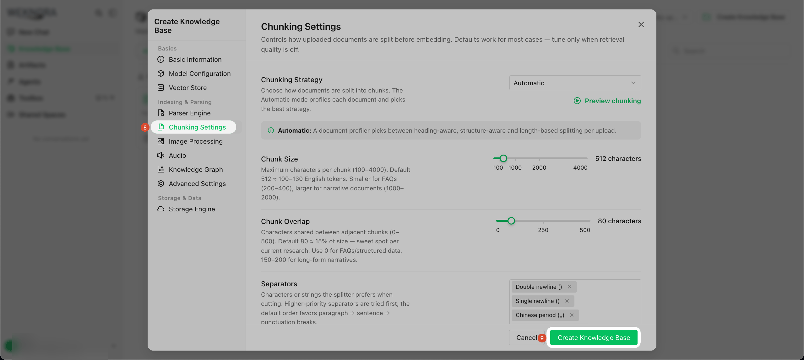

新建的知識庫預設會開啟 `Parent-Child Chunking`：用 384 字的小塊搜尋，再把它所屬的 4096 字大塊交給模型回答。開啟時，上面的 `Chunk Size` 不會用到。

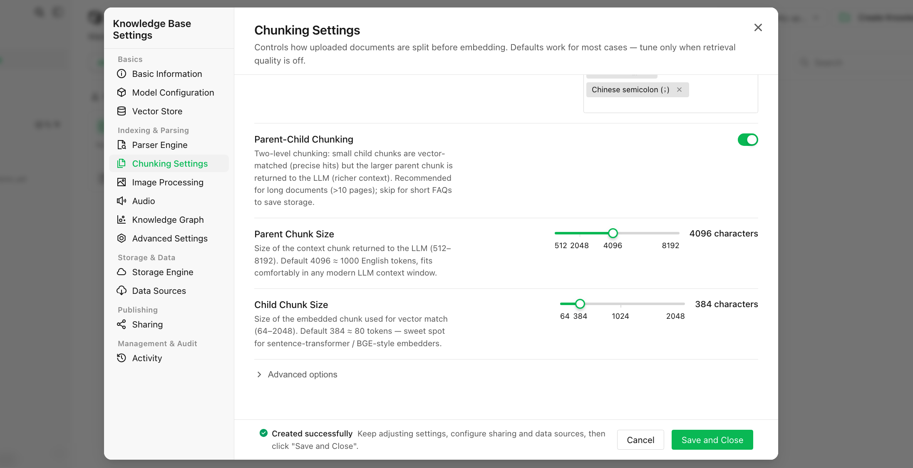

| | Parent-Child Chunking（預設） | 單層 1024 |
|---|---|---|
| 適合的文件 | 沒辦法逐份整理的文件，例如各部門自己寫的文件 | 已經整理過、每一段都能獨立看懂的文件 |
| 搜尋 | 小塊主題集中，搜得比較準 | 一塊比較大 |
| 交給模型的內容 | 最多 4096 字，上下文完整，但比較耗 token | 剛好一段 |

本次測試用的 API 文件已經按段落整理過，也可以關掉 `Parent-Child Chunking`、把 `Chunk Size` 改成 1024。

**小技巧：** 點 `Preview chunking`，貼上一份文件就能預覽切分結果。Markdown 文件有 3 個以上的標題時，會選用「按標題切分」，每一塊都會帶著它所屬的標題；如果有任何一塊超過 Chunk Size 的 2 倍，就會退回「按長度切分」，標題資訊也會不見。

### 4. 上傳文件

進入知識庫，點右上角 `Add Document`，選擇要上傳的文件。跳出 `Confirm Upload` 視窗後：

- `AI Question Generation`：關掉。它預設是開的，會幫每一塊都生成 3 個問題，本地模型處理會慢很多
- 其他設定維持預設

按 `Upload and parse`。

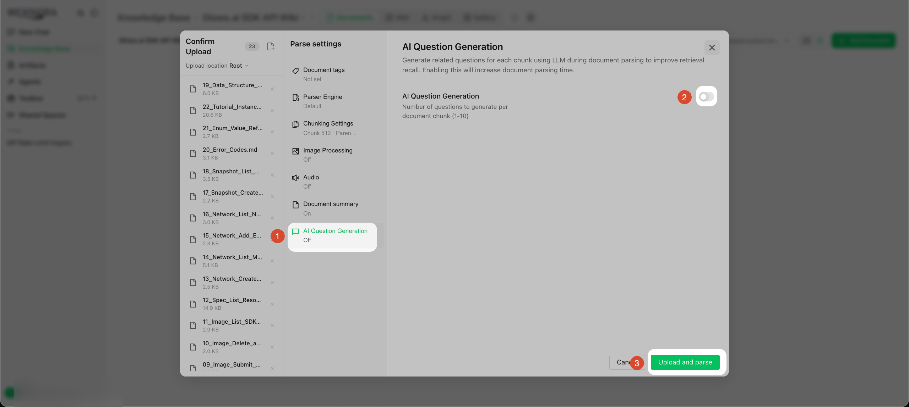

等每份文件的狀態都變成 **Completed**，就可以開始問答了。實測 23 份 API 文件約 4 分鐘處理完成。

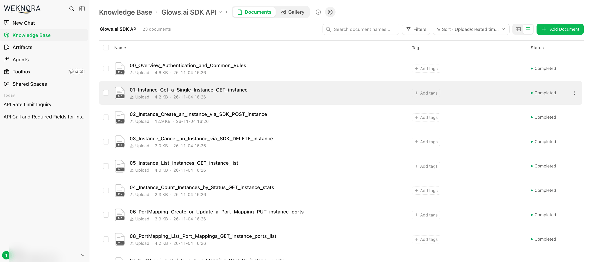

### 建立知識庫常見問題

**改了 Chunk Size，預覽結果卻沒變：**

`Parent-Child Chunking` 開著時，不會用到 `Chunk Size`。

**解決方式**：關掉 `Parent-Child Chunking`，或改調整父子塊的大小。

## 七、測試問答

### 1. 認識內建的 Agent

WeKnora 內建 4 個 Agent：

| Agent | 用途 |
|---|---|
| Quick Answer | 從知識庫搜出相關段落再回答（RAG），附引用來源 |
| Smart Reasoning | 自己規劃步驟、呼叫工具，適合需要好幾個步驟的問題。需要 ReRank 模型，Ollama 不支援，本篇不介紹 |
| Wiki Questioner | 從 Wiki 頁面找答案，要先開啟 Wiki 模式 |
| Data Analyst | 分析 CSV、Excel 檔案 |

### 2. 幫 Agent 選模型

每個 Agent 要另外指定對話模型，沒選的話，提問時會出現 `Agent "Quick Answer" is not ready`。點左側 `Agents` → `Quick Answer`。

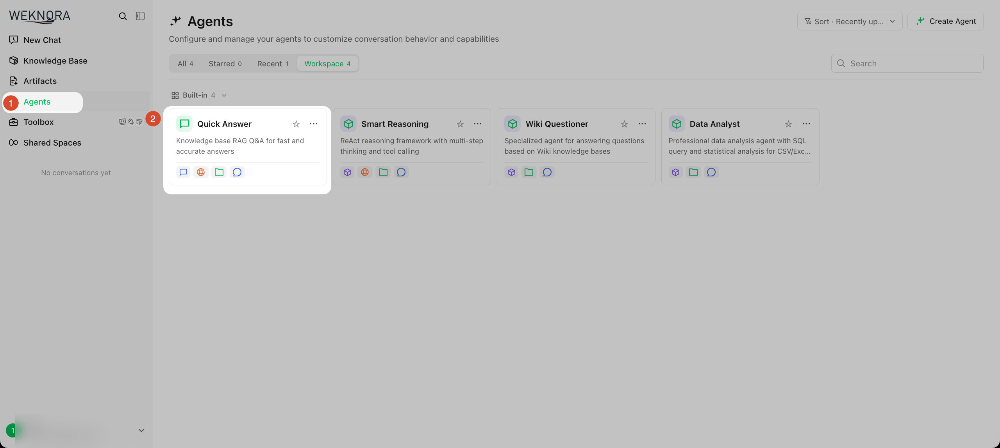

左邊選 `Model Config`，`Model` 選 `qwen3.5:9b`，按 `Save and Close`。`Thinking Mode` 維持 `Off`；`ReRank Model` 雖然有紅色星號，Quick Answer 留空也能正常使用。

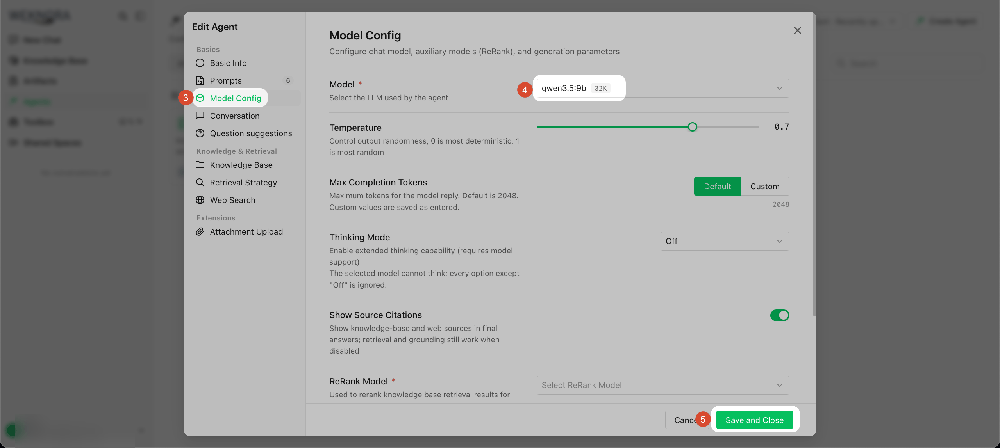

### 3. 提問

點左側 `New Chat`，Agent 選 `Quick Answer`，在輸入框打 `@` 選擇剛才建立的知識庫，再輸入問題。

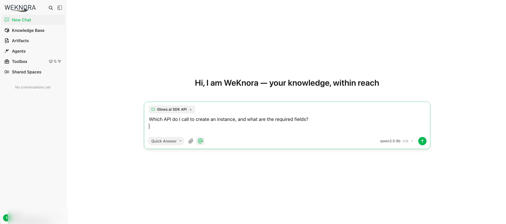

回答上方會顯示搜尋過程，右側 `Document sources` 列出引用了哪些文件，點開可以看到引用的原文。實測本地模型約 1 分鐘內就能回答完成。

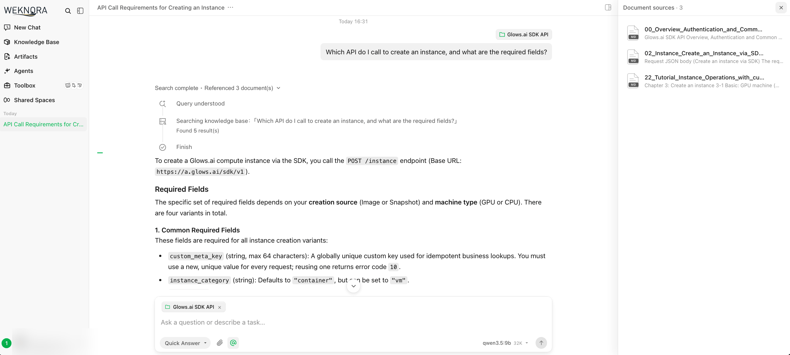

### 4. 用不同題型檢查知識庫

建議用以下幾種題型檢查知識庫的表現，每問一題就開一個新對話，避免前一題影響答案：

| 題型 | 範例 | 看什麼 |
|---|---|---|
| 單一文件的事實 | `Which API do I call to create an instance, and what are the required fields?` | 答案和引用的檔案對不對 |
| 共通規則 | `How do I authenticate API requests?` | 有沒有引用總覽文件 |
| 分辨相似內容 | `Which API should I use to find out how many instances are currently running?` | 分不分得出 stats 和 list 兩支 API |
| 跨文件 | `Which APIs do I need to call, in order, to create an instance and then cancel it?` | 有沒有整合多份文件 |
| 文件沒寫的 | `Does the API have a rate limit?` | 應該說明文件沒寫，編出數字就是幻覺 |

第一題的回答會把四種建立方式整理成表格，必填欄位都正確：

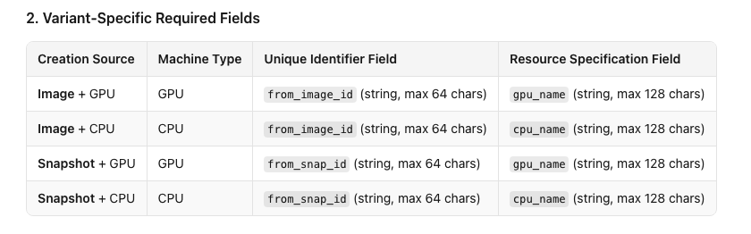

問 `Does the API have a rate limit?` 時，模型引用了錯誤碼文件，說明超過限制會回 HTTP 429，也明確指出文件沒有寫具體的次數上限，沒有自己編數字：

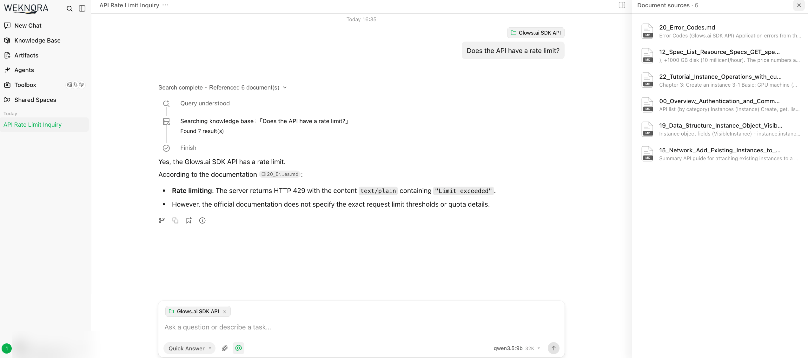

### 5. 實測心得

- **答案不理想時，先看引用**。沒搜到正確的段落，要從文件內容下手；搜到了卻沒用上，可以在 Agent 的 `Prompts` 裡加規則
- **文件寫法影響很大**。示意用的範例排在前面時，模型可能會優先引用它。建議把可直接使用的範例放在前面，示意值標明「需替換」，模型比較不會選錯
- **小模型偶爾會漏掉細節或說過頭**，重要資訊請點開引用核對原文

### 測試問答常見問題

**提問時出現 `Agent "Quick Answer" is not ready`：**

Agent 還沒選對話模型。選 Agent 時，如果旁邊出現驚嘆號、顯示 **Setup needed: Chat model**，也是同樣的原因：

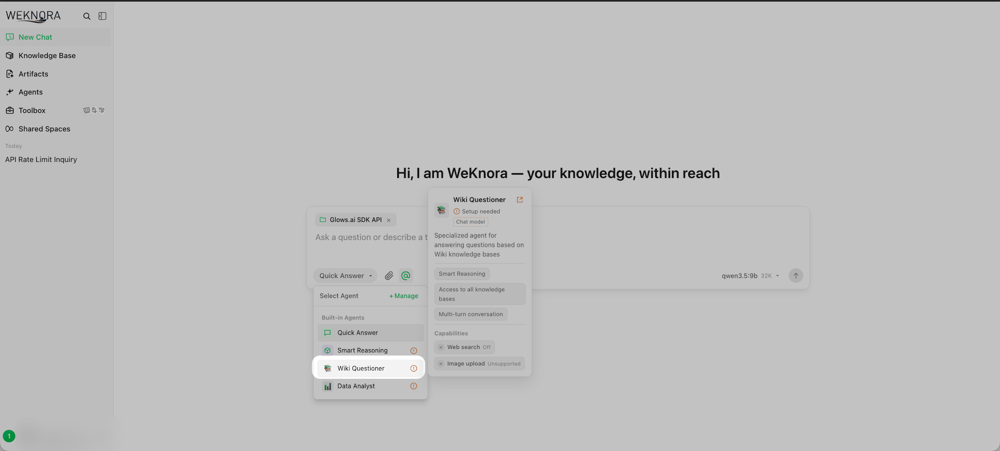

**解決方式**：到 `Agents` → 該 Agent → `Model Config` 選擇模型。

## 八、開啟 Wiki 模式

RAG 是每次提問都回頭翻原文；Wiki 則是先讓 AI 讀完文件，把內容整理成一頁頁互相連結的頁面，之後查整理過的內容。散在好幾份文件裡的同一個主題，會被整合成一頁，人也可以直接瀏覽。

知識庫有文件之後，`Indexing Strategy` 就不能再更改，所以要另外建一個同時開啟 RAG 和 Wiki 的知識庫。

### 1. Basic Information

- `Knowledge Base Type`：`Document-based`
- `Indexing Strategy`：`RAG Search` 和 `Wiki Knowledge Base` 都勾
- `Extraction Granularity`：選 `Standard`，差別見下表
- `Wiki Extraction Focus`（選填）：告訴 AI 要特別整理哪些東西。以 API 文件為例：`Prioritize API names and paths, request parameters, error codes, and status values`
- `Wiki Content Instructions`（選填）：可以指定頁面的語氣或語言，本篇留空
- 往下捲，`Knowledge Base Name` 填 `Glows.ai SDK API Wiki`

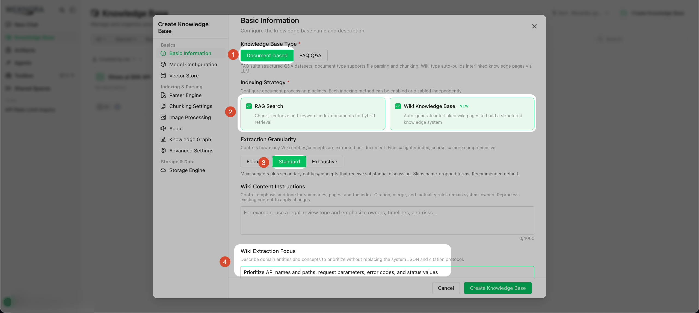

| Extraction Granularity | 會抽出什麼 | 適合 |
|---|---|---|
| Focused | 只抽每份文件的主角 | 先快速看效果 |
| Standard | 主角，加上有被詳細描述的次要概念 | 大部分情況，建議用這個 |
| Exhaustive | 連順帶一提的東西也抽 | 頁面最多，但容易出現內容很少的雜訊頁 |

### 2. Model Configuration

`LLM Model` 和 `Wiki Synthesis Model` 都選 `qwen3.5:9b`，`Embedding Model` 選 `bge-m3:latest`。`Wiki Synthesis Model` 負責把文件寫成 Wiki 頁面，沒選的話會改用 LLM Model。

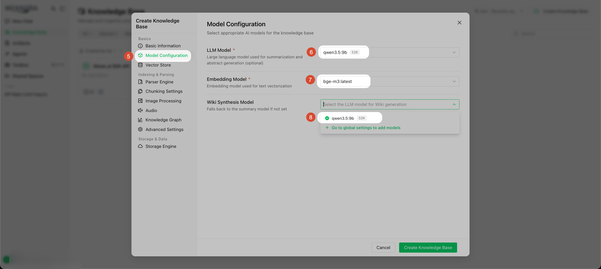

### 3. Chunking Settings

維持預設，按 `Create Knowledge Base`。

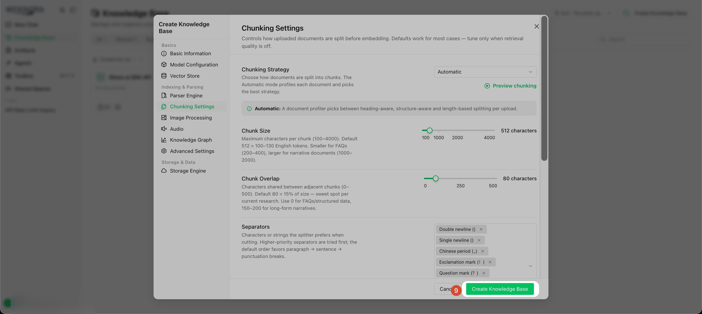

### 4. 上傳文件

上傳文件的方式跟前面相同，記得關掉 `AI Question Generation`。文件顯示 **Completed** 之後，Wiki 頁面會陸續生成。

### 5. 查看 Wiki

知識庫上方會多出 `Wiki` 和 `Graph` 分頁。`Wiki` 分頁的首頁是 `Index`，列出每份文件的摘要，左側依分類列出所有頁面：

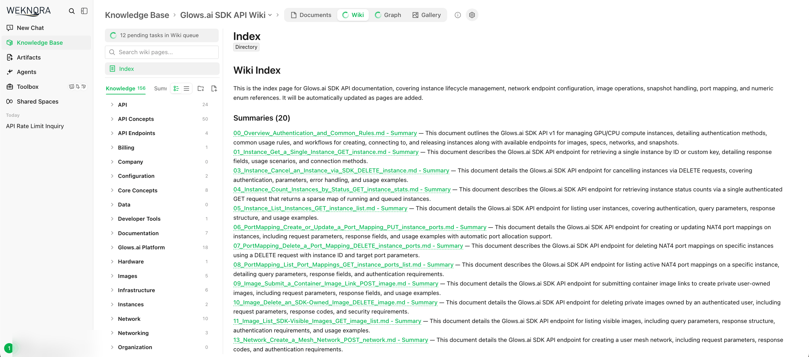

點開任一頁，可以看到整理好的內容。標題下方有頁面類型（例如 Entities）、版本號和別名；頁面最下方的 `Linked from` 和 `Source documents`，列出有哪些頁面連到這頁、根據哪些原始文件寫成：

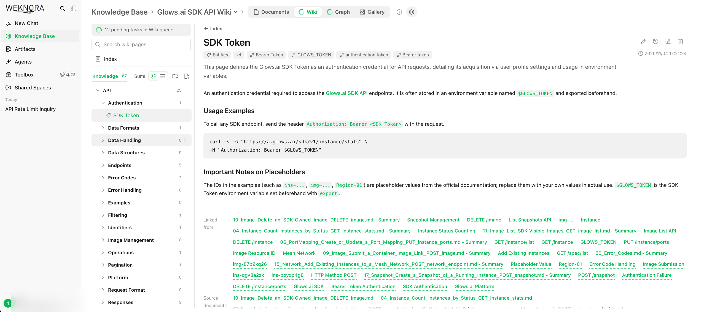

`Graph` 分頁會把頁面之間的關聯畫成網狀圖：

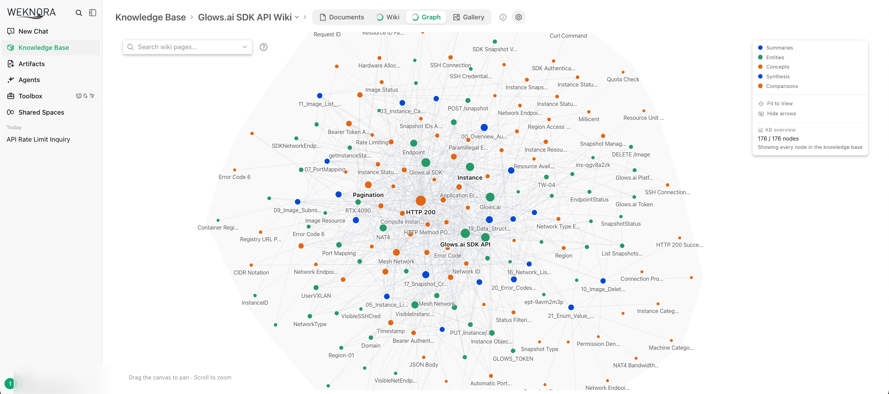

Wiki 頁面可以直接在瀏覽器裡編輯，有新文件加入時也會自動更新。每次修改都會留下版本紀錄，點頁面右上角的時鐘圖示，可以比較前後差異、回到舊版本。

### 6. 用 Wiki 問答

`Wiki Questioner` 一樣要先選模型：`Agents` → `Wiki Questioner` → `Model Config`，`Model` 選 `qwen3.5:9b`，按 `Save and Close`。

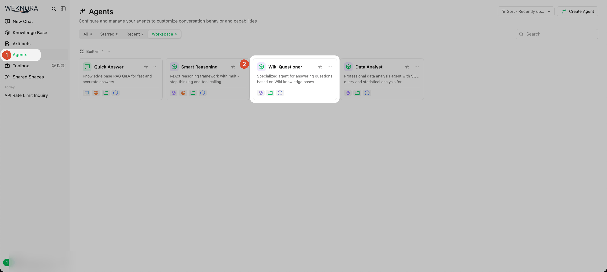

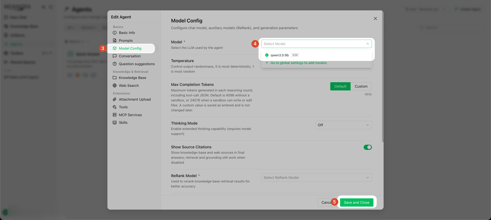

點 `New Chat`，Agent 選 `Wiki Questioner`，用 `@` 選擇 `Glows.ai SDK API Wiki`，再輸入問題。

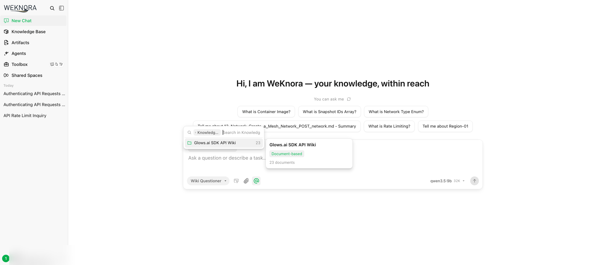

例如問 `How do I authenticate API requests?`，回答上方會顯示它讀了哪些內容，接著整理出取得 SDK Token、設定環境變數、帶入 header 三個步驟：

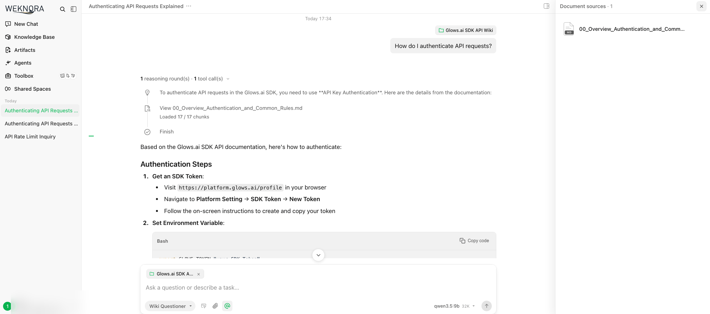

**進階測試：** 改掉某份來源文件裡的一個事實後重新上傳，看 Wiki 頁面會不會自動跟著更新。這是 Wiki 模式比一般 RAG 更適合長期維護知識的地方。

### Wiki 模式常見問題

**Wiki Questioner 回答不完整：**

提問時沒有用 `@` 選擇知識庫，它會在所有知識庫裡找，回答容易不完整。

**解決方式**：用 `@` 選擇要查詢的 Wiki 知識庫。

## 聯絡我們

使用 Glows.ai 時若有問題或建議，可透過 email、Discord 或 Line 聯絡我們。

**Email:** [support@glows.ai](mailto:support@glows.ai)

**Discord:** [https://discord.com/invite/glowsai](https://discord.com/invite/glowsai)

**Line:** [https://lin.ee/fHcoDgG](https://lin.ee/fHcoDgG)
